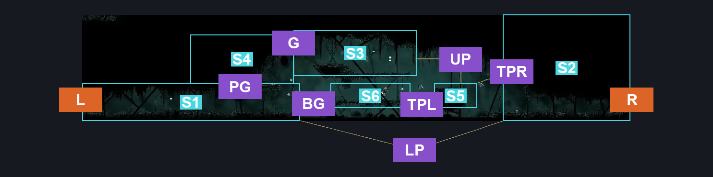
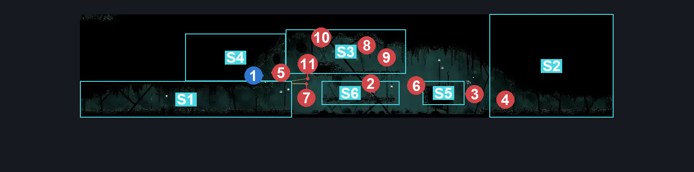
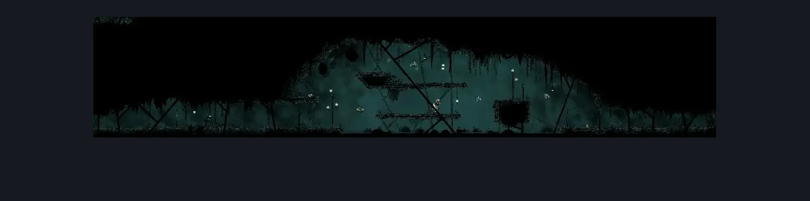

# Greymoor Upper Halfway Home Path (Greymoor_12)

**Game ID:** Greymoor_12

**Contributors:** Isssma

## Subrooms

| No. | Subroom | Annotated |
| --- | --- | --- |
| S1 | left section | ✓ |
| S2 | right section | ✓ |
| S3 | upper platform section | ✓ |
| S4 | check platform | ✓ |
| S5 | short platform | ✓ |
| S6 | long platform | ✓ |

## Room Transitions

| Alias | Name | From subroom | Destination | Destination alias | Requirements | TODO | Verification | Annotated | Notes |
| --- | --- | --- | --- | --- | --- | --- | --- | --- | --- |
| L | left | left section | [Greymoor Halfway Home Exterior (Greymoor_03)](greymoor-halfway-home-exterior.md) | MR | nada |  | Verified | ✓ |  |
| R | right | right section | [Greymoor West Bellshrine Room (Greymoor_01)](greymoor-west-bellshrine-room.md) | TL | none |  | Verified | ✓ |  |

## Subroom Connections

| Alias | Name | Source | Destination | Requirements | TODO | Verification | Annotated | Notes |
| --- | --- | --- | --- | --- | --- | --- | --- | --- |
| TPL | tall platform left | long platform | short platform | faydown cloak OR medium scuttlebrace OR (medium enemy pogo AND prereq fluttermite 1) OR (((easy enemy pogo AND prereq fluttermite 1) OR flea brew) AND (ledge grab right OR cling grip right OR clawline right x 1 OR progressive swift step 1 right OR sharpdart x 1 OR easy hunter pogo OR easy reaper pogo OR easy beast pogo OR easy witch pogo OR easy architect pogo OR easy shaman pogo)) |  | Verified | ✓ | the place changes in act 3, must note requirements somewhere |
| TPL | tall platform left | short platform | long platform | ledge grab left OR progressive swift step 1 left OR clawline left x 1 OR sharpdart x 1 OR faydown cloak OR drifters cloak OR easy hunter pogo OR easy reaper pogo OR easy beast pogo OR easy witch pogo OR easy architect pogo |  | Verified | ✓ |  |
| TPR | tall platform right | right section | short platform | faydown cloak OR medium scuttlebrace OR (medium enemy pogo  AND prereq fluttermite 1)OR (easy enemy pogo AND prereq fluttermite 1 AND (cling grip left OR ledge grab left)) OR (cling grip right AND (progressive swift step 1 left OR clawline left x 1 OR sharpdart x 1)) OR (silk soar AND (clawline left x 1 OR progressive swift step 2 left OR sharpdart x 1)) |  | Verified | ✓ |  |
| TPR | tall platform right | short platform | right section | nothing |  | Verified | ✓ |  |
| UP | upper platform | short platform | upper platform section | silk soar OR (easy enemy pogo AND prereq fluttermite 1) OR progressive swift step 1 left OR faydown cloak OR sharpdart x 1 OR clawline left x 1 OR flea brew OR (drifters cloak AND (cling grip left OR ledge grab left)) |  | Verified | ✓ | the place changes in act 3, must note requirements somewhere |
| UP | upper platform | upper platform section | short platform | none (just fall) |  | Verified | ✓ |  |
| G | gap | check platform | upper platform section | faydown cloak OR silk soar OR ((cling grip right OR ledge grab right) AND (clawline right x 1  OR progressive swift step 1 right OR sharpdart x 1)) |  | Verified | ✓ |  |
| G | gap | upper platform section | check platform | faydown cloak OR drifters cloak OR progressive swift step 1 left OR sharpdart x 1 OR clawline left x 1 OR easy hunter pogo OR easy reaper pogo OR easy beast pogo OR easy witch pogo OR easy architect pogo OR easy shaman pogo |  | Verified | ✓ |  |
| PG | pogo skip | left section | check platform | faydown cloak OR silk soar OR (hard enemy pogo AND ledge grab left AND prereq roachcatcher 1) |  | Verified | ✓ |  |
| PG | pogo skip | check platform | left section | none (fall) |  | Verified | ✓ |  |
| LP | lower pasage | right section | left section | swim |  | Verified | ✓ |  |
| LP | lower pasage | left section | right section | swim |  | Verified | ✓ |  |
| BG | big gap | left section | long platform | progressive swift step 1 right OR clawline right x 1 OR sharpdart x 1 OR faydown cloak OR drifters cloak OR easy beast pogo OR ((flea brew OR swim OR easy architect needle strike) AND ledge grab right) OR (medium enemy pogo AND prereq roachcatcher 1) |  | Verified | ✓ |  |
| BG | big gap | long platform | left section | progressive swift step 1 left OR clawline left x 1 OR sharpdart x 1 OR faydown cloak OR drifters cloak OR easy beast pogo OR easy hunter pogo OR easy architect pogo OR easy witch pogo OR easy reaper pogo OR easy shaman pogo OR flea brew OR swim OR (medium enemy pogo AND prereq roachcatcher 1) |  | Verified | ✓ |  |

## Check Locations

| No. | Check | Subroom | Requirements | TODO | Verification | Location Type | Annotated | Notes |
| --- | --- | --- | --- | --- | --- | --- | --- | --- |
| 1 | Greymoor that shard bundle i hate at the left side of the room | check platform | none |  | Verified | resource | ✓ |  |
| 2 | Pilgrim Guide 1 | long platform | none |  | Verified | enemy | ✓ |  |
| 3 | Fluttermite 1 | short platform | nothing |  | Verified | enemy | ✓ |  |
| 4 | Mite 1 | right section | nothing |  | Verified | enemy | ✓ |  |
| 5 | Mite 2 | check platform | Normal World Spawn |  | Verified | enemy | ✓ |  |
| 6 | Fluttermite 2 | short platform | Normal World Spawn |  | Verified | enemy | ✓ |  |
| 7 | Roachcatcher 1 | left section | Normal World Spawn |  | Verified | enemy | ✓ |  |
| 8 | Roachcatcher 2 | upper platform section | Normal World Spawn |  | Verified | enemy | ✓ |  |
| 9 | Roachcatcher 3 | upper platform section | Black Thread World Spawn |  | Verified | enemy | ✓ |  |
| 10 | Void Mass 1 | upper platform section | Black Thread World Spawn |  | Verified | enemy | ✓ |  |
| 11 | Roachcatcher 4 | left section | Black Thread World Spawn |  | Verified | enemy | ✓ |  |

## Room Images

### Connections

### Checks

### Scene

