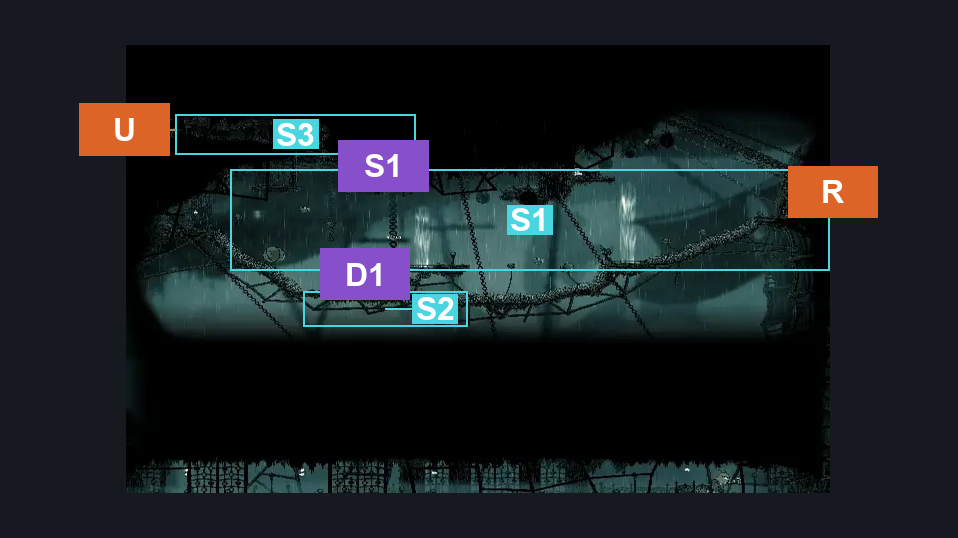
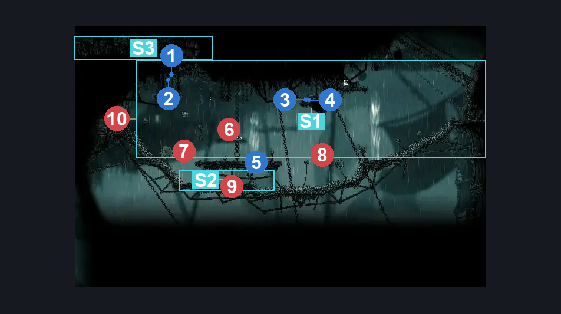
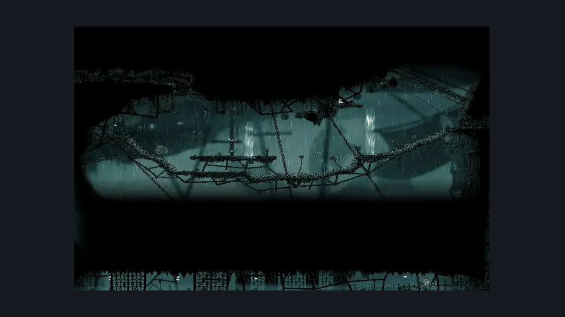

# Greymoor Upper Towers Path (Greymoor_11)

**Game ID:** Greymoor_11

**Contributors:** Isssma

## Subrooms

| No. | Subroom | Annotated |
| --- | --- | --- |
| S1 | main section | ✓ |
| S2 | airstream lever | ✓ |
| S3 | upper corridor | ✓ |

## Room Transitions

| Alias | Name | From subroom | Destination | Destination alias | Requirements | TODO | Verification | Annotated | Notes |
| --- | --- | --- | --- | --- | --- | --- | --- | --- | --- |
| U | up | upper corridor | [Greymoor Western Tower (Greymoor_06)](greymoor-western-tower.md) | UR | nothing |  | Verified | ✓ |  |
| R | right | main section | [Greymoor Eastern Tower (Greymoor_04)](greymoor-eastern-tower.md) | UL | nothing |  | Verified | ✓ |  |

## Subroom Connections

| Alias | Name | Source | Destination | Requirements | TODO | Verification | Annotated | Notes |
| --- | --- | --- | --- | --- | --- | --- | --- | --- |
| S1 | shaft 1 | main section | upper corridor | silk soar OR cling grip left OR medium scuttlebrace OR (faydown cloak AND hard enemy pogo AND prereq Roachcatcher 1) |  | Verified | ✓ |  |
| S1 | shaft 1 | upper corridor | main section | none (just fall) |  | Verified | ✓ |  |
| D1 | drop 1 | main section | airstream lever | none (just fall) |  | Verified | ✓ |  |
| D1 | drop 1 | airstream lever | main section | spike pogo OR silk soar OR ledge grab right OR (easy enemy pogo AND prereq mite 1) OR cling grip right OR faydown cloak OR (proficient movement AND progressive swift step 2 right) |  | Verified | ✓ |  |

## Check Locations

| No. | Check | Subroom | Requirements | TODO | Verification | Location Type | Annotated | Notes |
| --- | --- | --- | --- | --- | --- | --- | --- | --- |
| 1 | Greymoor - another smaller hanging rosary string at the left side of the room | main section | none |  | Verified | collectible | ✓ |  |
| 2 | Greymoor - Rosary Cache hanging at the left side of the room | main section | none |  | Verified | collectible | ✓ |  |
| 3 | Greymoor - Someones rosary pocket change above the airstream | main section | drifters cloak OR (silk soar AND (progressive swift step 2 right OR sharpdart x 1 OR clawline right x {1} OR faydown cloak OR hard enemy pogo)) |  | Verified | collectible | ✓ |  |
| 4 | Geo Small Persistent (1) | main section | drifters cloak OR (silk soar AND (progressive swift step 2 right OR sharpdart x 1 OR clawline right x {1} OR faydown cloak OR hard enemy pogo)) | TODO | Verified | collectible | ✓ | seems to be a second one near "Greymoor - Rosary Cache #17" in the scene dump. need to investigate in game. - hero, 10/13  not sure what the name refers to but looking in vanilla game thee scene starts with 2 rosary on the ground next to the cache, could it be those? Still need to check in an AP run butwhen i worked in this room i grabbed all the checks i saw in the map - isssma, 10/16 |
| 5 | airstream | airstream lever | hit lever right OR hit lever up |  | Verified | switch | ✓ |  |
| 6 | Roachcatcher 1 | main section | nothing |  | Verified | enemy | ✓ |  |
| 7 | Fluttermite 1 | main section | nothing |  | Verified | enemy | ✓ |  |
| 8 | Fluttermite 2 | main section | nothing |  | Verified | enemy | ✓ |  |
| 9 | Mite 1 | airstream lever | nothing |  | Verified | enemy | ✓ |  |
| 10 | Void Mass 1 | main section | Black Thread World Spawn |  | Verified | enemy | ✓ |  |

## Room Images

### Connections

### Checks

### Scene

