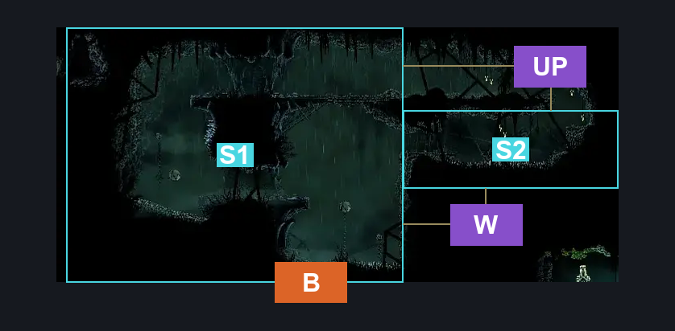
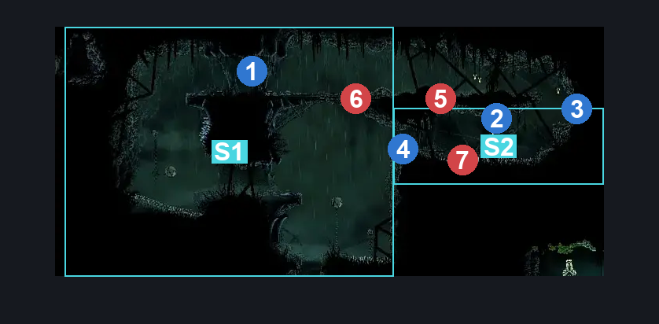
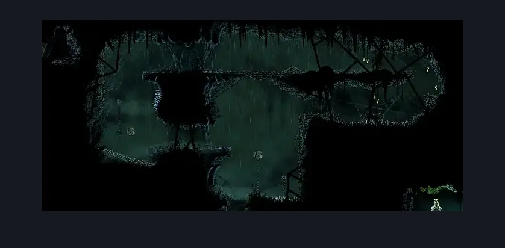

# Greymoor Weaver Shrine (Greymoor_22)

**Game ID:** Greymoor_22

**Contributors:** Isssma

## Subrooms

| No. | Subroom | Annotated |
| --- | --- | --- |
| S1 | left section | ✓ |
| S2 | right section | ✓ |

## Room Transitions

| Alias | Name | From subroom | Destination | Destination alias | Requirements | TODO | Verification | Annotated | Notes |
| --- | --- | --- | --- | --- | --- | --- | --- | --- | --- |
| B | bottom | left section | [Greymoor Craw Lake (Greymoor_15b)](greymoor-craw-lake.md) | T | none |  | Verified | ✓ |  |

## Subroom Connections

| Alias | Name | Source | Destination | Requirements | TODO | Verification | Annotated | Notes |
| --- | --- | --- | --- | --- | --- | --- | --- | --- |
| UP | upper path | left section | right section | easy hunter pogo OR easy reaper pogo OR easy wanderer pogo OR easy beast pogo OR hard witch pogo OR medium architect pogo OR easy shaman pogo OR ledge grab right OR cling grip right OR faydown cloak |  | Verified | ✓ |  |
| UP | upper path | right section | left section | ledge grab left OR silk soar OR cling grip left OR faydown cloak OR (prereq craw 1 AND medium enemy pogo) OR easy beast needle strike |  | Verified | ✓ |  |
| W | wall exit | right section | left section | clear wood blockade |  | Verified | ✓ |  |
| W | wall exit | left section | right section | clear wood blockade AND (cling grip right OR faydown cloak) |  | Verified | ✓ |  |

## Check Locations

| No. | Check | Subroom | Requirements | TODO | Verification | Location Type | Annotated | Notes |
| --- | --- | --- | --- | --- | --- | --- | --- | --- |
| 1 | Thread storm | left section | easy hunter pogo OR easy reaper pogo OR easy wanderer pogo OR easy beast pogo OR hard witch pogo OR medium architect pogo OR easy shaman pogo OR ledge grab OR cling grip OR faydown cloak |  | Verified | collectible | ✓ |  |
| 2 | Greymoor - rosaries hanging left of the weaver shrine | right section | none |  | Verified | resource | ✓ |  |
| 3 | Greymoor - some craw rosaries i guess and he will hit you | right section | none |  | Verified | resource | ✓ |  |
| 4 | wood blockade | right section | break wall left OR break wall up |  | Verified | blockade | ✓ |  |
| 5 | Craw 1 | right section | prereq Thread storm |  | Verified | enemy | ✓ | Spawn conditions: CrowCourtInSession=false |
| 6 | Craw 2 | left section | prereq Thread storm |  | Verified | enemy | ✓ | Spawn conditions: CrowCourtInSession=false |
| 7 | Craw 3 | right section | prereq Thread storm |  | Verified | enemy | ✓ | Spawn conditions: CrowCourtInSession=false |

## Room Images

### Connections

### Checks

### Scene

