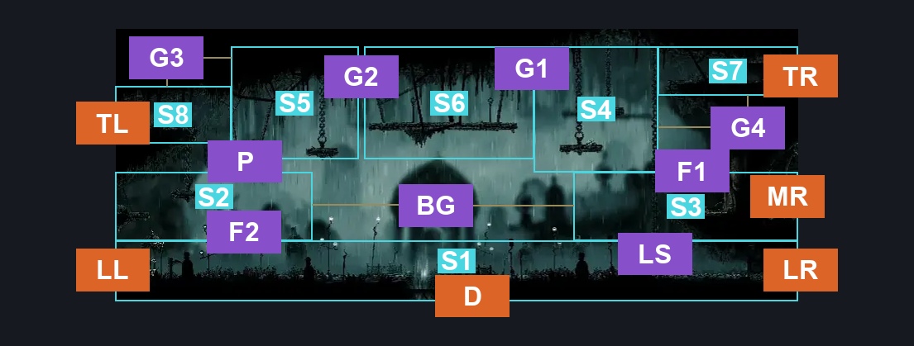
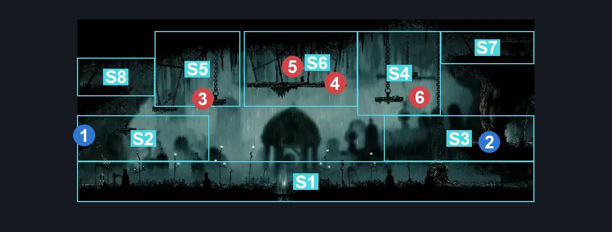
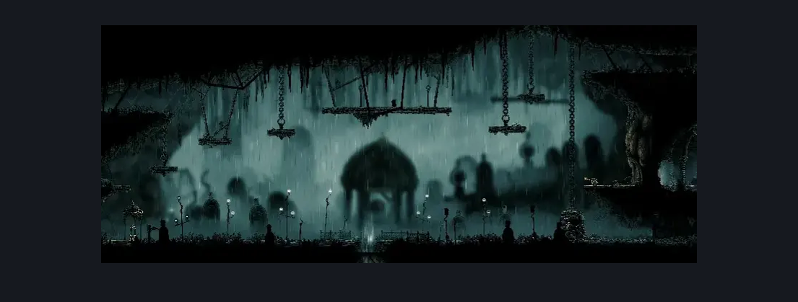

# Greymoor West Bellshrine Room (Greymoor_01)

**Game ID:** Greymoor_01

**Contributors:** Isssma

## Subrooms

| No. | Subroom | Annotated |
| --- | --- | --- |
| S1 | main path | ✓ |
| S2 | middle section left | ✓ |
| S3 | middle section right | ✓ |
| S4 | upper path right | ✓ |
| S5 | upper path left | ✓ |
| S6 | upper path middle | ✓ |
| S7 | right exit platform | ✓ |
| S8 | left exit platform | ✓ |

## Room Transitions

| Alias | Name | From subroom | Destination | Destination alias | Requirements | TODO | Verification | Annotated | Notes |
| --- | --- | --- | --- | --- | --- | --- | --- | --- | --- |
| TL | top left | left exit platform | [Greymoor Upper Halfway Home Path (Greymoor_12)](greymoor-upper-halfway-home-path.md) | R | nothing |  | Verified | ✓ |  |
| TR | top right | right exit platform | [Greymoor East Bellshrine Room (Greymoor_02)](greymoor-east-bellshrine-room.md) | BL | nothing |  | Verified | ✓ |  |
| LR | lower right | main path | [Greymoor East Bellshrine Room (Greymoor_02)](greymoor-east-bellshrine-room.md) | LSL | nothing |  | Verified | ✓ |  |
| LL | lower left | main path | [Greymoor Lower Halfway Home Path (Greymoor_13)](greymoor-lower-halfway-home-path.md) | R | none |  | Verified | ✓ |  |
| MR | middle right | middle section right | [Greymoor Bellshrine (Bellshrine_02)](greymoor-bellshrine.md) | L | ( bellshrinesanity off AND activate bellshrine switch IN greymoor bellshrine )  OR ( bellshrinesanity on AND have bell greymoor ) |  | Verified | ✓ | need to make sure this stays in sync with the connection on the other side |
| D | down | main path | [Far Fields Upper Shaft (Bone_East_11)](../far-fields/far-fields-upper-shaft.md) | C | clear greymoor floor blockade IN far fields upper shaft |  | Verified | ✓ | MUST enter from far fields to activate this connection |

## Subroom Connections

| Alias | Name | Source | Destination | Requirements | TODO | Verification | Annotated | Notes |
| --- | --- | --- | --- | --- | --- | --- | --- | --- |
| LS | lever switch | main path | middle section right | cling grip right OR silk soar OR medium scuttlebrace OR (prereq shrine entrance lever AND (ledge grab right OR easy shaman pogo)) |  | Verified | ✓ |  |
| LS | lever switch | middle section right | main path | none (Switch is on this sidel) |  | Verified | ✓ |  |
| P | Platform | middle section left | upper path left | ledge grab right OR faydown cloak OR silk soar OR medium shaman pogo OR cling grip right |  | Verified | ✓ |  |
| P | Platform | upper path left | middle section left | none (just fall) |  | Verified | ✓ |  |
| F1 | Fall 1 | middle section right | upper path right | Silk soar |  | Verified | ✓ |  |
| F1 | Fall 1 | upper path right | middle section right | none (just fall) |  | Verified | ✓ |  |
| BG | Big Gap | middle section right | middle section left | progressive swift step 1 left AND clawline left x 5 AND drifters cloak AND faydown cloak |  | Verified | ✓ |  |
| BG | Big Gap | middle section left | middle section right | progressive swift step 1 right AND clawline right x 5 AND drifters cloak AND faydown cloak |  | Verified | ✓ |  |
| G1 | Gap 1 | upper path right | upper path middle | faydown cloak OR drifters cloak OR flea brew OR progressive swift step 1 left OR clawline left x 1 OR sharpdart x 1 OR medium scuttlebrace OR silk soar OR easy beast pogo OR easy architect needle strike OR easy wanderer needle strike |  | Verified | ✓ |  |
| G1 | Gap 1 | upper path middle | upper path right | nothing |  | Verified | ✓ |  |
| F2 | Fall 2 | middle section left | main path | none (just fall) |  | Verified | ✓ |  |
| F2 | Fall 2 | main path | middle section left | silk soar |  | Verified | ✓ |  |
| G2 | gap 2 | upper path left | upper path middle | silk soar OR progressive swift step 1 right OR sharpdart x 2 OR clawline right x 2 OR faydown cloak OR ledge grab right OR easy beast pogo OR easy architect needle strike OR (hard enemy pogo AND prereq craw 1) |  | Verified | ✓ |  |
| G2 | gap 2 | upper path middle | upper path left | nothing |  | Verified | ✓ |  |
| G3 | gap 3 | upper path left | left exit platform | Ledge grab left OR cling grip left OR (medium enemy pogo AND prereq craw 1) OR faydown cloak OR medium scuttlebrace OR (progressive swift step 1 left AND (clawline left x 1 OR sharpdart x 1)) OR silk soar |  | Verified | ✓ |  |
| G3 | gap 3 | left exit platform | upper path left | nothing |  | Verified | ✓ |  |
| G4 | gap 4 | right exit platform | upper path right | progressive swift step 1 OR flea brew OR ledge grab left OR clawline left x 1 OR sharpdart x 1 OR drifters cloak OR faydown cloak OR silk soar OR easy [hunter, reaper, beast, architect, witch, shaman] crest pogo OR easy wanderer needle strike |  | Verified | ✓ |  |
| G4 | gap 4 | upper path right | right exit platform | cling grip right OR progressive swift step 1 right OR faydown cloak OR silk soar OR clawline right x 3 OR sharpdart x 3 OR ((drifters cloak OR clawline right x 1 OR sharpdart x 1) AND ledge grab right) |  | Verified | ✓ |  |

## Check Locations

| No. | Check | Subroom | Requirements | TODO | Verification | Location Type | Annotated | Notes |
| --- | --- | --- | --- | --- | --- | --- | --- | --- |
| 1 | Greymoor - Rosary Cache above rosary machine | middle section left | none |  | Verified | resource | ✓ |  |
| 2 | shrine entrance lever | middle section right | flip switch right OR flip switch up OR flip switch left |  | Verified | switch | ✓ |  |
| 3 | Craw 1 | upper path left | nothing |  | Verified | enemy | ✓ | FSM Boolean flags: CrowCourtInSession |
| 4 | Craw 2 | upper path middle | nothing |  | Verified | enemy | ✓ | FSM Boolean flags: CrowCourtInSession |
| 5 | Craw 3 | upper path middle | nothing |  | Verified | enemy | ✓ | FSM Boolean flags: CrowCourtInSession |
| 6 | Mite 1 | upper path right | nothing |  | Verified | enemy | ✓ | good luck, he jumps down to the bottom if not killed |

## Room Images

### Connections

### Checks

### Scene

