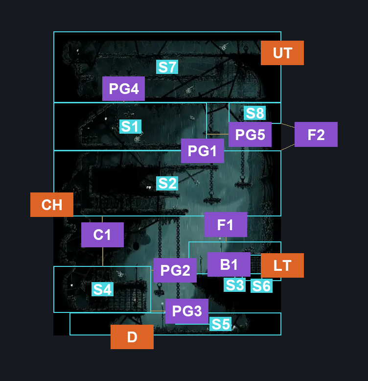
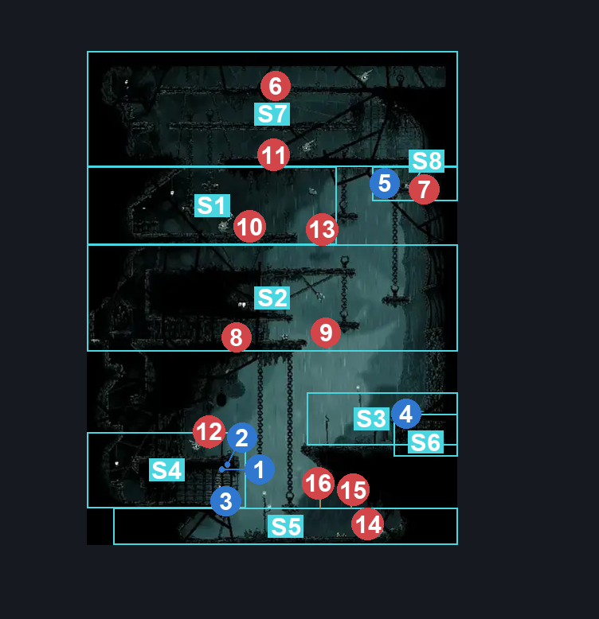
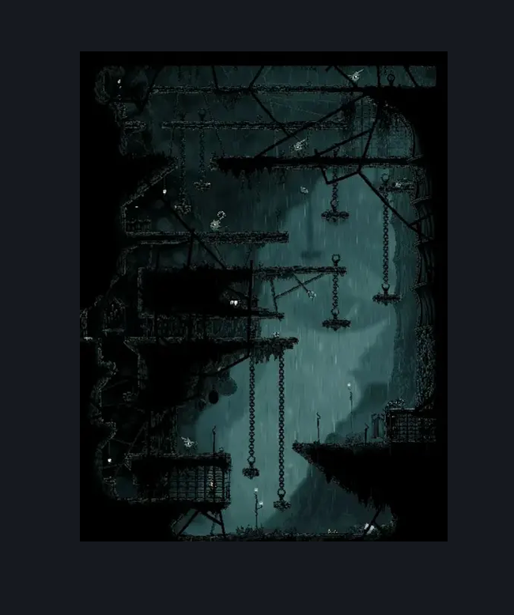

# Greymoor Western Room (Greymoor_07)

**Game ID:** Greymoor_07

**Contributors:** Isssma

## Subrooms

| No. | Subroom | Annotated |
| --- | --- | --- |
| S1 | upper section | ✓ |
| S2 | middle section | ✓ |
| S3 | tower entrance | ✓ |
| S4 | rosaries room | ✓ |
| S5 | lower section | ✓ |
| S6 | door cage | ✓ |
| S7 | wood corridor | ✓ |
| S8 | tiny platform | ✓ |

## Room Transitions

| Alias | Name | From subroom | Destination | Destination alias | Requirements | TODO | Verification | Annotated | Notes |
| --- | --- | --- | --- | --- | --- | --- | --- | --- | --- |
| LT | lower tower | door cage | [Greymoor Western Tower (Greymoor_06)](greymoor-western-tower.md) | LL | nothing |  | Verified | ✓ |  |
| UT | upper tower | wood corridor | [Greymoor Western Tower (Greymoor_06)](greymoor-western-tower.md) | ML | nothing |  | Verified | ✓ |  |
| D | down | lower section | [Greymoor Entry to Bellhart (Greymoor_08)](greymoor-entry-to-bellhart.md) | T | nothing |  | Verified | ✓ |  |
| CH | chapel | middle section | [Greymoor Chapel of The Reaper Entrance (Greymoor_20b)](greymoor-chapel-of-the-reaper-entrance.md) | R | nothing |  | Verified | ✓ |  |

## Subroom Connections

| Alias | Name | Source | Destination | Requirements | TODO | Verification | Annotated | Notes |
| --- | --- | --- | --- | --- | --- | --- | --- | --- |
| PG1 | platform gap 1 | upper section | middle section | nothing (just fall) |  | Verified | ✓ |  |
| PG1 | platform gap 1 | middle section | upper section | ((act 1 OR act 2) AND (ledge grab left OR cling grip left OR silk soar OR easy scuttlebrace OR (progressive swift step 2 left AND proficient movement) OR faydown cloak)) OR (act 3 AND ((faydown cloak AND clawline right x 1) OR (((clawline right x 1 AND (ledge grab right OR flea brew)) OR (progressive swift step 1 right AND ((sharpdart x 1 AND drifters cloak) OR clawline right x 1)) OR (progressive swift step 2 right AND sharpdart) OR clawline right x 2) AND (ledge grab left OR cling grip left OR silk soar OR easy scuttlebrace OR (progressive swift step 2 left AND proficient movement))))) |  | Verified | ✓ |  |
| F1 | fall 1 | middle section | tower entrance | nothing |  | Verified | ✓ |  |
| F1 | fall 1 | tower entrance | middle section | silk soar OR (cling grip right AND (faydown cloak OR clawline left x 1 OR sharpdart x 1 OR (drifters cloak AND (ledge grab left OR progressive swift step 2 left OR easy beast pogo OR easy shaman pogo)) OR (easy architect needle strike AND progressive swift step 2 left))) |  | Verified | ✓ |  |
| B1 | blockade 1 | tower entrance | door cage | unlock tower entrance door |  | Verified | ✓ |  |
| B1 | blockade 1 | door cage | tower entrance | unlock tower entrance door |  | Verified | ✓ |  |
| PG2 | platform gap 2 | tower entrance | rosaries room | nothing |  | Verified | ✓ |  |
| PG2 | platform gap 2 | rosaries room | tower entrance | progressive swift step 1 right OR clawline right x 1 OR sharpdart x 1 OR faydown cloak OR silk soar OR ledge grab right OR easy architect needle strike OR easy beast pogo  OR drifters cloak OR (proficient movement AND cling grip right) |  | Verified | ✓ |  |
| PG3 | platform gap 3 | rosaries room | lower section | nothing |  | Verified | ✓ |  |
| PG3 | platform gap 3 | lower section | rosaries room | ((ACT 1 OR ACT 2) AND (ledge grab left OR ledge grab right OR faydown cloak OR cling grip left OR cling grip right OR ((progressive swift step 2 right OR progressive swift step 2 left) AND proficient movement) OR silk soar OR (medium shaman pogo AND medium scuttlebrace))) OR (ACT 3 AND (silk soar OR cling grip left OR (hard enemy pogo AND (prereq Silk Snipper 1 OR prereq Roachcatcher 1) AND easy scuttlebrace))) |  | Verified | ✓ |  |
| C1 | climb 1 | rosaries room | middle section | faydown cloak OR silk soar OR easy scuttlebrace OR ((progressive swift step 2 right AND progressive swift step 2 left) AND proficient movement) OR (ledge grab right AND ledge grab left) OR ((ledge grab left OR cling grip left OR (proficient movement AND progressive swift step 2 left)) AND (ledge grab right OR cling grip right OR (proficient movement AND progressive swift step 2 right))) |  | Verified | ✓ |  |
| C1 | climb 1 | middle section | rosaries room | nothing |  | Verified | ✓ |  |
| PG4 | platform gap 4 | wood corridor | upper section | nothing |  | Verified | ✓ |  |
| PG4 | platform gap 4 | upper section | wood corridor | ledge grab left OR ledge grab right OR faydown cloak OR silk soar OR (medium enemy pogo AND prereq Silk Snipper 1) OR cling grip right OR cling grip left |  | Verified | ✓ |  |
| PG5 | platform gap 5 | tiny platform | upper section | faydown cloak OR clawline left x 1 OR progressive swift step 1 left OR sharpdart x 1 OR ledge grab left OR easy beast pogo OR medium shaman pogo OR easy hunter pogo OR easy architect pogo OR easy reaper pogo |  | Verified | ✓ |  |
| PG5 | platform gap 5 | upper section | tiny platform | faydown cloak OR clawline right x 2 OR sharpdart x 2 OR ((easy enemy pogo AND prereq fluttermite 1 AND (ACT 1 OR ACT 2)) AND (sharpdart x 1 OR clawline x 1)) OR progressive swift step 1 right  OR ledge grab right OR cling grip right OR easy beast pogo OR medium shaman pogo |  | Verified | ✓ |  |
| F2 | fall 2 | tiny platform | middle section | nothing |  | Verified | ✓ |  |
| F2 | fall 2 | middle section | tiny platform | silk soar |  | Verified | ✓ |  |

## Check Locations

| No. | Check | Subroom | Requirements | TODO | Verification | Location Type | Annotated | Notes |
| --- | --- | --- | --- | --- | --- | --- | --- | --- |
| 1 | Greymoor - hanging rosaries below scissor fucker | rosaries room | nothing |  | Verified | resource | ✓ |  |
| 2 | Greymoor - the other hanging rosaries below scissor fucker | rosaries room | nothing |  | Verified | resource | ✓ |  |
| 3 | Greymoor - Rosary Dish (scissor fucker mortage) | rosaries room | nothing |  | Verified | resource | ✓ |  |
| 4 | tower entrance door | tower entrance | break lever right OR break lever left OR break lever up |  | Verified | blockade | ✓ |  |
| 5 | Greymoor - that one rosary i hate in tiny platform to the right | tiny platform | nothing |  | Verified | resource | ✓ |  |
| 6 | Silk Snipper 1 | wood corridor | nothing |  | Verified | enemy | ✓ |  |
| 7 | Mite 1 | tiny platform | nothing |  | Verified | enemy | ✓ |  |
| 8 | Mite 2 | middle section | nothing |  | Verified | enemy | ✓ |  |
| 9 | Fluttermite 1 | middle section | Normal World Spawn |  | Verified | enemy | ✓ |  |
| 10 | Dreg Catcher 1 | upper section | Normal World Spawn |  | Verified | enemy | ✓ |  |
| 11 | Silk Snipper 2 | wood corridor | Normal World Spawn |  | Verified | enemy | ✓ |  |
| 12 | Silk Snipper 3 | rosaries room | Normal World Spawn |  | Verified | enemy | ✓ |  |
| 13 | Fluttermite 2 | upper section | Normal World Spawn |  | Verified | enemy | ✓ |  |
| 14 | Silk Snipper 4 | lower section | Black Thread World Spawn |  | Verified | enemy | ✓ |  |
| 15 | Void Mass 1 | lower section | Black Thread World Spawn |  | Verified | enemy | ✓ |  |
| 16 | Roachcatcher 1 | lower section | Black Thread World Spawn |  | Verified | enemy | ✓ |  |

## Room Images

### Connections

### Checks

### Scene

