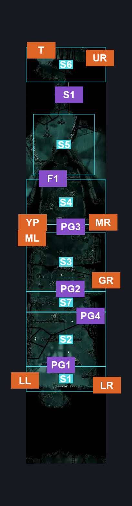
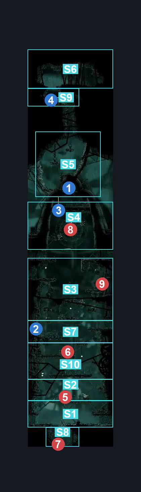
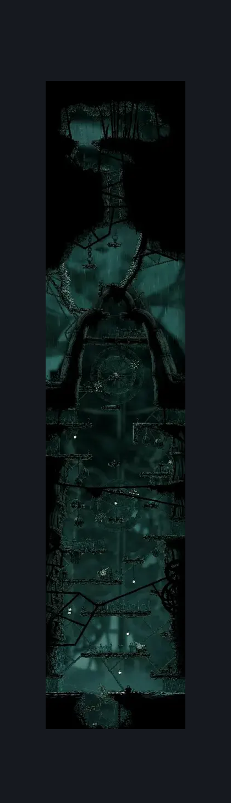

# Greymoor Western Tower (Greymoor_06)

**Game ID:** Greymoor_06

**Contributors:** Isssma

## Subrooms

| No. | Subroom | Annotated |
| --- | --- | --- |
| S1 | lower section | ✓ |
| S2 | first guarded platform | ✓ |
| S3 | lower spike wheel | ✓ |
| S4 | upper spike wheel | ✓ |
| S5 | tower top section | ✓ |
| S6 | whisp thicket entrance | ✓ |
| S7 | middle section | ✓ |
| S8 | small drop | ✓ |
| S9 | tower drop | ✓ |
| S10 | second guarded platform | ✓ |

## Room Transitions

| Alias | Name | From subroom | Destination | Destination alias | Requirements | TODO | Verification | Annotated | Notes |
| --- | --- | --- | --- | --- | --- | --- | --- | --- | --- |
| LR | lower right | lower section | [Greymoor Towers Patio (Greymoor_05)](greymoor-towers-patio.md) | LL | none |  | Verified | ✓ |  |
| LL | lower left | lower section | [Greymoor Western Room (Greymoor_07)](greymoor-western-room.md) | LT | none |  | Verified | ✓ |  |
| ML | middle left | lower spike wheel | [Greymoor Western Room (Greymoor_07)](greymoor-western-room.md) | UT | none |  | Verified | ✓ |  |
| MR | middle right | upper spike wheel | [Greymoor Middle Passage (Greymoor_10)](greymoor-middle-passage.md) | L | none |  | Verified | ✓ |  |
| YP | Yanarby Path | upper spike wheel | [Yarnaby Place (Wisp_03)](yarnaby-place.md) | R | none |  | Verified | ✓ |  |
| GR | garmon room | lower spike wheel | [Greymoor Towers Patio (Greymoor_05)](greymoor-towers-patio.md) | ML | none |  | Verified | ✓ |  |
| UR | upper right | whisp thicket entrance | [Greymoor Upper Towers Path (Greymoor_11)](greymoor-upper-towers-path.md) | U | none |  | Verified | ✓ |  |
| T | Top | whisp thicket entrance | [Wisp Thicket Bench (Wisp_04)](../wisp-thicket/wisp-thicket-bench.md) | B | faydown cloak AND (silk soar OR cling grip left) |  | Verified | ✓ |  |

## Subroom Connections

| Alias | Name | Source | Destination | Requirements | TODO | Verification | Annotated | Notes |
| --- | --- | --- | --- | --- | --- | --- | --- | --- |
| PG1 | plartform gap 1 | lower section | first guarded platform | ledge grab right OR ledge grab left OR silk soar OR cling grip right OR cling grip left OR (proficient movement AND (progressive swift step 2 right OR (progressive swift step 2 left))) OR medium shaman pogo  OR easy beast needle strike OR faydown cloak |  | Verified | ✓ |  |
| PG1 | plartform gap 1 | first guarded platform | lower section | none (just fall) |  | Verified | ✓ |  |
| PG2 | platform gap 2 | middle section | lower spike wheel | ledge grab right OR silk soar OR cling grip right OR progressive swift step 1 right OR easy beast needle strike OR faydown cloak OR spike pogo OR clawline right x 1 |  | Verified | ✓ |  |
| PG2 | platform gap 2 | lower spike wheel | middle section | none (just fall) |  | Verified | ✓ |  |
| PG3 | platform gap 3 | lower spike wheel | upper spike wheel | cling grip right OR silk soar OR faydown cloak OR easy scuttlebrace |  | Verified | ✓ |  |
| PG3 | platform gap 3 | upper spike wheel | lower spike wheel | none (just fall) |  | Verified | ✓ |  |
| F1 | fall 1 | upper spike wheel | tower top section | unlock top trapdoor AND ((ledge grab left OR ledge grab right) AND (faydown cloak OR spike pogo)) |  | Verified | ✓ |  |
| F1 | fall 1 | tower top section | upper spike wheel | unlock top trapdoor |  | Verified | ✓ |  |
| S1 | shaft 1 | tower top section | tower drop | silk soar OR (cling grip left AND (ledge grab right OR cling grip left)) OR (cling grip right AND (cling grip left OR ledge grab left OR easy beast needle strike)) OR (easy scuttlebrace AND (faydown cloak OR ledge grab right OR (ledge grab left AND (easy beast needle strike )))) |  | Verified | ✓ |  |
| S1 | shaft 1 | tower drop | tower top section | none (just fall) |  | Verified | ✓ |  |
| PG4 | platform gap 4 | middle section | second guarded platform | nothing |  | Verified | ✓ |  |
| PG4 | platform gap 4 | second guarded platform | middle section | ((ledge grab right OR medium pogo off silk snipper) AND (ledge grab left OR progressive swift step 1 left OR sharpdart x 1 OR clawline left x 1 OR flea brew)) OR silk soar OR cling grip right  OR easy shaman pogo  OR easy beast needle strike OR faydown cloak |  | Verified | ✓ | medium enemy pogo in this case since enemy must be alive and lured to its original spawn to use as another enemy pogo, although the enemy here has some health and some moves allow a pogo with no damage dealt to the enemy  also for the life of me i could not get a left cling grip |
| PG5 | platform gap 5 | lower section | small drop | nothing |  | Verified | ✓ |  |
| PG5 | platform gap 5 | small drop | lower section | silk soar OR ledge grab left OR faydown cloak OR cling grip left OR medium pogo off mite |  | Verified | ✓ |  |
| D | drop | whisp thicket entrance | tower drop | none |  | Verified | ✓ |  |
| D | drop | tower drop | whisp thicket entrance | cling grip left OR faydown cloak OR silk soar OR easy scuttlebrace |  | Verified | ✓ |  |
| PG6 | platform gap 6 | first guarded platform | second guarded platform | faydown cloak OR easy scuttlebrace OR silk soar OR ((ledge grab right OR easy pogo off Silk Snipper OR cling grip right) AND (ledge grab left OR cling grip left)) |  | Verified | ✓ |  |
| PG6 | platform gap 6 | second guarded platform | first guarded platform | nothing |  | Verified | ✓ |  |

## Check Locations

| No. | Check | Subroom | Requirements | TODO | Verification | Location Type | Annotated | Notes |
| --- | --- | --- | --- | --- | --- | --- | --- | --- |
| 1 | Flea: Greymoor - Tower | tower top section | none |  | Verified | collectible | ✓ |  |
| 2 | Greymoor - Rosary cache below a spike wheel | middle section | nothing |  | Verified | resource | ✓ |  |
| 3 | top trapdoor | tower top section | break lever right OR break lever left OR break lever up |  | Verified | blockade | ✓ |  |
| 4 | Mister Mushroom Meeting Greymoor | tower drop | after THE Mister Mushroom Meeting Far Fields AND Needolin |  | Verified | event | ✓ |  |
| 5 | Silk Snipper 1 | first guarded platform | nothing |  | Verified | enemy | ✓ |  |
| 6 | Silk Snipper 2 | second guarded platform | nothing |  | Verified | enemy | ✓ | he drops down to you if reached from below |
| 7 | Mite 1 | small drop | nada |  | Verified | enemy | ✓ |  |
| 8 | Mite 2 | upper spike wheel | nothing |  | Verified | enemy | ✓ |  |
| 9 | Mite 3 | lower spike wheel | nothing |  | Verified | enemy | ✓ |  |

## Room Images

### Connections

### Checks

### Scene

