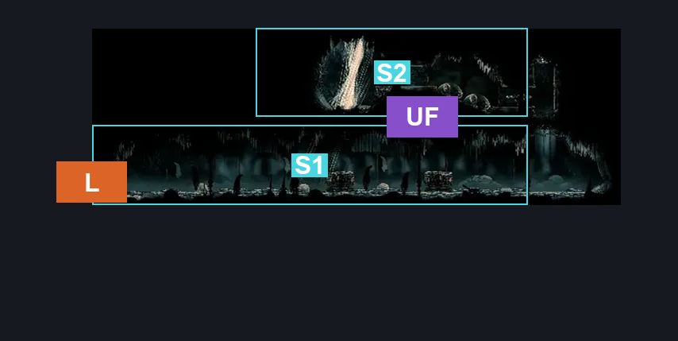
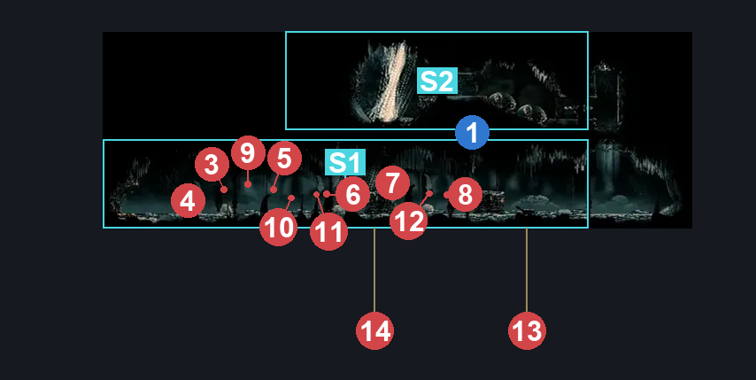
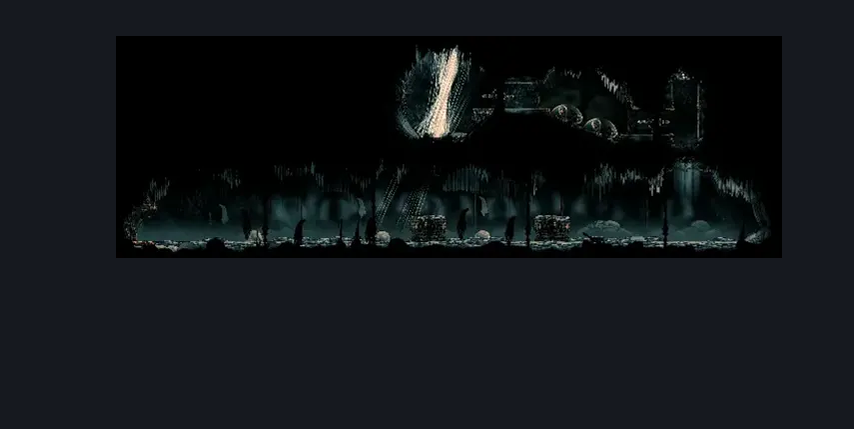

# Baby Room Interior Secret (Hang_14)

**Game ID:** Hang_14

**Contributors:** rebel

## Subrooms

| No. | Subroom | Annotated |
| --- | --- | --- |
| S1 | Ground | ✓ |
| S2 | Upper | ✓ |

## Room Transitions

| Alias | Name | From subroom | Destination | Destination alias | Requirements | TODO | Verification | Annotated | Notes |
| --- | --- | --- | --- | --- | --- | --- | --- | --- | --- |
| L | left1 | Ground | [High Halls Baby Room (Hang_16)](high-halls-baby-room.md) | S | Nada |  | Verified | ✓ |  |

## Subroom Connections

| Alias | Name | Source | Destination | Requirements | TODO | Verification | Annotated | Notes |
| --- | --- | --- | --- | --- | --- | --- | --- | --- |
| UF | Up <> Floor | Ground | Upper | (Activate Breakable Ceiling AND (Silk Soar OR (Faydown Cloak AND Cling Grip))) |  | Verified | ✓ | no reason to go up, nothing there. |
| UF | Up <> Floor | Upper | Ground | Activate Breakable Ceiling |  | Verified | ✓ |  |

## Check Locations

| No. | Check | Subroom | Requirements | TODO | Verification | Location Type | Annotated | Notes |
| --- | --- | --- | --- | --- | --- | --- | --- | --- |
| 1 | Breakable Ceiling | Ground | Break Wall Up |  | Verified | switch | ✓ |  |
| 2 | Clawmaiden Silk | Upper | (Attack Left AND Open Airlock Left AND (Faydown Cloak OR Clawline OR Sharpdart OR Sprint OR Dash)) |  | Verified | logic-point |  |  |
| 3 | Clawmaiden 1 | Ground | Normal World Spawn |  | Verified | enemy | ✓ |  |
| 4 | Clawmaiden 2 | Ground | Normal World Spawn |  | Verified | enemy | ✓ | spawn at random? |
| 5 | Clawmaiden 3 | Ground | Normal World Spawn |  | Verified | enemy | ✓ |  |
| 6 | Clawmaiden 4 | Ground | Normal World Spawn |  | Verified | enemy | ✓ |  |
| 7 | Clawmaiden 5 | Ground | Normal World Spawn |  | Verified | enemy | ✓ |  |
| 8 | Clawmaiden 6 | Ground | Normal World Spawn |  | Verified | enemy | ✓ |  |
| 9 | Clawmaiden 7 | Ground | Normal World Spawn |  | Verified | enemy | ✓ |  |
| 10 | Clawmaiden 8 | Ground | Normal World Spawn |  | Verified | enemy | ✓ |  |
| 11 | Clawmaiden 9 | Ground | Normal World Spawn |  | Verified | enemy | ✓ |  |
| 12 | Clawmaiden 10 | Ground | Normal World Spawn |  | Verified | enemy | ✓ |  |
| 13 | Clawmaiden 11 | Ground | Normal World Spawn |  | Verified | enemy | ✓ |  |
| 14 | Clawmaiden 12 | Ground | Normal World Spawn |  | Verified | enemy | ✓ |  |

## Room Images

### Connections

### Checks

### Scene

