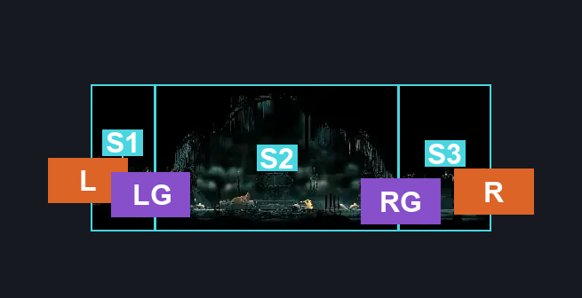
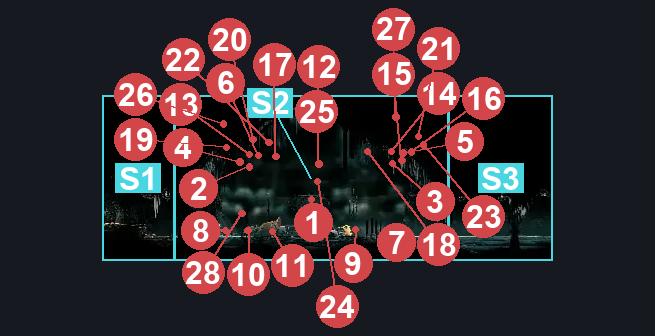
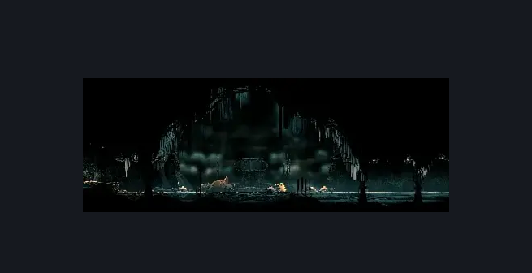

# High Halls Arena (Hang_04)

**Game ID:** Hang_04

**Contributors:** samupo, rebel, Gallos

## Subrooms

| No. | Subroom | Annotated |
| --- | --- | --- |
| S1 | left of gauntlet | ✓ |
| S2 | gauntlet arena | ✓ |
| S3 | right of gauntlet | ✓ |

## Room Transitions

| Alias | Name | From subroom | Destination | Destination alias | Requirements | TODO | Verification | Annotated | Notes |
| --- | --- | --- | --- | --- | --- | --- | --- | --- | --- |
| L | left1 | left of gauntlet | [High Halls Conductor (Hang_12)](high-halls-conductor.md) | R | none |  | Verified | ✓ |  |
| R | right1 | right of gauntlet | [High Halls Vault (Hang_06)](high-halls-vault.md) | L | none |  | Verified | ✓ |  |

## Subroom Connections

| Alias | Name | Source | Destination | Requirements | TODO | Verification | Annotated | Notes |
| --- | --- | --- | --- | --- | --- | --- | --- | --- |
| RG | right gauntlet door | right of gauntlet | gauntlet arena | none (starts gauntlet) |  | Verified | ✓ |  |
| RG | right gauntlet door | gauntlet arena | right of gauntlet | defeat gauntlet fight |  | Verified | ✓ |  |
| LG | left gauntlet door | gauntlet arena | left of gauntlet | defeat gauntlet fight |  | Verified | ✓ |  |
| LG | left gauntlet door | left of gauntlet | gauntlet arena | defeat gauntlet fight |  | Verified | ✓ |  |

## Check Locations

| No. | Check | Subroom | Requirements | TODO | Verification | Location Type | Annotated | Notes |
| --- | --- | --- | --- | --- | --- | --- | --- | --- |
| 1 | gauntlet fight | gauntlet arena | none |  | Verified | gauntlet | ✓ |  |
| 2 | Reed 1 | gauntlet arena | none |  | Verified | enemy | ✓ | gauntlet beaten = false |
| 3 | Reed 2 | gauntlet arena | none |  | Verified | enemy | ✓ | gauntlet beaten = false |
| 4 | Reed 3 | gauntlet arena | none |  | Verified | enemy | ✓ | gauntlet beaten = false |
| 5 | Reed 4 | gauntlet arena | none |  | Verified | enemy | ✓ | gauntlet beaten = false |
| 6 | Reed 5 | gauntlet arena | none |  | Verified | enemy | ✓ | gauntlet beaten = false |
| 7 | Envoy 1 | gauntlet arena | none |  | Verified | enemy | ✓ | gauntlet beaten = false |
| 8 | Choristor 1 | gauntlet arena | none |  | Verified | enemy | ✓ | gauntlet beaten = false |
| 9 | Choristor 2 | gauntlet arena | none |  | Verified | enemy | ✓ | gauntlet beaten = false |
| 10 | Choristor 3 | gauntlet arena | none |  | Verified | enemy | ✓ | gauntlet beaten = false |
| 11 | Choristor 4 | gauntlet arena | none |  | Verified | enemy | ✓ | gauntlet beaten = false |
| 12 | Choir Bellbearer 1 | gauntlet arena | none |  | Verified | enemy | ✓ | gauntlet beaten = false |
| 13 | Choir Bellbearer 2 | gauntlet arena | none |  | Verified | enemy | ✓ | gauntlet beaten = false |
| 14 | Choir Bellbearer 3 | gauntlet arena | none |  | Verified | enemy | ✓ | gauntlet beaten = false |
| 15 | Choir Bellbearer 4 | gauntlet arena | none |  | Verified | enemy | ✓ | gauntlet beaten = false |
| 16 | Choir Bellbearer 5 | gauntlet arena | none |  | Verified | enemy | ✓ | gauntlet beaten = false |
| 17 | Maestro 1 | gauntlet arena | none |  | Verified | enemy | ✓ | gauntlet beaten = false |
| 18 | Maestro 2 | gauntlet arena | none |  | Verified | enemy | ✓ | gauntlet beaten = false |
| 19 | Maestro 3 | gauntlet arena | none |  | Verified | enemy | ✓ | gauntlet beaten = false |
| 20 | Minister 1 | gauntlet arena | none |  | Verified | enemy | ✓ | gauntlet beaten = false |
| 21 | Minister 2 | gauntlet arena | none |  | Verified | enemy | ✓ | gauntlet beaten = false |
| 22 | Minister 3 | gauntlet arena | none |  | Verified | enemy | ✓ | gauntlet beaten = false |
| 23 | Minister 4 | gauntlet arena | none |  | Verified | enemy | ✓ | gauntlet beaten = false |
| 24 | Minister 5 | gauntlet arena | Black Thread World Spawn |  | Verified | enemy | ✓ |  |
| 25 | Choir Clapper 1 | gauntlet arena | none |  | Verified | enemy | ✓ | gauntlet beaten = false |
| 26 | Choir Clapper 2 | gauntlet arena | none |  | Verified | enemy | ✓ | gauntlet beaten = false |
| 27 | Choir Clapper 3 | gauntlet arena | none |  | Verified | enemy | ✓ | gauntlet beaten = false |
| 28 | Choir Clapper 4 | gauntlet arena | Black Thread World Spawn |  | Verified | enemy | ✓ |  |

## Room Images

### Connections

### Checks

### Scene

