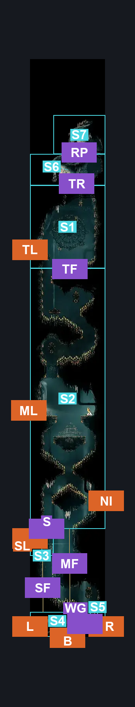
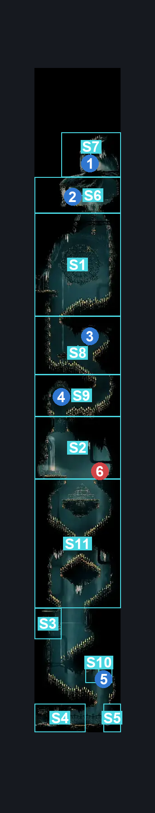
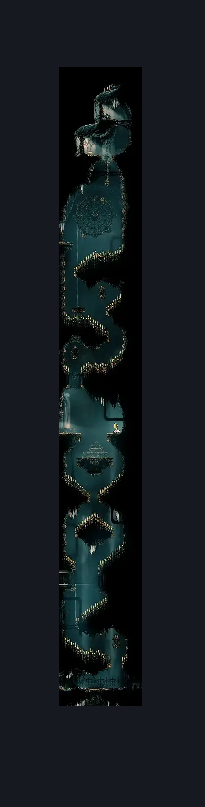

# High Halls Big Shaft (Hang_08)

**Game ID:** Hang_08

**Contributors:** samupo, rebel, Gallos

## Subrooms

| No. | Subroom | Annotated |
| --- | --- | --- |
| S1 | Top | ✓ |
| S2 | Middle | ✓ |
| S3 | Left Spike Exit | ✓ |
| S4 | Bottom | ✓ |
| S5 | Behind Sentinel Gate | ✓ |
| S6 | Resting Site Ledge | ✓ |
| S7 | Penthouse | ✓ |
| S8 | Clawline Gate 1 | ✓ |
| S9 | Clawline Gate 2 | ✓ |
| S10 | Clawline Gate 3 | ✓ |
| S11 | Spike Hell | ✓ |

## Room Transitions

| Alias | Name | From subroom | Destination | Destination alias | Requirements | TODO | Verification | Annotated | Notes |
| --- | --- | --- | --- | --- | --- | --- | --- | --- | --- |
| SL | left3 | Left Spike Exit | [High Halls Flooded Room (Hang_10)](high-halls-flooded-room.md) | R | none |  | Verified | ✓ |  |
| B | bot1 | Bottom | [High Halls Vault (Hang_06)](high-halls-vault.md) | T | none |  | Verified | ✓ |  |
| L | left4 | Bottom | [High Halls Baby Room (Hang_16)](high-halls-baby-room.md) | R | none |  | Verified | ✓ |  |
| NI | right2 | Spike Hell | [High Halls Not Implemented Room (Cog_11)](high-halls-not-implemented-room.md) | L | invalid |  | Verified | ✓ | NOT IMPLEMENTED BY DEVS |
| R | right1 | Behind Sentinel Gate | [High Halls Sentinel Graveyard (Hang_17b)](high-halls-sentinel-graveyard.md) | L | Activate Clawline Gate 3 AND complete THE Final Audience Wish Promised |  | Verified | ✓ |  |
| ML | left2 | Middle | [High Halls Cogfly Room (Hang_09)](high-halls-cogfly-room.md) | R | none |  | Verified | ✓ |  |
| TL | left1 | Top | [High Halls Big Slide (Hang_13)](high-halls-big-slide.md) | R | none |  | Verified | ✓ |  |

## Subroom Connections

| Alias | Name | Source | Destination | Requirements | TODO | Verification | Annotated | Notes |
| --- | --- | --- | --- | --- | --- | --- | --- | --- |
| TF | Falling from Top | Top | Clawline Gate 1 | none |  | Verified | ✓ |  |
| TF | Falling from Top | Clawline Gate 1 | Top | silk soar |  | Verified | ✓ |  |
| C1 | ClawGate 1 to 2 | Clawline Gate 1 | Clawline Gate 2 | (Activate Clawline Gate 1 AND ((proficient movement AND spike pogo AND clawline left) OR ((faydown cloak OR drifter's) AND spike pogo AND clawline either))) |  | Verified | ✓ |  |
| C1 | ClawGate 1 to 2 | Clawline Gate 2 | Clawline Gate 1 | activate CLawline gate 1 AND (proficient movement AND spike pogo AND faydown cloak) |  | Verified | ✓ |  |
| C2 | Clawline | Clawline Gate 2 | Middle | clawline either AND Activate Clawline Gate 2 |  | Verified | ✓ |  |
| C2 | Clawline | Middle | Clawline Gate 2 | Activate Clawline Gate 2 AND ((faydown cloak AND easy pogo off Minister) OR silk soar OR (medium pogo off Minister AND cling grip either)) |  | Verified | ✓ |  |
| MS | middle to spike hell | Middle | Spike Hell | none |  | Verified | ✓ | falling |
| MS | middle to spike hell | Spike Hell | Middle | cling grip either OR faydown cloak OR (easy pogo off Minister AND (easy shaman pogo OR easy plasmium stall)) OR (easy shaman pogo AND scuttlebrace) |  | Verified | ✓ |  |
| S | Spiked Secret | Spike Hell | Left Spike Exit | ((proficient movement AND spike pogo) OR Drifter's cloak) AND (break wall left OR break wall right) |  | Verified | ✓ |  |
| S | Spiked Secret | Left Spike Exit | Spike Hell | break wall right AND ((proficient movement AND spike pogo AND faydown cloak) OR (cling grip both AND faydown cloak AND spike pogo) OR (proficient movement AND spike pogo AND cling grip right) OR (proficient movement AND hard shaman pogo)) |  | Verified | ✓ |  |
| SF | Falling from Secret | Left Spike Exit | Clawline Gate 3 | break wall left AND (drifter's cloak OR spike pogo) AND clawline either |  | Verified | ✓ |  |
| SF | Falling from Secret | Clawline Gate 3 | Left Spike Exit | spike pogo AND (faydown cloak OR cling grip left OR (cling grip right AND easy shaman pogo)) |  | Verified | ✓ |  |
| FC3 | Floor <> Clawline 3 | Bottom | Clawline Gate 3 | activate Clawline Gate 3 AND (spike pogo AND (faydown cloak OR cling grip right OR (cling grip left AND easy shaman pogo))) |  | Verified | ✓ |  |
| FC3 | Floor <> Clawline 3 | Clawline Gate 3 | Bottom | Activate Clawline Gate 3 |  | Verified | ✓ |  |
| WG | wish gate | Bottom | Behind Sentinel Gate | complete THE final audience wish promised |  | Verified | ✓ |  |
| WG | wish gate | Behind Sentinel Gate | Bottom | complete THE final audience wish promised |  | Verified | ✓ |  |
| TR | top to resting site | Top | Resting Site Ledge | clawline either |  | Verified | ✓ |  |
| TR | top to resting site | Resting Site Ledge | Top | none |  | Verified | ✓ | falling |
| RP | resting site to penthouse | Resting Site Ledge | Penthouse | silk soar OR cling grip right OR (faydown cloak AND cling grip left) |  | Verified | ✓ |  |
| RP | resting site to penthouse | Penthouse | Resting Site Ledge | none |  | Verified | ✓ | falling |

## Check Locations

| No. | Check | Subroom | Requirements | TODO | Verification | Location Type | Annotated | Notes |
| --- | --- | --- | --- | --- | --- | --- | --- | --- |
| 1 | High Halls - Rosary Chest | Penthouse | none |  | Verified | collectible | ✓ |  |
| 2 | Resting Site: High Halls | Resting Site Ledge | complete THE A Vassal Lost Wish Promised |  | Verified | event | ✓ |  |
| 3 | Clawline Gate 1 | Clawline Gate 1 | Clawline |  | Verified | switch | ✓ |  |
| 4 | Clawline Gate 2 | Clawline Gate 2 | Clawline |  | Verified | switch | ✓ |  |
| 5 | Clawline Gate 3 | Clawline Gate 3 | Clawline |  | Verified | switch | ✓ |  |
| 6 | Minister 1 | Middle | free |  | Verified | enemy | ✓ |  |

## Notes

the subroom connections in this room need a lot of work. it may be worthwhile to just start from scratch instead of frankensteining something usable out of them.

## Room Images

### Connections

### Checks

### Scene

