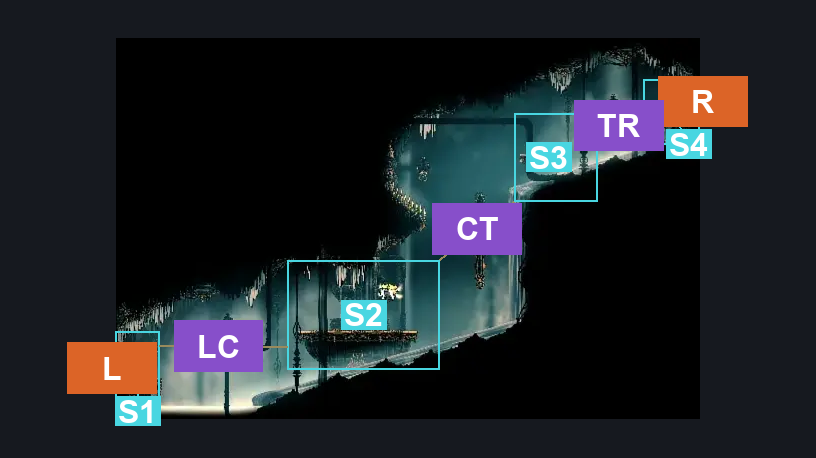
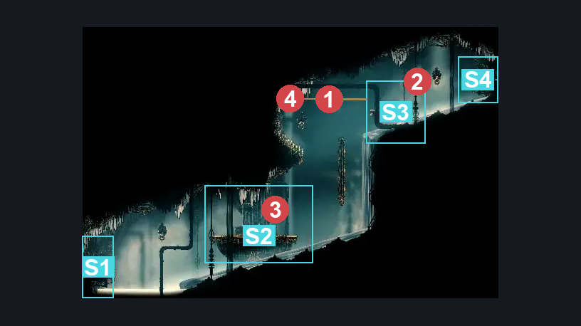
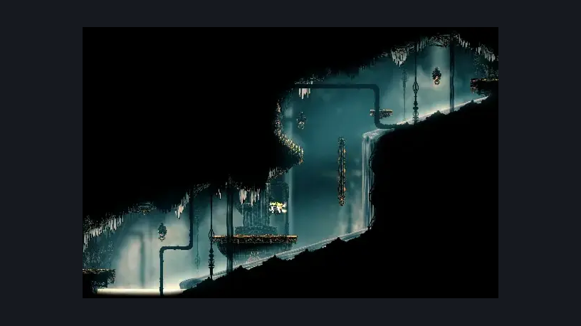

# High Halls Big Slide (Hang_13)

**Game ID:** Hang_13

**Contributors:** samupo, rebel

## Subrooms

| No. | Subroom | Annotated |
| --- | --- | --- |
| S1 | Left Entrance | ✓ |
| S2 | Center Platform | ✓ |
| S3 | Top Platform | ✓ |
| S4 | Right Exit | ✓ |

## Room Transitions

| Alias | Name | From subroom | Destination | Destination alias | Requirements | TODO | Verification | Annotated | Notes |
| --- | --- | --- | --- | --- | --- | --- | --- | --- | --- |
| R | right1 | Right Exit | [High Halls Big Shaft (Hang_08)](high-halls-big-shaft.md) | TL | None |  | Verified | ✓ |  |
| L | left1 | Left Entrance | [High Halls Shaft Bottom (Hang_03)](high-halls-shaft-bottom.md) | TR | None |  | Verified | ✓ |  |

## Subroom Connections

| Alias | Name | Source | Destination | Requirements | TODO | Verification | Annotated | Notes |
| --- | --- | --- | --- | --- | --- | --- | --- | --- |
| LC | Left <> Center | Left Entrance | Center Platform | Clawline OR (Swift Step 2 AND Faydown Cloak) OR (Easy Plasmium Stall AND Faydown Cloak AND Sprint AND (Ledge Grab OR Cling Grip)) |  | Verified | ✓ |  |
| LC | Left <> Center | Center Platform | Left Entrance | Clawline OR (Sprint AND (Dash OR Faydown Cloak)) OR (Swim AND (Ledge Grab OR Cling Grip)) OR (Faydown Cloak AND (Medium Plasmium Stall OR Medium Voltvessels Stall OR Easy Beast Charge OR Easy Architect Charge)) |  | Verified | ✓ |  |
| CT | Center <> Top | Center Platform | Top Platform | Clawline AND (Ledge Grab OR Faydown Cloak OR Cling Grip) |  | Verified | ✓ |  |
| CT | Center <> Top | Top Platform | Center Platform | Ledge Grab OR Swim OR Faydown Cloak OR Clawline OR Sharpdart OR (Cling Grip AND Proficient Movement) OR Sprint OR Dash OR Drifter's Cloak OR Easy Reaper Pogo OR Easy Hunter Pogo OR Easy Beast Pogo OR Easy Shaman Pogo OR Easy Architect Pogo OR Easy Hunter Charge OR Easy Wanderer Charge OR Easy Witch Charge OR Easy Beast Charge OR Easy Architect Charge OR Easy Shaman Charge OR Easy Flintslate Stall OR Easy Plasmium Stall OR Easy Voltvessels Stall OR Flea Brew |  | Verified | ✓ | honestly just like literally anything in the game? |
| TR | Top <> Right | Top Platform | Right Exit | Clawline OR (Faydown Cloak AND (Sprint OR Drifter's Cloak OR Sharpdart OR (Swim AND (Ledge Grab OR Cling Grip)))) |  | Verified | ✓ |  |
| TR | Top <> Right | Right Exit | Top Platform | Clawline OR Sharpdart OR Swift Step 2 OR (Faydown Cloak AND (Dash OR Sprint)) |  | Verified | ✓ |  |

## Check Locations

| No. | Check | Subroom | Requirements | TODO | Verification | Location Type | Annotated | Notes |
| --- | --- | --- | --- | --- | --- | --- | --- | --- |
| 1 | Minister 1 | Top Platform | Nada |  | Verified | enemy | ✓ |  |
| 2 | Minister 2 | Top Platform | Nothing |  | Verified | enemy | ✓ |  |
| 3 | Maestro 1 | Center Platform | Free |  | Verified | enemy | ✓ |  |
| 4 | Void Mass 1 | Top Platform | Black Thread World Spawn |  | Verified | enemy | ✓ |  |

## Room Images

### Connections

### Checks

### Scene

