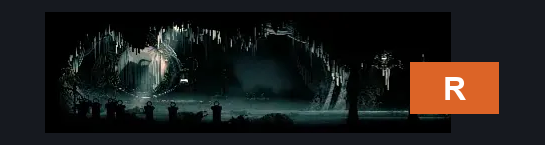
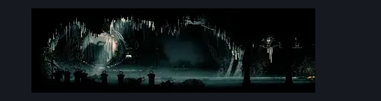

# High Halls Conductor (Hang_12)

**Game ID:** Hang_12

**Contributors:** samupo, rebel

## Subrooms

No subrooms defined.

## Room Transitions

| Alias | Name | From subroom | Destination | Destination alias | Requirements | TODO | Verification | Annotated | Notes |
| --- | --- | --- | --- | --- | --- | --- | --- | --- | --- |
| R | right1 |  | [High Halls Arena (Hang_04)](high-halls-arena.md) | L | none |  | Verified | ✓ |  |

## Subroom Connections

No subroom connections defined.

## Check Locations

| No. | Check | Subroom | Requirements | TODO | Verification | Location Type | Annotated | Notes |
| --- | --- | --- | --- | --- | --- | --- | --- | --- |
| 1 | Conductors Melody |  | Act 2 |  | Verified | collectible | ✓ |  |

## Room Images

### Connections

### Checks

### Scene

