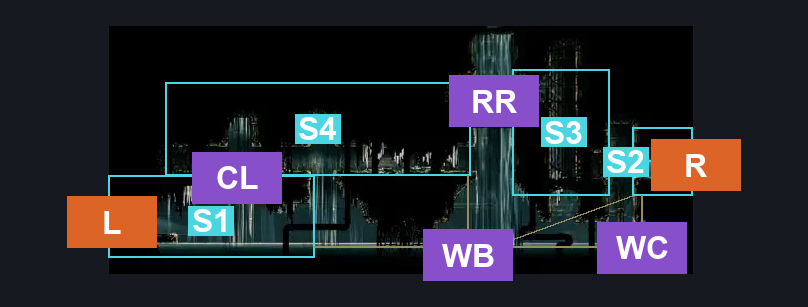
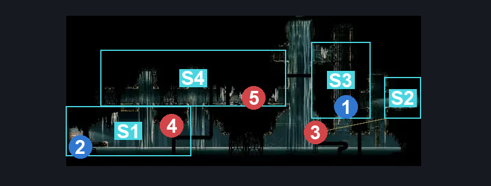
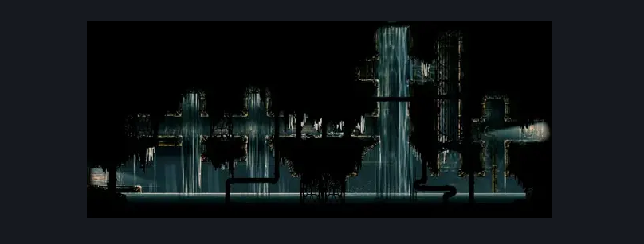

# High Halls Flooded Room (Hang_10)

**Game ID:** Hang_10

**Contributors:** samupo, herounit, rebel, Gallos

## Subrooms

| No. | Subroom | Annotated |
| --- | --- | --- |
| S1 | left exit area | ✓ |
| S2 | right exit area | ✓ |
| S3 | relic spot right | ✓ |
| S4 | relic spot left | ✓ |

## Room Transitions

| Alias | Name | From subroom | Destination | Destination alias | Requirements | TODO | Verification | Annotated | Notes |
| --- | --- | --- | --- | --- | --- | --- | --- | --- | --- |
| L | left1 | left exit area | [High Halls Shaft Bottom (Hang_03)](high-halls-shaft-bottom.md) | BR | clear left exit blockade |  | Verified | ✓ |  |
| R | right1 | right exit area | [High Halls Big Shaft (Hang_08)](high-halls-big-shaft.md) | SL | none |  | Verified | ✓ |  |

## Subroom Connections

| Alias | Name | Source | Destination | Requirements | TODO | Verification | Annotated | Notes |
| --- | --- | --- | --- | --- | --- | --- | --- | --- |
| CL | climb | left exit area | relic spot left | ((faydown OR clawline right OR sharpdart) AND (cling grip right OR scuttlebrace)) OR (swim AND easy pogo off drapefly AND (cling grip either OR (faydown AND ledge grab either))) |  | Verified | ✓ |  |
| CL | climb | relic spot left | left exit area | none |  | Verified | ✓ | falling |
| WC | water crossing | left exit area | right exit area | swim AND cling grip either |  | Verified | ✓ |  |
| WC | water crossing | right exit area | left exit area | swim OR (clawline left AND faydown cloak AND drifter's cloak AND (cling grip left OR (ledge grab left AND cling grip right))) |  | Verified | ✓ |  |
| RR | Relic spot left n right | relic spot left | relic spot right | cling grip either OR (easy pogo off giant drapemite AND faydown cloak) OR scuttlebrace |  | Verified | ✓ |  |
| RR | Relic spot left n right | relic spot right | relic spot left | cling grip either OR silk soar OR scuttlebrace |  | Verified | ✓ |  |
| WB | relic spot to right exit | relic spot left | right exit area | (clawline right AND faydown cloak AND drifter's cloak AND cling grip either) |  | Verified | ✓ |  |
| WB | relic spot to right exit | right exit area | relic spot left | swim AND easy pogo off drapefly AND faydown cloak |  | Verified | ✓ |  |

## Check Locations

| No. | Check | Subroom | Requirements | TODO | Verification | Location Type | Annotated | Notes |
| --- | --- | --- | --- | --- | --- | --- | --- | --- |
| 1 | relic psalm cylinder high halls | relic spot right | none |  | Verified | collectible | ✓ |  |
| 2 | left exit blockade | left exit area | break wall left |  | Verified | blockade | ✓ |  |
| 3 | Drapefly 1 | right exit area | normal world spawn |  | Verified | enemy | ✓ |  |
| 4 | Drapefly 2 | left exit area | normal world spawn |  | Verified | enemy | ✓ |  |
| 5 | Giant Drapemite 1 | relic spot left | normal world spawn |  | Verified | enemy | ✓ |  |

## Notes

this room needs swimming requirements added to cross it - at least two subrooms

## Room Images

### Connections

### Checks

### Scene

