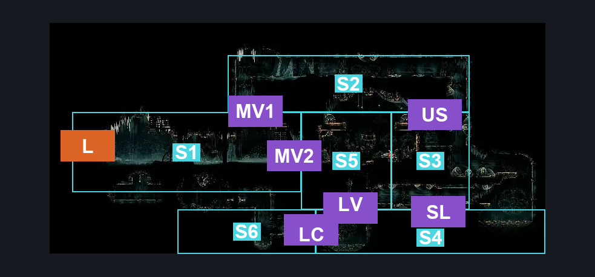
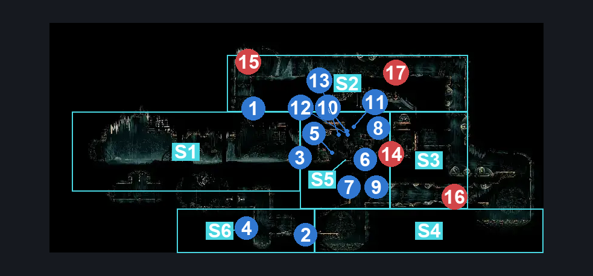
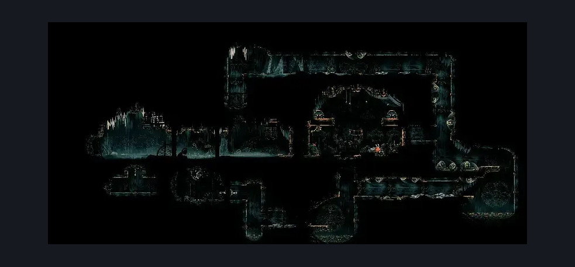

# High Halls Rosary Bank (Hang_06_bank)

**Game ID:** Hang_06_bank

**Contributors:** rebel

## Subrooms

| No. | Subroom | Annotated |
| --- | --- | --- |
| S1 | Main Room | ✓ |
| S2 | Upper Vents | ✓ |
| S3 | Side Vents | ✓ |
| S4 | Lower Vents | ✓ |
| S5 | Vault | ✓ |
| S6 | Rosary Dropper | ✓ |

## Room Transitions

| Alias | Name | From subroom | Destination | Destination alias | Requirements | TODO | Verification | Annotated | Notes |
| --- | --- | --- | --- | --- | --- | --- | --- | --- | --- |
| L | left1 | Main Room | [High Halls Vault (Hang_06)](high-halls-vault.md) | D | Unlock Rosary Bank Door IN High Halls Vault |  | Verified | ✓ |  |

## Subroom Connections

| Alias | Name | Source | Destination | Requirements | TODO | Verification | Annotated | Notes |
| --- | --- | --- | --- | --- | --- | --- | --- | --- |
| MV1 | Main <> Vents | Main Room | Upper Vents | (Activate Breakable Ceiling AND (Cling Grip OR Scuttlebrace OR Silk Soar)) |  | Verified | ✓ |  |
| MV1 | Main <> Vents | Upper Vents | Main Room | Activate Breakable Ceiling |  | Verified | ✓ |  |
| US | Upper <> Side | Upper Vents | Side Vents | Nothing (Fall) |  | Verified | ✓ |  |
| US | Upper <> Side | Side Vents | Upper Vents | Cling Grip OR Silk Soar |  | Verified | ✓ |  |
| SL | Side <> Lower | Side Vents | Lower Vents | (Cling Grip AND Dash) OR Clawline OR Sharpdart |  | Verified | ✓ |  |
| SL | Side <> Lower | Lower Vents | Side Vents | Cling Grip AND Dash |  | Verified | ✓ |  |
| LV | Lower <> Vault | Lower Vents | Vault | ((Dash OR Clawline OR Sharpdart) AND (Cling Grip OR Easy Scuttlebrace OR (Faydown Cloak AND Ledge Grab))) |  | Verified | ✓ |  |
| LV | Lower <> Vault | Vault | Lower Vents | Nothing (Fall) |  | Verified | ✓ |  |
| LC | Lower <> Cannon | Lower Vents | Rosary Dropper | (Activate Rosary Cannon Wall AND (Clawline OR Dash OR Faydown Cloak OR Cling Grip)) |  | Verified | ✓ |  |
| LC | Lower <> Cannon | Rosary Dropper | Lower Vents | (Activate Rosary Cannon Wall AND (Faydown Cloak OR Cling Grip)) |  | Verified | ✓ |  |
| MV2 | Main <> Vault | Main Room | Vault | Activate Vault Door Switch |  | Verified | ✓ |  |
| MV2 | Main <> Vault | Vault | Main Room | Activate Vault Door Switch |  | Verified | ✓ |  |

## Check Locations

| No. | Check | Subroom | Requirements | TODO | Verification | Location Type | Annotated | Notes |
| --- | --- | --- | --- | --- | --- | --- | --- | --- |
| 1 | Breakable Ceiling | Main Room | Break Wall up |  | Verified | blockade | ✓ |  |
| 2 | Rosary Cannon Wall | Lower Vents | Break Wall Left |  | Verified | blockade | ✓ |  |
| 3 | Vault Door Switch | Vault | Flip Lever Left |  | Verified | switch | ✓ |  |
| 4 | Rosary Cannon | Rosary Dropper | Activate Rosary Cannon Wall |  | Verified | collectible | ✓ |  |
| 5 | Rosary Chest 1 | Vault | Free |  | Verified | resource | ✓ |  |
| 6 | Rosary Chest 2 | Vault | Zilch |  | Verified | resource | ✓ |  |
| 7 | Rosary Chest 3 | Vault | Nada |  | Verified | resource | ✓ |  |
| 8 | Vault String 1 | Vault | Nothing |  | Verified | resource | ✓ |  |
| 9 | Vault String 2 | Vault | Nothing |  | Verified | resource | ✓ |  |
| 10 | Missable String 1 | Vault | Nada |  | Verified | resource | ✓ | only exists in act 2 |
| 11 | Missable String 2 | Vault | Free |  | Verified | resource | ✓ | only exists in act 2 |
| 12 | Missable String 3 | Vault | Nothing |  | Verified | resource | ✓ | only exists in act 2 |
| 13 | Missable String 4 | Vault | None |  | Verified | resource | ✓ | only exists in act 2 |
| 14 | Snitchfly 1 | Vault | Act 3 |  | Verified | enemy | ✓ |  |
| 15 | Drapefly 1 | Upper Vents | nada |  | Verified | enemy | ✓ |  |
| 16 | Giant Drapemite 1 | Side Vents | zilch |  | Verified | enemy | ✓ |  |
| 17 | Drapemite 1 | Upper Vents | free |  | Verified | enemy | ✓ |  |

## Room Images

### Connections

### Checks

### Scene

