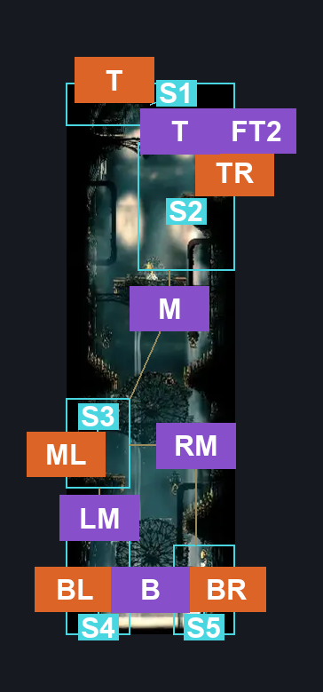
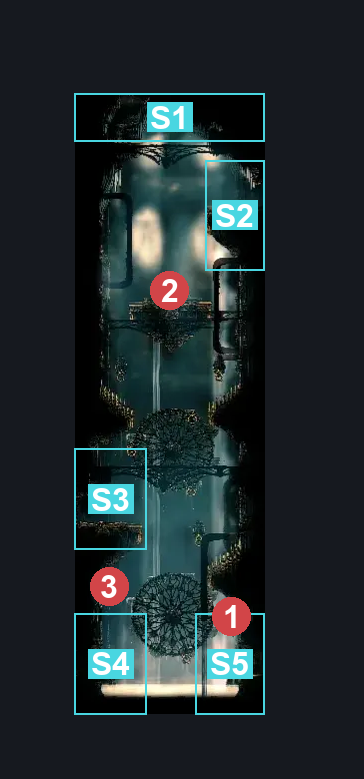
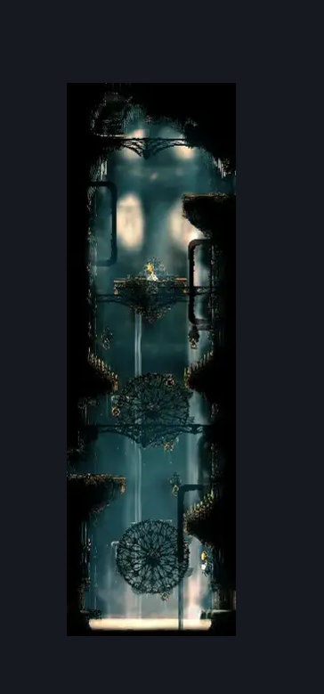

# High Halls Shaft Bottom (Hang_03)

**Game ID:** Hang_03

**Contributors:** samupo, rebel, Gallos

## Subrooms

| No. | Subroom | Annotated |
| --- | --- | --- |
| S1 | Top | ✓ |
| S2 | Top Right | ✓ |
| S3 | Middle Left | ✓ |
| S4 | Bottom Left | ✓ |
| S5 | Bottom Right | ✓ |

## Room Transitions

| Alias | Name | From subroom | Destination | Destination alias | Requirements | TODO | Verification | Annotated | Notes |
| --- | --- | --- | --- | --- | --- | --- | --- | --- | --- |
| T | top1 | Top | [High Halls Shaft Top (Hang_03_top)](high-halls-shaft-top.md) | B | none |  | Verified | ✓ |  |
| TR | right1 | Top Right | [High Halls Big Slide (Hang_13)](high-halls-big-slide.md) | L | none |  | Verified | ✓ |  |
| BL | left2 | Bottom Left | [High Halls Small Room (Hang_15)](high-halls-small-room.md) | R | none |  | Verified | ✓ |  |
| BR | right2 | Bottom Right | [High Halls Flooded Room (Hang_10)](high-halls-flooded-room.md) | L | clear left exit blockade IN high halls flooded room |  | Verified | ✓ |  |
| ML | left1 | Middle Left | [High Halls Small Slide (Hang_02)](high-halls-small-slide.md) | R | none |  | Verified | ✓ |  |

## Subroom Connections

| Alias | Name | Source | Destination | Requirements | TODO | Verification | Annotated | Notes |
| --- | --- | --- | --- | --- | --- | --- | --- | --- |
| B | Bottom Traversal | Bottom Left | Bottom Right | swim OR clawline right OR (faydown cloak AND dash right) OR (easy pogo off Minister AND (drifter's cloak OR dash right OR scuttlebrace OR easy [shaman, beast] pogo)) OR (easy shaman pogo AND scuttlebrace AND silk soar) |  | Verified | ✓ |  |
| B | Bottom Traversal | Bottom Right | Bottom Left | swim OR clawline left OR (faydown cloak AND dash left) OR (easy pogo off Minister AND (drifter's cloak OR dash left OR scuttlebrace OR easy [shaman, beast] pogo)) OR (easy shaman pogo AND scuttlebrace AND silk soar) |  | Verified | ✓ |  |
| RM | Bottom Right to Mid Left | Middle Left | Bottom Right | none |  | Verified | ✓ | falling |
| RM | Bottom Right to Mid Left | Bottom Right | Middle Left | ( cling grip right AND faydown cloak AND spike pogo ) OR clawline either OR hard pogo off Minister OR ((cling grip right OR scuttlebrace) AND medium pogo off Minister AND spike pogo) |  | Verified | ✓ |  |
| LM | Falling from Mid | Middle Left | Bottom Left | none |  | Verified | ✓ | falling |
| LM | Falling from Mid | Bottom Left | Middle Left | ( cling grip left AND faydown cloak) OR clawline either OR hard pogo off Minister OR ((cling grip left OR scuttlebrace) AND medium pogo off Minister) |  | Verified | ✓ |  |
| M | Middle Left to Top Right | Middle Left | Top Right | (cling grip either AND (faydown cloak AND spike pogo)) OR (cling grip left AND clawline left AND ((dash right AND (cling grip right OR ledge grab right)) OR clawline right OR sharpdart OR scuttlebrace OR easy pogo off Minister OR drifter's cloak)) OR (cling grip right AND clawline right AND (cling grip left OR clawline left OR scuttlebrace OR easy pogo off Minister)) |  | Verified | ✓ |  |
| M | Middle Left to Top Right | Top Right | Middle Left | none |  | Verified | ✓ | falling |
| T | Top Right to Top | Top Right | Top | (faydown cloak AND (((run OR clawline left) AND ledge grab left) OR cling grip left)) OR silk soar OR (cling grip left AND easy pogo off Minister) |  | Verified | ✓ |  |
| FT2 | Falling from Top 2 | Top | Top Right | clawline right OR dash right OR faydown cloak OR scuttlebrace OR easy beast pogo OR easy architect needle strike OR ((easy [heal, rune rage] stall OR easy wanderer needle strike) AND (ledge grab right OR cling grip right)) OR sharpdart OR easy [voltvessels, plasmium, flintslate,flea brew] stall |  | Verified | ✓ |  |

## Check Locations

| No. | Check | Subroom | Requirements | TODO | Verification | Location Type | Annotated | Notes |
| --- | --- | --- | --- | --- | --- | --- | --- | --- |
| 1 | Minister 1 | Bottom Right | nada? |  | Verified | enemy | ✓ |  |
| 2 | Minister 2 | Top Right | Normal World Spawn |  | Verified | enemy | ✓ |  |
| 3 | Void Mass 1 | Bottom Left | Black Thread World Spawn |  | Verified | enemy | ✓ |  |

## Notes

can touch up this room later, it looks functional right now.

## Room Images

### Connections

### Checks

### Scene

