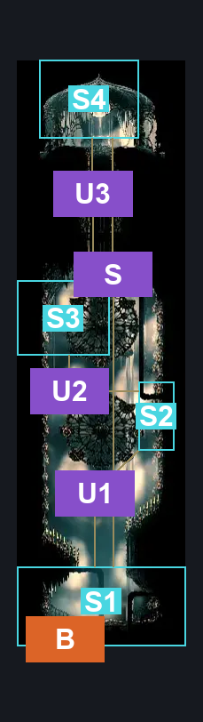
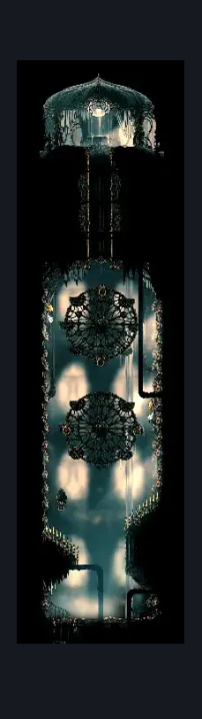

# High Halls Shaft Top (Hang_03_top)

**Game ID:** Hang_03_top

**Contributors:** samupo, rebel

## Subrooms

| No. | Subroom | Annotated |
| --- | --- | --- |
| S1 | Floor | ✓ |
| S2 | Enemy 1 | ✓ |
| S3 | Enemy 2 | ✓ |
| S4 | Spool | ✓ |

## Room Transitions

| Alias | Name | From subroom | Destination | Destination alias | Requirements | TODO | Verification | Annotated | Notes |
| --- | --- | --- | --- | --- | --- | --- | --- | --- | --- |
| B | bot1 | Floor | [High Halls Shaft Bottom (Hang_03)](high-halls-shaft-bottom.md) | T | none |  | Verified | ✓ |  |

## Subroom Connections

| Alias | Name | Source | Destination | Requirements | TODO | Verification | Annotated | Notes |
| --- | --- | --- | --- | --- | --- | --- | --- | --- |
| U1 | Up 1 | Floor | Enemy 1 | Silk Soar OR (Clawline AND Faydown Cloak AND Cling Grip) |  | Verified | ✓ |  |
| U1 | Up 1 | Enemy 1 | Floor | Nothing. (Fall) |  | Verified | ✓ |  |
| U2 | Up 2 | Enemy 1 | Enemy 2 | Clawline AND Faydown Cloak |  | Verified | ✓ |  |
| U2 | Up 2 | Enemy 2 | Enemy 1 | Clawline |  | Verified | ✓ |  |
| U3 | Up 3 | Enemy 2 | Spool | Faydown Cloak AND Cling Grip AND Clawline |  | Verified | ✓ |  |
| U3 | Up 3 | Spool | Enemy 2 | Clawline |  | Verified | ✓ |  |
| S | Skip Allat | Floor | Spool | Silk Soar |  | Verified | ✓ |  |
| S | Skip Allat | Spool | Floor | Nothing. (Fall) |  | Verified | ✓ |  |

## Check Locations

| No. | Check | Subroom | Requirements | TODO | Verification | Location Type | Annotated | Notes |
| --- | --- | --- | --- | --- | --- | --- | --- | --- |
| 1 | High Halls - Spool Fragment | Spool | Attack Up |  | Verified | collectible | ✓ |  |
| 2 | Minister 1 | Enemy 1 | zilch |  | Verified | enemy | ✓ |  |
| 3 | Minister 2 | Enemy 2 | free |  | Verified | enemy | ✓ |  |

## Room Images

### Connections

### Checks

### Scene

