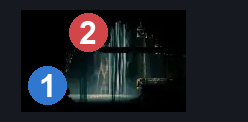
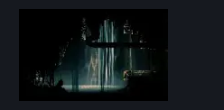

# High Halls Small Room (Hang_15)

**Game ID:** Hang_15

**Contributors:** samupo, rebel

## Subrooms

No subrooms defined.

## Room Transitions

| Alias | Name | From subroom | Destination | Destination alias | Requirements | TODO | Verification | Annotated | Notes |
| --- | --- | --- | --- | --- | --- | --- | --- | --- | --- |
| R | right1 |  | [High Halls Shaft Bottom (Hang_03)](high-halls-shaft-bottom.md) | BL | none |  | Verified | ✓ |  |

## Subroom Connections

No subroom connections defined.

## Check Locations

| No. | Check | Subroom | Requirements | TODO | Verification | Location Type | Annotated | Notes |
| --- | --- | --- | --- | --- | --- | --- | --- | --- |
| 1 | High Halls - Shell Shard Cache #2 |  | none |  | Verified | collectible | ✓ |  |
| 2 | Drapefly 1 |  | nada |  | Verified | enemy | ✓ |  |

## Room Images

### Connections

### Checks

### Scene

