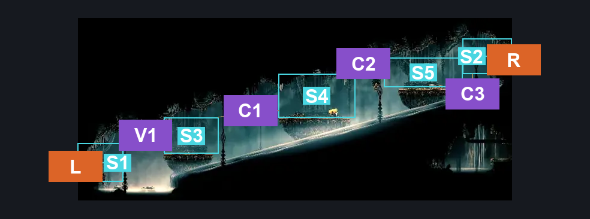
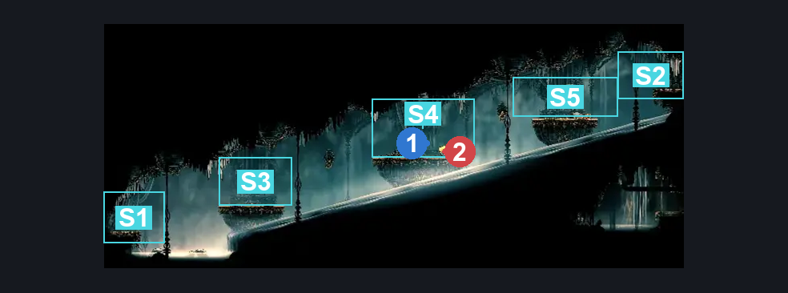
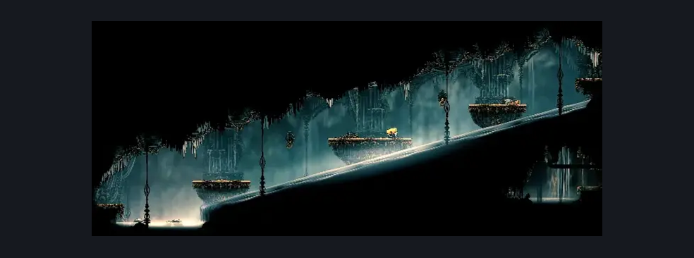

# High Halls Small Slide (Hang_02)

**Game ID:** Hang_02

**Contributors:** samupo, rebel

## Subrooms

| No. | Subroom | Annotated |
| --- | --- | --- |
| S1 | left exit | ✓ |
| S2 | right exit | ✓ |
| S3 | left platform | ✓ |
| S4 | center platform | ✓ |
| S5 | right platform | ✓ |

## Room Transitions

| Alias | Name | From subroom | Destination | Destination alias | Requirements | TODO | Verification | Annotated | Notes |
| --- | --- | --- | --- | --- | --- | --- | --- | --- | --- |
| R | right1 | right exit | [High Halls Shaft Bottom (Hang_03)](high-halls-shaft-bottom.md) | ML | none |  | Verified | ✓ |  |
| L | left1 | left exit | [High Halls Entrance (Hang_01)](../choral-chambers/high-halls-entrance.md) | TP | none |  | Verified | ✓ |  |

## Subroom Connections

| Alias | Name | Source | Destination | Requirements | TODO | Verification | Annotated | Notes |
| --- | --- | --- | --- | --- | --- | --- | --- | --- |
| V1 | vertical 1 | left exit | left platform | Swift Step 2 OR Clawline OR (Sharpdart AND Proficient Movement) OR (Faydown Cloak AND (Easy Scuttlebrace OR Drifter's Cloak OR Easy Voltvessels Stall OR Easy Plasmium Stall OR Medium Flintslate Stall OR Flea Brew)) |  | Verified | ✓ |  |
| V1 | vertical 1 | left platform | left exit | Clawline OR Sharpdart OR Faydown Cloak OR Drifter's Cloak OR Easy Scuttlebrace OR Swift Step 2 OR (((Flea Brew AND Easy Flea Brew Stall) OR Medium Flintslate Stall OR Swim) AND (Ledge Grab OR Cling Grip)) OR Medium Plasmium Stall OR Medium Voltvessels Stall |  | Verified | ✓ |  |
| C1 | crossing 1 | left platform | center platform | Clawline OR (Faydown Cloak AND Sprint AND Ledge Grab) |  | Verified | ✓ |  |
| C1 | crossing 1 | center platform | left platform | Faydown Cloak OR Swift Step 2 OR Clawline OR Sharpdart OR Easy Scuttlebrace OR Drifter's Cloak OR (Flea Brew AND Easy Flea Brew Stall) OR Medium Voltvessels Stall OR Medium Plasmium Stall |  | Verified | ✓ |  |
| C2 | crossing 2 | center platform | right platform | Clawline OR (Faydown Cloak AND (Sprint OR Dash OR Drifter's Cloak OR Sharpdart OR easy Beast Charge OR Easy Architect Charge OR Easy Voltvessels Stall OR Easy Plasmium Stall OR Flea Brew OR (Easy Flintslate Stall AND Ledge Grab))) |  | Verified | ✓ |  |
| C2 | crossing 2 | right platform | center platform | Sprint OR Dash OR Drifter's Cloak OR Faydown Cloak OR Clawline OR Sharpdart OR Easy Scuttlebrace OR Easy Flintslate Stall OR Easy Voltvessels Stall OR Easy Plasmium Stall OR Flea Brew |  | Verified | ✓ |  |
| C3 | crossing 3 | right platform | right exit | Faydown Cloak OR ((Cling Grip OR Easy Scuttlebrace) AND (Sprint OR Dash OR Flea Brew OR Easy Architect Charge OR Easy Beast Charge OR Drifter's Cloak OR Easy Plasmium Stall)) OR ((Clawline OR Sharpdart) AND Ledge Grab) |  | Verified | ✓ |  |
| C3 | crossing 3 | right exit | right platform | Sprint OR Dash OR Drifter's Cloak OR Faydown Cloak OR Clawline OR Sharpdart OR Easy Scuttlebrace OR Easy Flintslate Stall OR Easy Voltvessels Stall OR Easy Plasmium Stall OR Flea Brew |  | Verified | ✓ |  |

## Check Locations

| No. | Check | Subroom | Requirements | TODO | Verification | Location Type | Annotated | Notes |
| --- | --- | --- | --- | --- | --- | --- | --- | --- |
| 1 | Second Sentinel Encounter | center platform | act 3 AND complete THE second sentinel activation |  | Verified | event | ✓ |  |
| 2 | Maestro 1 | center platform | nada |  | Verified | enemy | ✓ |  |

## Room Images

### Connections

### Checks

### Scene

