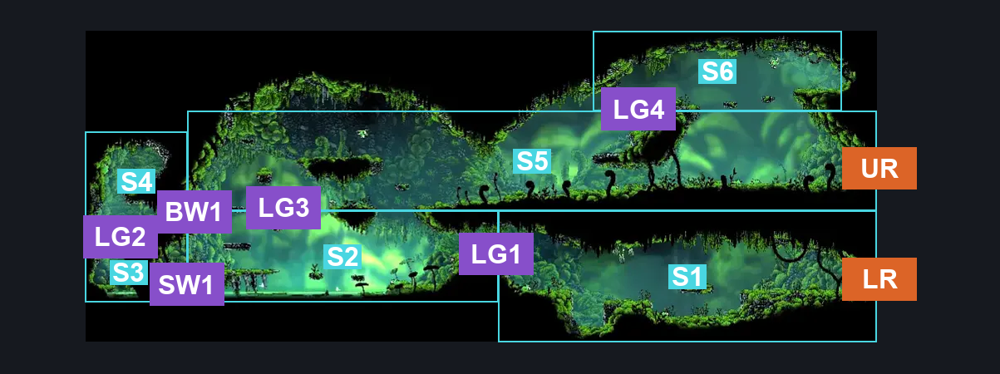
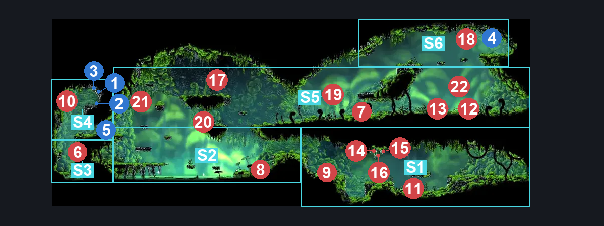
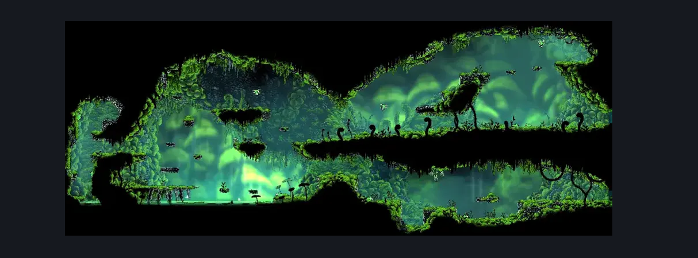

# Moss Grotto West (Tut_02)

**Game ID:** Tut_02

**Contributors:** herounit, gallos

## Subrooms

| No. | Subroom | Annotated |
| --- | --- | --- |
| S1 | lower right exit area | ✓ |
| S2 | the pond | ✓ |
| S3 | the backroom floor | ✓ |
| S4 | the backroom exit | ✓ |
| S5 | the backroom cache | ✓ |
| S6 | upper level | ✓ |
| S7 | mossberry platform | ✓ |

## Room Transitions

| Alias | Name | From subroom | Destination | Destination alias | Requirements | TODO | Verification | Annotated | Notes |
| --- | --- | --- | --- | --- | --- | --- | --- | --- | --- |
| UR | upper right | upper level | [Moss Grotto Center (Tut_01)](moss-grotto-center.md) | ML | none |  | Verified | ✓ | asdf |
| LR | lower right | lower right exit area | [Moss Grotto Center (Tut_01)](moss-grotto-center.md) | LL | break vines right |  | Verified | ✓ |  |

## Subroom Connections

| Alias | Name | Source | Destination | Requirements | TODO | Verification | Annotated | Notes |
| --- | --- | --- | --- | --- | --- | --- | --- | --- |
| LG1 | first ledge grab | lower right exit area | the pond | ledge grab left OR cling grip left OR easy scuttlebrace  OR faydown cloak  OR silk soar OR ( easy shaman pogo AND easy enemy pogo off mossgrub ) |  | Verified | ✓ |  |
| LG1 | first ledge grab | the pond | lower right exit area | none (falling) |  | Verified | ✓ |  |
| SW1 | first swim | the pond | the backroom floor | swim |  | Verified | ✓ |  |
| SW1 | first swim | the backroom floor | the pond | swim |  | Verified | ✓ |  |
| BG1 | back grab 1 | the backroom floor | the backroom exit | ledge grab left OR cling grip either OR faydown cloak  OR silk soar OR easy damage boost off mossgrub OR easy enemy pogo off mossgrub |  | Verified | ✓ |  |
| BG1 | back grab 1 | the backroom exit | the backroom floor | none (falling) |  | Verified | ✓ |  |
| BG2 | back grab 2 | the backroom exit | the backroom cache | ledge grab right OR cling grip either OR faydown cloak OR silk soar OR easy shaman pogo OR easy scuttlebrace OR easy damage boost off mossgrub OR easy enemy pogo off mossgrub |  | Verified | ✓ |  |
| BG2 | back grab 2 | the backroom cache | the backroom exit | none (falling) |  | Verified | ✓ |  |
| BW1 | breakable wall 1 | the backroom cache | the pond | clear one-way breakable wall |  | Verified | ✓ |  |
| BW1 | breakable wall 1 | the pond | the backroom cache | clear one-way breakable wall |  | Verified | ✓ |  |
| LG3 | ledge grab 3 | the pond | upper level | ledge grab right  OR run  OR dash right OR drifters  OR faydown  OR easy beast pogo  OR cling grip right OR silk soar  OR clawline right OR sharpdart  OR easy [architect, wanderer] charge OR easy voltvessels stall OR flea brew |  | Verified | ✓ |  |
| LG3 | ledge grab 3 | upper level | the pond | none (falling) |  | Verified | ✓ |  |
| LG4 | ledge grab 4 | upper level | mossberry platform | ledge grab right OR faydown  OR cling grip right  OR silk soar  OR easy enemy pogo off mossmir  OR easy damage boost off mossmir OR ( easy shaman pogo AND ( easy enemy pogo off mossgrub OR easy scuttlebrace ) ) |  | Verified | ✓ |  |
| LG4 | ledge grab 4 | mossberry platform | upper level | none (falling) |  | Verified | ✓ |  |

## Check Locations

| No. | Check | Subroom | Requirements | TODO | Verification | Location Type | Annotated | Notes |
| --- | --- | --- | --- | --- | --- | --- | --- | --- |
| 1 | shell shard cache moss grotto 5 | the backroom cache | none |  | Verified | collectible | ✓ |  |
| 2 | shell shard cache moss grotto 6 | the backroom cache | none |  | Verified | collectible | ✓ |  |
| 3 | shell shard cache moss grotto 7 | the backroom cache | none |  | Verified | collectible | ✓ |  |
| 4 | moss grotto west mossberry | mossberry platform | none |  | Verified | collectible | ✓ |  |
| 5 | one-way breakable wall | the backroom exit | break wall right |  | Verified | blockade | ✓ |  |
| 6 | Mossgrub 1 | the backroom floor | None |  | Verified | enemy | ✓ |  |
| 7 | Mossgrub 2 | upper level | None |  | Verified | enemy | ✓ |  |
| 8 | Mossgrub 3 | the pond | None |  | Verified | enemy | ✓ |  |
| 9 | Mossgrub 4 | lower right exit area | None |  | Verified | enemy | ✓ |  |
| 10 | Mossgrub 5 | the backroom cache | None |  | Verified | enemy | ✓ |  |
| 11 | Mossgrub 6 | lower right exit area | None |  | Verified | enemy | ✓ |  |
| 12 | Mossgrub 7 | upper level | Normal World Spawn |  | Verified | enemy | ✓ |  |
| 13 | Mossgrub 8 | upper level | Normal World Spawn |  | Verified | enemy | ✓ |  |
| 14 | MossBone Cocoon 1 | lower right exit area | None |  | Verified | enemy | ✓ |  |
| 15 | MossBone Cocoon 2 | lower right exit area | None |  | Verified | enemy | ✓ |  |
| 16 | MossBone Cocoon 3 | lower right exit area | None |  | Verified | enemy | ✓ |  |
| 17 | Mossmir 1 | upper level | None |  | Verified | enemy | ✓ |  |
| 18 | Mossmir 2 | mossberry platform | Normal World Spawn |  | Verified | enemy | ✓ |  |
| 19 | Mossmir 3 | upper level | Normal World Spawn |  | Verified | enemy | ✓ |  |
| 20 | MossBone Cocoon 4 | upper level | Normal World Spawn |  | Verified | enemy | ✓ |  |
| 21 | Mossmir 4 | upper level | Black Thread World Spawn |  | Verified | enemy | ✓ |  |
| 22 | Moss Mother 1 | upper level | Black Thread World Spawn |  | Verified | enemy | ✓ |  |

## Notes

somehow missed this being its own room before

## Room Images

### Connections

### Checks

### Scene

