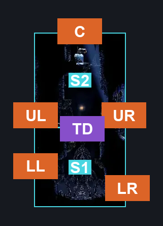
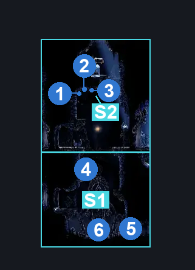
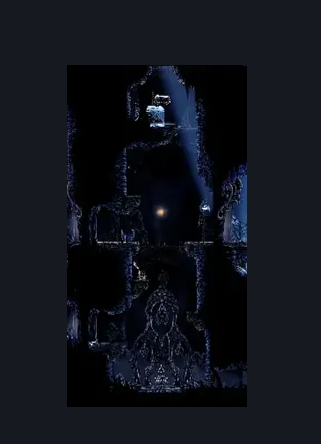

# Mount Fay Bench Toll (Bellway_Peak)

**Game ID:** Bellway_Peak

**Contributors:** Pyxl

## Subrooms

| No. | Subroom | Annotated |
| --- | --- | --- |
| S1 | Lower Area | ✓ |
| S2 | Upper Area | ✓ |

## Room Transitions

| Alias | Name | From subroom | Destination | Destination alias | Requirements | TODO | Verification | Annotated | Notes |
| --- | --- | --- | --- | --- | --- | --- | --- | --- | --- |
| UR | right1 | Upper Area | [Mount Fay Ice Lake Platforming Room (Peak_04)](mount-fay-ice-lake-platforming-room.md) | L | None |  | Verified | ✓ |  |
| LR | right2 | Lower Area | [Memory Crystal (Bellway_Peak_02)](memory-crystal.md) | L | complete Breakable Wall - Mount Fay Bench Toll |  | Verified | ✓ | Can Be Broken From Both sides |
| C | top1 | Upper Area | [Mount Fay Lower Slope (Peak_05)](mount-fay-lower-slope.md) | F | Silk Soar OR ( Cling Grip both AND ( Dash Right OR Drifters Cloak OR Faydown Cloak OR Clawline Right ) ) OR ( Clawline Right AND Faydown Cloak AND Ledge Grab Left ) OR ( Faydown Cloak AND Scuttlebrace ) |  | Verified | ✓ |  |
| UL | left1 | Upper Area | [Mount Fay Mask Shard (Peak_04c)](mount-fay-mask-shard.md) | UR | None |  | Verified | ✓ |  |
| LL | left2 | Lower Area | [Mount Fay Mask Shard (Peak_04c)](mount-fay-mask-shard.md) | LR | Ledge Grab Left OR ( Dash AND Prereq bench toll AND Proficient Movement ) OR Faydown Cloak OR Cling Grip Left OR Silk Soar |  | Verified | ✓ |  |

## Subroom Connections

| Alias | Name | Source | Destination | Requirements | TODO | Verification | Annotated | Notes |
| --- | --- | --- | --- | --- | --- | --- | --- | --- |
| TD | Trapdoor | Lower Area | Upper Area | ( Faydown Cloak OR Silk Soar OR ( Cling Grip Both AND Clawline Both ) OR ( Ledge Grab Both AND ( Dash Both OR Clawline Both OR Drifters Cloak ) ) ) AND Complete Trapdoor lever |  | Verified | ✓ | Lever activation is permanent |
| TD | Trapdoor | Upper Area | Lower Area | Complete Trapdoor lever |  | Verified | ✓ | Lever activation is permanent |

## Check Locations

| No. | Check | Subroom | Requirements | TODO | Verification | Location Type | Annotated | Notes |
| --- | --- | --- | --- | --- | --- | --- | --- | --- |
| 1 | Mount Fay - Rosary Cache #1 | Upper Area | Cling Grip left OR Silk Soar OR Ledge grab Left OR Faydown Cloak |  | Verified | resource | ✓ |  |
| 2 | Mount Fay - Rosary Cache #2 | Upper Area | Cling Grip left OR Silk Soar OR Ledge grab Left OR Faydown Cloak |  | Verified | resource | ✓ |  |
| 3 | Mount Fay - Rosary Cache #3 | Upper Area | Cling Grip left OR Silk Soar OR Ledge grab Left OR Faydown Cloak |  | Verified | resource | ✓ |  |
| 4 | Trapdoor Lever | Lower Area | Faydown Cloak OR Silk Soar OR ( Cling Grip Both AND Clawline Both ) OR ( Ledge Grab Both AND ( Dash Both OR Clawline Both OR Drifters Cloak ) ) |  | Verified | switch | ✓ |  |
| 5 | Breakable Wall - Mount Fay Bench Toll | Lower Area | None |  | Verified | blockade | ✓ |  |
| 6 | Bench Toll | Lower Area | Spend 60 rosaries |  | Verified | lock | ✓ |  |

## Room Images

### Connections

### Checks

### Scene

