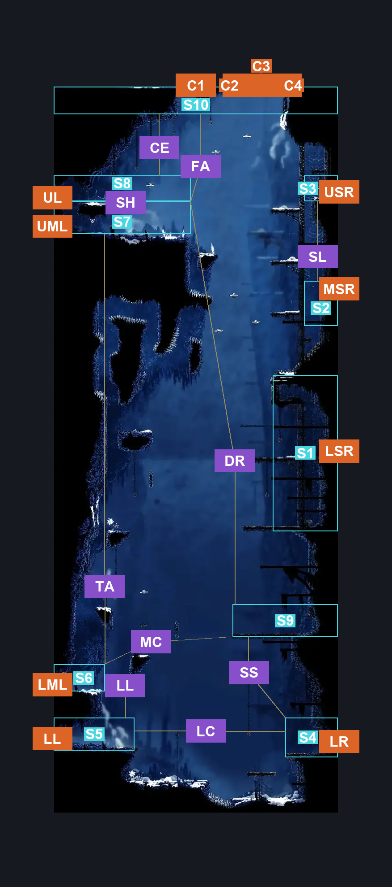
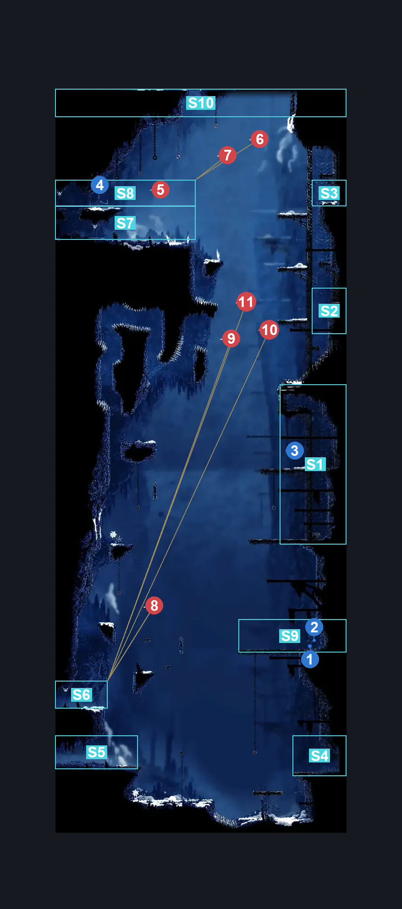
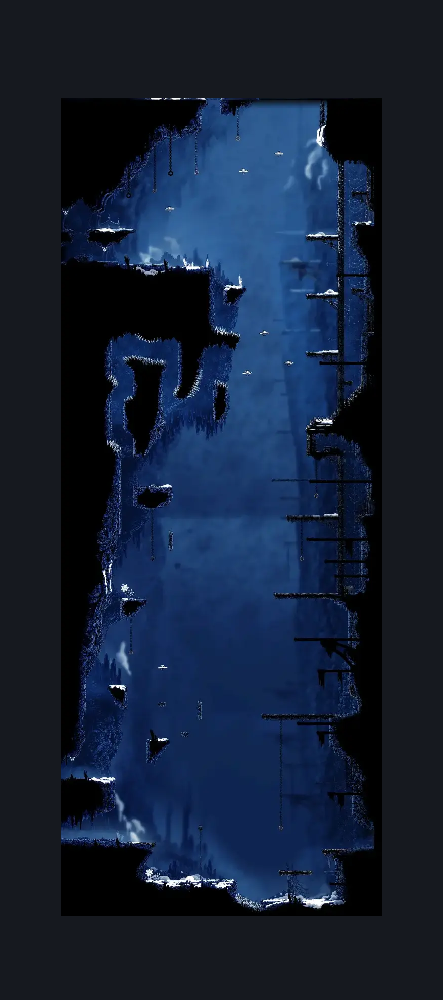

# Mount Fay Entrance (Peak_01)

**Game ID:** Peak_01

**Contributors:** Pyxl

## Subrooms

| No. | Subroom | Annotated |
| --- | --- | --- |
| S1 | Slab Spool Room | ✓ |
| S2 | Slab Side Room Lower | ✓ |
| S3 | Slab Side Room Upper | ✓ |
| S4 | lower Entrance | ✓ |
| S5 | Lower Left Exit | ✓ |
| S6 | Lower Middle Left Exit | ✓ |
| S7 | Upper Middle Left Exit | ✓ |
| S8 | Upper Left Exit | ✓ |
| S9 | Shell Shard Ledge | ✓ |
| S10 | Ceiling Exits | ✓ |

## Room Transitions

| Alias | Name | From subroom | Destination | Destination alias | Requirements | TODO | Verification | Annotated | Notes |
| --- | --- | --- | --- | --- | --- | --- | --- | --- | --- |
| LSR | right3 | Slab Spool Room | [Slab Flea Prison (Slab_13)](../the-slab/slab-flea-prison.md) | L | None |  | Verified | ✓ |  |
| C4 | top4 | Ceiling Exits | [Mount Fay Right Side Middle Room (Peak_07)](mount-fay-right-side-middle-room.md) | F4 | Invalid |  | Verified | ✓ | Just leads to f3 instead of f4 like intended |
| C2 | top2 | Ceiling Exits | [Mount Fay Right Side Middle Room (Peak_07)](mount-fay-right-side-middle-room.md) | F2 | Silk Soar |  | Verified | ✓ |  |
| C3 | top3 | Ceiling Exits | [Mount Fay Right Side Middle Room (Peak_07)](mount-fay-right-side-middle-room.md) | F3 | Silk Soar AND Proficient Movement |  | Verified | ✓ |  |
| UL | left1 | Upper Left Exit | [Mount Fay Shakra (Peak_02)](mount-fay-shakra.md) | UR | None |  | Verified | ✓ |  |
| LL | left4 | Lower Left Exit | [Mount Fay Shakra (Peak_02)](mount-fay-shakra.md) | LR | None |  | Verified | ✓ |  |
| LML | left3 | Lower Middle Left Exit | [Mount Fay Shakra (Peak_02)](mount-fay-shakra.md) | LMR | None |  | Verified | ✓ |  |
| UML | left2 | Upper Middle Left Exit | [Mount Fay Shakra (Peak_02)](mount-fay-shakra.md) | UMR | None |  | Verified | ✓ |  |
| USR | right1 | Slab Side Room Upper | [Slab Arena (Slab_16)](../the-slab/slab-arena.md) | L | None |  | Verified | ✓ |  |
| C1 | top1 | Ceiling Exits | [Mount Fay Right Side Middle Room (Peak_07)](mount-fay-right-side-middle-room.md) | F1 | ( Cling Grip Left AND ( ( Clawline Right AND Clawline Left ) OR ( Faydown Cloak AND DRifters Cloak AND Dash Right ) OR ( Drifters Cloak AND Sharpdart AND ( Proficient Movement AND Spike Pogo ) AND Hard Heal Stall AND Hard Cocoon Skip ) ) AND Easy Pogo off driftlin ) OR Silk Soar |  | Verified | ✓ |  |
| MSR | right2 | Slab Side Room Lower | [Slab Chilly Prison (Slab_15)](../the-slab/slab-chilly-prison.md) | L | None |  | Verified | ✓ |  |
| LR | right4 | lower Entrance | [Slab Bellway (Slab_06)](../the-slab/slab-bellway.md) | L | None |  | Verified | ✓ |  |
| DU | Dummy | Ceiling Exits | [Mount Fay Right Side Middle Room (Peak_07)](mount-fay-right-side-middle-room.md) | F5 | Invalid |  | Verified |  |  |

## Subroom Connections

| Alias | Name | Source | Destination | Requirements | TODO | Verification | Annotated | Notes |
| --- | --- | --- | --- | --- | --- | --- | --- | --- |
| SL | Slab Connection | Slab Side Room Upper | Slab Side Room Lower | None |  | Verified | ✓ |  |
| SL | Slab Connection | Slab Side Room Lower | Slab Side Room Upper | Cling Grip left OR Scuttlebrace OR Silk Soar OR ( Cling Grip Right AND Faydown Cloak ) |  | Verified | ✓ |  |
| LC | Lower Crossing | lower Entrance | Lower Left Exit | Silk Soar OR Clawline Left OR ( Faydown Cloak AND ( Proficient Movement AND Spike Pogo ) AND Hard Heal Stall AND Hard Cocoon Skip AND Ledge Grab left ) OR ( Sharpdart AND Drifters Cloak AND Proficient movement ) |  | Verified | ✓ |  |
| LC | Lower Crossing | Lower Left Exit | lower Entrance | Cling Grip right OR Silk Soar OR Clawline right OR Faydown Cloak OR ( Dash right AND ( Sprint Right OR Drifters Cloak OR Sharpdart OR easy Beast Crest pogo OR Medium Heal Stall ) ) |  | Verified | ✓ |  |
| LL | Lower Ledge | Lower Left Exit | Lower Middle Left Exit | Silk Soar OR ( Faydown Cloak AND ( Cling Grip left OR ( Hard Heal Stall AND Scuttlebrace ) ) ) |  | Verified | ✓ |  |
| LL | Lower Ledge | Lower Middle Left Exit | Lower Left Exit | None |  | Verified | ✓ |  |
| MC | Middle Crossing | Lower Middle Left Exit | Shell Shard Ledge | ( Cling Grip Right AND ( ( Clawline Right OR Drifters Cloak OR ( Faydown Cloak AND ( Dash Right OR Sharpdart ) ) ) OR ( Medium Reaper Crest pogo AND Faydown Cloak AND Clawline Right AND ( Proficient Movement AND Spike Pogo ) ) ) ) |  | Verified | ✓ |  |
| MC | Middle Crossing | Shell Shard Ledge | Lower Middle Left Exit | Clawline Left OR Silk Soar OR Drifters Cloak OR ( Dash Left AND Faydown Cloak ) |  | Verified | ✓ |  |
| SS | Silk Soar Shards | lower Entrance | Shell Shard Ledge | Silk Soar |  | Verified | ✓ |  |
| SS | Silk Soar Shards | Shell Shard Ledge | lower Entrance | None |  | Verified | ✓ |  |
| TA | The Ascent | Lower Middle Left Exit | Upper Middle Left Exit | Silk Soar OR ( ( Cling Grip Both AND ( Clawline Both OR ( Faydown Cloak AND Drifters Cloak ) OR ( Sharpdart AND Drifters Cloak AND Hard Cocoon Skip AND ( Sprint Both OR Have Tool Flintslate ) ) ) ) AND easy pogo off driftlin ) |  | Verified | ✓ |  |
| TA | The Ascent | Upper Middle Left Exit | Lower Middle Left Exit | None |  | Verified | ✓ |  |
| SH | Shortcut | Upper Middle Left Exit | Upper Left Exit | Faydown Cloak OR Silk Soar OR ( complete Breakable Wall - Mount Fay Entrance AND ( Cling Grip Either OR Scuttlebrace OR ( Easy Beast Crest pogo AND Medium Heal Stall AND Ledge Grab Either ) ) ) |  | Verified | ✓ |  |
| SH | Shortcut | Upper Left Exit | Upper Middle Left Exit | None |  | Verified | ✓ |  |
| DR | Drop | Upper Left Exit | Shell Shard Ledge | None |  | Verified | ✓ |  |
| DR | Drop | Shell Shard Ledge | Upper Left Exit | Silk Soar |  | Verified | ✓ |  |
| CE | Celing Exits | Upper Left Exit | Ceiling Exits | ( Cling Grip Left AND ( ( Clawline Right AND Clawline Left ) OR ( Faydown Cloak AND DRifters Cloak AND Dash Right ) OR ( Drifters Cloak AND Sharpdart AND ( Proficient Movement AND Spike Pogo ) AND Hard Heal Stall AND Hard Cocoon Skip ) ) AND Easy Pogo off driftlin ) OR Silk Soar |  | Verified | ✓ |  |
| CE | Celing Exits | Ceiling Exits | Upper Left Exit | dash left OR Faydown Cloak OR Easy Hunter pogo OR ( ( ( ( Hard plasmium stall OR Hard Cross Stitch stall x 5 OR Hard Pale Nails Stall x 5) AND Ledge grab Left ) OR Easy Flea Brew Stall OR Easy VoltVessels Stall ) AND Easy pogo off driftlin ) OR Clawline left OR Drifters Cloak OR Easy Beast pogo OR Medium Architect pogo |  | Verified | ✓ |  |
| FA | Fallin | Ceiling Exits | Upper Middle Left Exit | None |  | Verified | ✓ |  |

## Check Locations

| No. | Check | Subroom | Requirements | TODO | Verification | Location Type | Annotated | Notes |
| --- | --- | --- | --- | --- | --- | --- | --- | --- |
| 1 | Mount Fay - Shell shard cache #1 | Shell Shard Ledge | None |  | Verified | resource | ✓ |  |
| 2 | Mount Fay - Shell shard cache #2 | Shell Shard Ledge | None |  | Verified | resource | ✓ |  |
| 3 | The Slab - Spool Fragment | Slab Spool Room | cling grip Either OR Scuttlebrace OR Silk Soar |  | Verified | collectible | ✓ | Duplicate check name for spool fragment?   the one shown in "Slab flea prison" was a placeholder till i did this room, remove other one if still present - Pyxl |
| 4 | Breakable Wall - Mount Fay Entrance | Upper Left Exit | None |  | Verified | blockade | ✓ |  |
| 5 | Driftlin 1 | Upper Left Exit | ( Cling Grip Left AND ( ( Clawline Right AND Clawline Left ) OR ( Faydown Cloak AND DRifters Cloak AND Dash Right ) OR ( Drifters Cloak AND Sharpdart AND ( Proficient Movement AND Spike Pogo ) AND Hard Heal Stall AND Hard Cocoon Skip ) ) AND Easy Pogo off driftlin ) OR Silk Soar |  | Verified | enemy | ✓ |  |
| 6 | Driftlin 2 | Upper Left Exit | ( Cling Grip Left AND ( ( Clawline Right AND Clawline Left ) OR ( Faydown Cloak AND DRifters Cloak AND Dash Right ) OR ( Drifters Cloak AND Sharpdart AND ( Proficient Movement AND Spike Pogo ) AND Hard Heal Stall AND Hard Cocoon Skip ) ) AND Easy Pogo off driftlin ) OR Silk Soar |  | Verified | enemy | ✓ |  |
| 7 | Driftlin 3 | Upper Left Exit | ( Cling Grip Left AND ( ( Clawline Right AND Clawline Left ) OR ( Faydown Cloak AND DRifters Cloak AND Dash Right ) OR ( Drifters Cloak AND Sharpdart AND ( Proficient Movement AND Spike Pogo ) AND Hard Heal Stall AND Hard Cocoon Skip ) ) AND Easy Pogo off driftlin ) OR Silk Soar |  | Verified | enemy | ✓ |  |
| 8 | Driftlin 4 | Lower Middle Left Exit | Silk Soar OR ( ( Cling Grip Both AND ( Clawline Both OR ( Faydown Cloak AND Drifters Cloak ) OR ( Sharpdart AND Drifters Cloak AND Hard Cocoon Skip AND ( Sprint Both OR Have Tool Flintslate ) ) ) ) AND easy pogo off driftlin ) |  | Verified | enemy | ✓ |  |
| 9 | Driftlin 5 | Lower Middle Left Exit | Silk Soar OR ( ( Cling Grip Both AND ( Clawline Both OR ( Faydown Cloak AND Drifters Cloak ) OR ( Sharpdart AND Drifters Cloak AND Hard Cocoon Skip AND ( Sprint Both OR Have Tool Flintslate ) ) ) ) AND easy pogo off driftlin ) |  | Verified | enemy | ✓ |  |
| 10 | Driftlin 6 | Lower Middle Left Exit | Silk Soar OR ( ( Cling Grip Both AND ( Clawline Both OR ( Faydown Cloak AND Drifters Cloak ) OR ( Sharpdart AND Drifters Cloak AND Hard Cocoon Skip AND ( Sprint Both OR Have Tool Flintslate ) ) ) ) AND easy pogo off driftlin ) |  | Verified | enemy | ✓ |  |
| 11 | Driftlin 7 | Lower Middle Left Exit | Silk Soar OR ( ( Cling Grip Both AND ( Clawline Both OR ( Faydown Cloak AND Drifters Cloak ) OR ( Sharpdart AND Drifters Cloak AND Hard Cocoon Skip AND ( Sprint Both OR Have Tool Flintslate ) ) ) ) AND easy pogo off driftlin ) |  | Verified | enemy | ✓ |  |

## Room Images

### Connections

### Checks

### Scene

