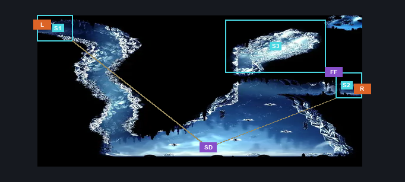
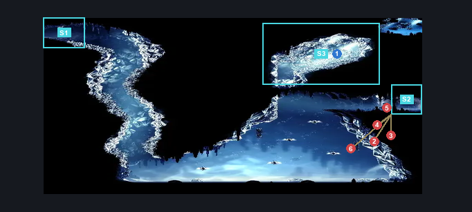
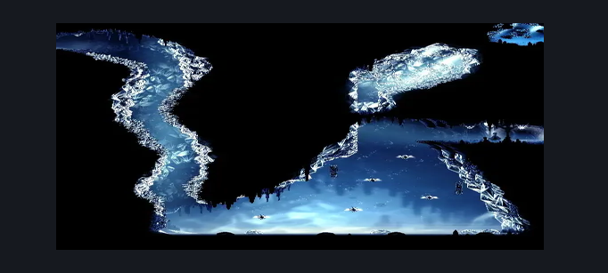

# Mount Fay Frozen Flea (Peak_05c)

**Game ID:** Peak_05c

**Contributors:** Pyxl

## Subrooms

| No. | Subroom | Annotated |
| --- | --- | --- |
| S1 | Upper Left | ✓ |
| S2 | Right Exit | ✓ |
| S3 | Frozen Flea | ✓ |

## Room Transitions

| Alias | Name | From subroom | Destination | Destination alias | Requirements | TODO | Verification | Annotated | Notes |
| --- | --- | --- | --- | --- | --- | --- | --- | --- | --- |
| R | right1 | Right Exit | [Mount Fay Magnetite Outcropping (Peak_05e)](mount-fay-magnetite-outcropping.md) | L | None |  | Verified | ✓ |  |
| L | left2 | Upper Left | [Mount Fay Lower Slope (Peak_05)](mount-fay-lower-slope.md) | R | None |  | Verified | ✓ |  |

## Subroom Connections

| Alias | Name | Source | Destination | Requirements | TODO | Verification | Annotated | Notes |
| --- | --- | --- | --- | --- | --- | --- | --- | --- |
| SD | Spike Drop | Upper Left | Right Exit | Clawline Both AND ( Cling Grip Both OR ( Faydown Cloak AND Ledge Grab Right ) ) AND Easy Pogo Off Mnemonid |  | Verified | ✓ | One Way |
| FF | Frozen Flea | Right Exit | Frozen Flea | Cling Grip Left OR Scuttlebrace |  | Verified | ✓ |  |
| FF | Frozen Flea | Frozen Flea | Right Exit | Cling Grip Left OR Dash Right OR Drifters Cloak OR Faydown Cloak OR Clawline Right OR Sharpdart |  | Verified | ✓ |  |

## Check Locations

| No. | Check | Subroom | Requirements | TODO | Verification | Location Type | Annotated | Notes |
| --- | --- | --- | --- | --- | --- | --- | --- | --- |
| 1 | Flea: Mount Fay | Frozen Flea | None |  | Verified | collectible | ✓ |  |
| 2 | Mnemonid 1 | Right Exit | None |  | Verified | enemy | ✓ |  |
| 3 | Mnemonid 2 | Right Exit | None |  | Verified | enemy | ✓ |  |
| 4 | Mnemonid 3 | Right Exit | None |  | Verified | enemy | ✓ |  |
| 5 | Mnemonid 4 | Right Exit | None |  | Verified | enemy | ✓ |  |
| 6 | Mnemonid 5 | Right Exit | None |  | Verified | enemy | ✓ |  |

## Room Images

### Connections

### Checks

### Scene

