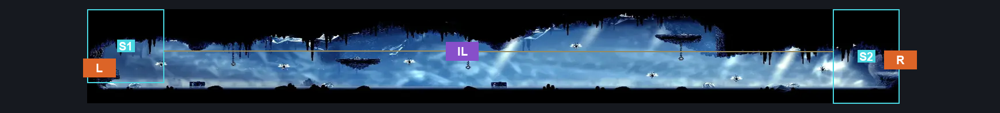
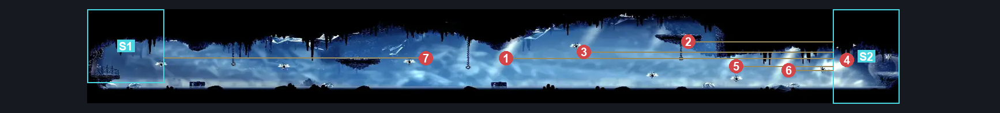
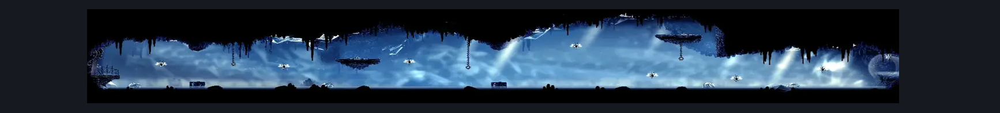

# Mount Fay Ice Lake Platforming Room (Peak_04)

**Game ID:** Peak_04

**Contributors:** Pyxl

## Subrooms

| No. | Subroom | Annotated |
| --- | --- | --- |
| S1 | Left Ledge | ✓ |
| S2 | Right Ledge | ✓ |

## Room Transitions

| Alias | Name | From subroom | Destination | Destination alias | Requirements | TODO | Verification | Annotated | Notes |
| --- | --- | --- | --- | --- | --- | --- | --- | --- | --- |
| L | left1 | Left Ledge | [Mount Fay Bench Toll (Bellway_Peak)](mount-fay-bench-toll.md) | UR | None |  | Verified | ✓ |  |
| R | right1 | Right Ledge | [Mount Fay Large Servitor Hallway (Peak_04d)](mount-fay-large-servitor-hallway.md) | L | None |  | Verified | ✓ |  |

## Subroom Connections

| Alias | Name | Source | Destination | Requirements | TODO | Verification | Annotated | Notes |
| --- | --- | --- | --- | --- | --- | --- | --- | --- |
| IL | Ice Lake | Left Ledge | Right Ledge | ( Clawline Left AND ( Swim OR Faydown Cloak OR Drifters Cloak OR Cling Grip Left ) ) AND easy Pogo off mnemonid |  | Verified | ✓ |  |
| IL | Ice Lake | Right Ledge | Left Ledge | ( Clawline Right AND ( Swim OR Faydown Cloak OR Drifters Cloak OR Cling Grip Right ) ) AND easy Pogo OFF Mnemonid |  | Verified | ✓ | ( Clawline Right AND ( Swim OR Faydown Cloak OR Drifters Cloak OR Cling Grip Right ) ) AND easy Pogo off mnemonid |

## Check Locations

| No. | Check | Subroom | Requirements | TODO | Verification | Location Type | Annotated | Notes |
| --- | --- | --- | --- | --- | --- | --- | --- | --- |
| 1 | Mnemonid 1 | Right Ledge | ( Clawline Right AND ( Swim OR Faydown Cloak OR Drifters Cloak OR Cling Grip Right ) ) AND easy Pogo OFF Mnemonid |  | Verified | enemy | ✓ |  |
| 2 | Mnemonid 2 | Right Ledge | ( Clawline Right AND ( Swim OR Faydown Cloak OR Drifters Cloak OR Cling Grip Right ) ) AND easy Pogo OFF Mnemonid |  | Verified | enemy | ✓ |  |
| 3 | Mnemonid 3 | Right Ledge | ( Clawline Right AND ( Swim OR Faydown Cloak OR Drifters Cloak OR Cling Grip Right ) ) AND easy Pogo OFF Mnemonid |  | Verified | enemy | ✓ |  |
| 4 | Mnemonid 4 | Right Ledge | ( Clawline Right AND ( Swim OR Faydown Cloak OR Drifters Cloak OR Cling Grip Right ) ) AND easy Pogo OFF Mnemonid |  | Verified | enemy | ✓ |  |
| 5 | Mnemonid 5 | Right Ledge | ( Clawline Right AND ( Swim OR Faydown Cloak OR Drifters Cloak OR Cling Grip Right ) ) AND easy Pogo OFF Mnemonid |  | Verified | enemy | ✓ |  |
| 6 | Mnemonid 6 | Right Ledge | ( Clawline Right AND ( Swim OR Faydown Cloak OR Drifters Cloak OR Cling Grip Right ) ) AND easy Pogo OFF Mnemonid |  | Verified | enemy | ✓ |  |
| 7 | Mnemonid 7 | Left Ledge | ( Clawline Left AND ( Swim OR Faydown Cloak OR Drifters Cloak OR Cling Grip Left ) ) AND easy Pogo off mnemonid |  | Verified | enemy | ✓ |  |

## Room Images

### Connections

### Checks

### Scene

