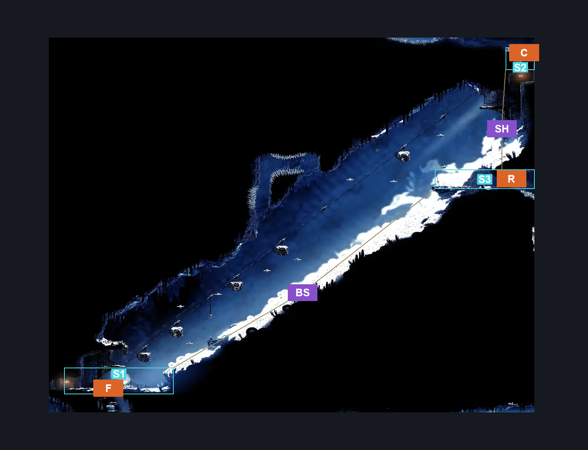
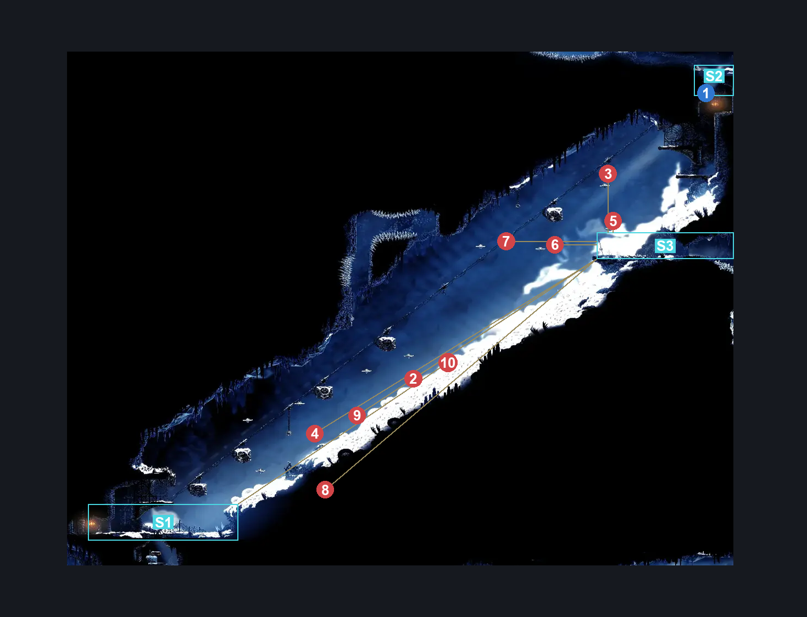
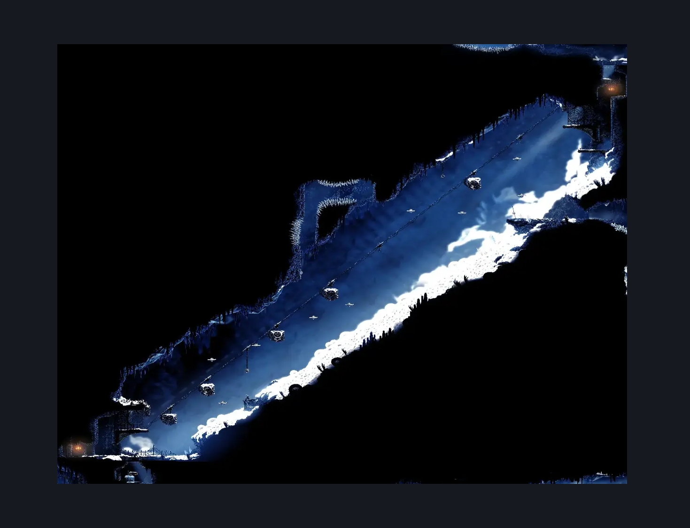

# Mount Fay Lower Slope (Peak_05)

**Game ID:** Peak_05

**Contributors:** Pyxl

## Subrooms

| No. | Subroom | Annotated |
| --- | --- | --- |
| S1 | Bottom | ✓ |
| S2 | Ceiling Area | ✓ |
| S3 | Right Exit | ✓ |

## Room Transitions

| Alias | Name | From subroom | Destination | Destination alias | Requirements | TODO | Verification | Annotated | Notes |
| --- | --- | --- | --- | --- | --- | --- | --- | --- | --- |
| C | top2 | Ceiling Area | [Mount Fay Upper Slope (Peak_08)](mount-fay-upper-slope.md) | F | None |  | Verified | ✓ |  |
| F | bot1 | Bottom | [Mount Fay Bench Toll (Bellway_Peak)](mount-fay-bench-toll.md) | C | None |  | Verified | ✓ |  |
| R | right3 | Right Exit | [Mount Fay Frozen Flea (Peak_05c)](mount-fay-frozen-flea.md) | L | None |  | Verified | ✓ |  |

## Subroom Connections

| Alias | Name | Source | Destination | Requirements | TODO | Verification | Annotated | Notes |
| --- | --- | --- | --- | --- | --- | --- | --- | --- |
| SH | Shaft | Ceiling Area | Right Exit | Complete Mount Fay Slope Lever |  | Verified | ✓ |  |
| SH | Shaft | Right Exit | Ceiling Area | Complete Mount Fay Slope Lever AND ( ( Faydown Cloak AND Drifters Cloak AND Cling Grip Either AND Sharpdart ) OR Silk Soar OR ( Clawline Both AND Faydown Cloak AND Cling Grip Either ) ) |  | Verified | ✓ |  |
| BS | Big Slope | Right Exit | Bottom | None |  | Verified | ✓ |  |
| BS | Big Slope | Bottom | Right Exit | Faydown Cloak OR ( Cling Grip Both AND Clawline Right ) |  | Verified | ✓ |  |

## Check Locations

| No. | Check | Subroom | Requirements | TODO | Verification | Location Type | Annotated | Notes |
| --- | --- | --- | --- | --- | --- | --- | --- | --- |
| 1 | Mount Fay Slope Lever | Ceiling Area | None |  | Verified | switch | ✓ |  |
| 2 | Driftlin 1 | Right Exit | None |  | Verified | enemy | ✓ |  |
| 3 | Driftlin 2 | Right Exit | Faydown Cloak |  | Verified | enemy | ✓ |  |
| 4 | Driftlin 3 | Right Exit | None |  | Verified | enemy | ✓ |  |
| 5 | Driftlin 4 | Right Exit | Faydown Cloak |  | Verified | enemy | ✓ |  |
| 6 | Driftlin 5 | Right Exit | None |  | Verified | enemy | ✓ |  |
| 7 | Driftlin 6 | Right Exit | None |  | Verified | enemy | ✓ |  |
| 8 | Driftlin 7 | Right Exit | None |  | Verified | enemy | ✓ |  |
| 9 | Driftlin 8 | Right Exit | None |  | Verified | enemy | ✓ |  |
| 10 | Driftlin 9 | Bottom | Faydown Cloak OR ( Cling Grip Both AND Clawline Right ) |  | Verified | enemy | ✓ |  |

## Room Images

### Connections

### Checks

### Scene

