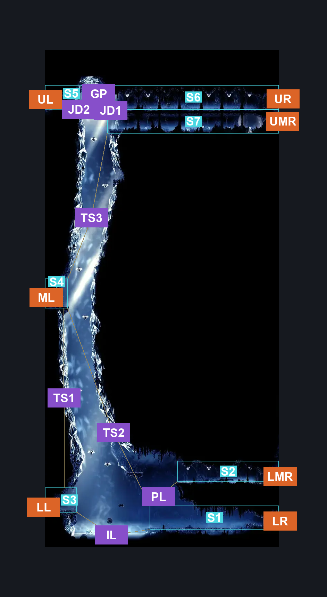
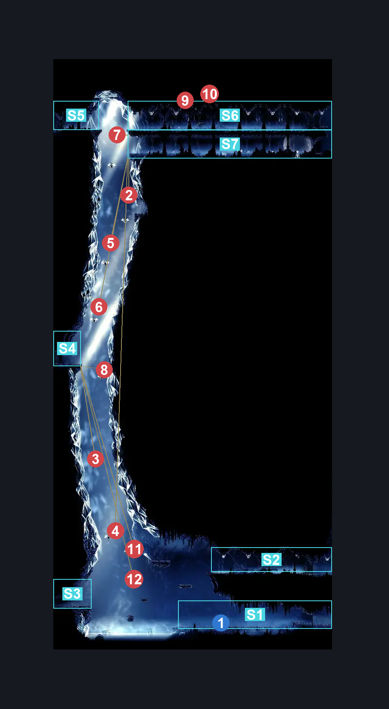
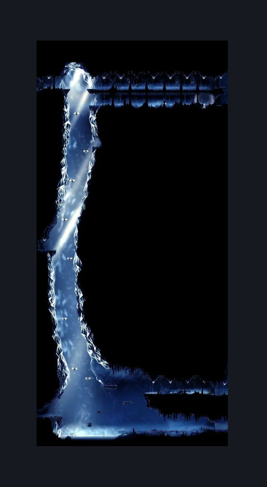

# Mount Fay Shakra (Peak_02)

**Game ID:** Peak_02

**Contributors:** Pyxl

## Subrooms

| No. | Subroom | Annotated |
| --- | --- | --- |
| S1 | Shakra | ✓ |
| S2 | Lower Middle Hallway | ✓ |
| S3 | Lower Left Ledge | ✓ |
| S4 | Middle Left Ledge | ✓ |
| S5 | Upper Left Ledge | ✓ |
| S6 | Upper Hallway | ✓ |
| S7 | Upper Middle Hallway | ✓ |

## Room Transitions

| Alias | Name | From subroom | Destination | Destination alias | Requirements | TODO | Verification | Annotated | Notes |
| --- | --- | --- | --- | --- | --- | --- | --- | --- | --- |
| LR | right3 | Shakra | [Mount Fay Entrance (Peak_01)](mount-fay-entrance.md) | LL | None |  | Verified | ✓ |  |
| UR | right4 | Upper Hallway | [Mount Fay Entrance (Peak_01)](mount-fay-entrance.md) | UL | None |  | Verified | ✓ |  |
| ML | left1 | Middle Left Ledge | [Mount Fay Large Servitor Hallway (Peak_04d)](mount-fay-large-servitor-hallway.md) | R | None |  | Verified | ✓ |  |
| LL | left2 | Lower Left Ledge | [Mount Fay Lore Room (Peak_10)](mount-fay-lore-room.md) | R | None |  | Verified | ✓ |  |
| UMR | right1 | Upper Middle Hallway | [Mount Fay Entrance (Peak_01)](mount-fay-entrance.md) | UML | None |  | Verified | ✓ |  |
| LMR | right2 | Lower Middle Hallway | [Mount Fay Entrance (Peak_01)](mount-fay-entrance.md) | LML | None |  | Verified | ✓ |  |
| UL | left3 | Upper Left Ledge | [Mount Fay Magnetite Outcropping (Peak_05e)](mount-fay-magnetite-outcropping.md) | LR | None |  | Verified | ✓ |  |

## Subroom Connections

| Alias | Name | Source | Destination | Requirements | TODO | Verification | Annotated | Notes |
| --- | --- | --- | --- | --- | --- | --- | --- | --- |
| IL | Ice Lake | Shakra | Lower Left Ledge | Faydown Cloak OR Clawline Left OR ( Sharpdart AND Proficient Movement ) OR ( Easy Heal Stall AND Cling Grip Left AND Swim ) OR ( Dash left AND Drifters Cloak ) |  | Verified | ✓ |  |
| IL | Ice Lake | Lower Left Ledge | Shakra | Dash Right OR Sprint Right OR Swim OR Drifters Cloak OR Faydown Cloak OR Clawline Right OR Sharpdart |  | Verified | ✓ |  |
| PL | Platforms | Shakra | Lower Middle Hallway | Faydown Cloak OR ( Clawline Both AND ( Dash Left OR Ledge Grab Left OR Drifters Cloak ) ) OR Silk Soar |  | Verified | ✓ |  |
| PL | Platforms | Lower Middle Hallway | Shakra | None |  | Verified | ✓ |  |
| TS1 | Tall Shaft 1 | Middle Left Ledge | Lower Left Ledge | None |  | Verified | ✓ |  |
| TS2 | Tall Shaft 2 | Middle Left Ledge | Shakra | None |  | Verified | ✓ |  |
| TS3 | Tall Shaft 3 | Upper Middle Hallway | Middle Left Ledge | None |  | Verified | ✓ |  |
| JD1 | Jump Down 1 | Upper Hallway | Upper Middle Hallway | None |  | Verified | ✓ |  |
| JD1 | Jump Down 1 | Upper Middle Hallway | Upper Hallway | Faydown Cloak |  | Verified | ✓ |  |
| JD2 | Jump Down 2 | Upper Left Ledge | Upper Middle Hallway | None |  | Verified | ✓ |  |
| JD2 | Jump Down 2 | Upper Middle Hallway | Upper Left Ledge | Faydown Cloak |  | Verified | ✓ |  |
| GP | Gap | Upper Left Ledge | Upper Hallway | Sprint Right OR Dash Right OR Drifters Cloak OR Faydown Cloak OR Clawline Right OR Sharpdart OR Easy Hunter Crest Pogo OR Easy Beast Crest pogo OR Easy Architect Crest pogo OR ( Ledge Grab Right AND ( Easy Reaper Crest Pogo OR ( Easy Wanderer Crest Pogo AND Easy needle strike ) OR Easy Witch Crest Pogo OR Easy Shaman Crest Pogo ) ) OR Easy Scuttlebrace |  | Verified | ✓ |  |
| GP | Gap | Upper Hallway | Upper Left Ledge | Sprint Left OR Dash Left OR Drifters Cloak OR Faydown Cloak OR Clawline Left OR Sharpdart OR Easy Hunter Crest Pogo OR Easy Beast Crest pogo OR Easy Architect Crest pogo OR ( Ledge Grab Left AND ( Easy Reaper Crest Pogo OR ( Easy Wanderer Crest Pogo AND Easy needle strike ) OR Easy Witch Crest Pogo OR Easy Shaman Crest Pogo ) ) OR Easy Scuttlebrace |  | Verified | ✓ |  |

## Check Locations

| No. | Check | Subroom | Requirements | TODO | Verification | Location Type | Annotated | Notes |
| --- | --- | --- | --- | --- | --- | --- | --- | --- |
| 1 | Mount Fay - Map Purchase | Shakra | None |  | Verified | collectible | ✓ |  |
| 2 | Mnemonid 1 | Upper Middle Hallway | None |  | Verified | enemy | ✓ |  |
| 3 | Mnemonid 2 | Middle Left Ledge | None |  | Verified | enemy | ✓ |  |
| 4 | Mnemonid 3 | Upper Middle Hallway | None |  | Verified | enemy | ✓ |  |
| 5 | Mnemonid 4 | Upper Middle Hallway | None |  | Verified | enemy | ✓ |  |
| 6 | Mnemonid 5 | Upper Middle Hallway | None |  | Verified | enemy | ✓ |  |
| 7 | Mnemonid 6 | Upper Middle Hallway | None |  | Verified | enemy | ✓ |  |
| 8 | Mnemonid 7 | Middle Left Ledge | None |  | Verified | enemy | ✓ |  |
| 9 | Weaver Servitor Broken 1 | Upper Hallway | None |  | Verified | enemy | ✓ |  |
| 10 | Servitor Boran 1 | Upper Hallway | None |  | Verified | enemy | ✓ |  |
| 11 | Mnemonid 8 | Middle Left Ledge | Normal World Spawn |  | Verified | enemy | ✓ |  |
| 12 | Mnemonid 9 | Middle Left Ledge | Black Thread World Spawn |  | Verified | enemy | ✓ |  |

## Room Images

### Connections

### Checks

### Scene

