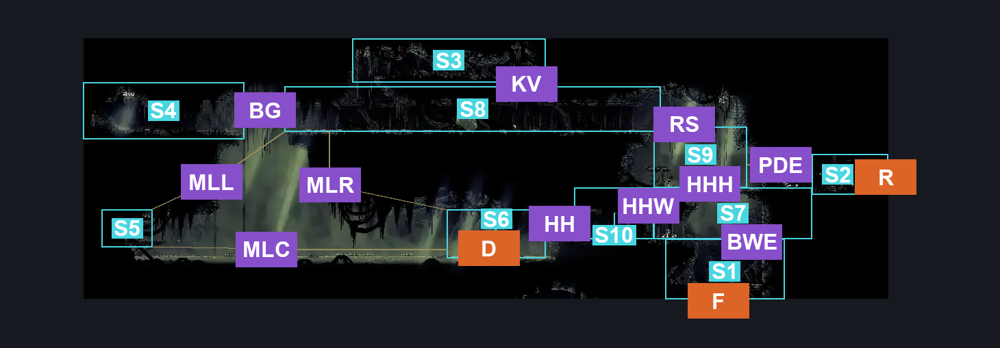
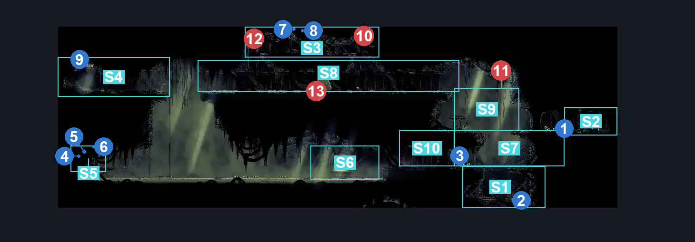
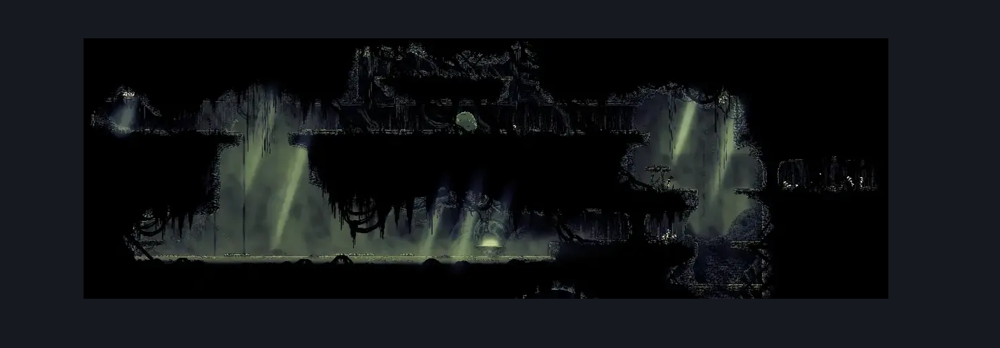

# Putrified Ducts Connection To Bilewater (Aqueduct_04)

**Game ID:** Aqueduct_04

**Contributors:** Pyxl

## Subrooms

| No. | Subroom | Annotated |
| --- | --- | --- |
| S1 | Bilewater Entrance | ✓ |
| S2 | Putrified Ducts Entrance | ✓ |
| S3 | Shell Shard Platform | ✓ |
| S4 | Apostate Key Area | ✓ |
| S5 | Lower Shell Ledge | ✓ |
| S6 | Hut Door | ✓ |
| S7 | Hub Area | ✓ |
| S8 | Upper Platform | ✓ |
| S9 | Upper Hub Zone | ✓ |
| S10 | Hutledge | ✓ |

## Room Transitions

| Alias | Name | From subroom | Destination | Destination alias | Requirements | TODO | Verification | Annotated | Notes |
| --- | --- | --- | --- | --- | --- | --- | --- | --- | --- |
| R | right1 | Putrified Ducts Entrance | [Putrified Ducts Tall Room (Aqueduct_02)](putrified-ducts-tall-room.md) | LL | None |  | Verified | ✓ |  |
| D | door1 | Hut Door | [Huntress (Room_Huntress)](huntress.md) | L | None |  | Verified | ✓ |  |
| F | bot1 | Bilewater Entrance | [Bilewater Upper Bloatroach Tower (Shadow_01)](../bilewater/bilewater-upper-bloatroach-tower.md) | C | None |  | Verified | ✓ |  |

## Subroom Connections

| Alias | Name | Source | Destination | Requirements | TODO | Verification | Annotated | Notes |
| --- | --- | --- | --- | --- | --- | --- | --- | --- |
| PDE | Putrified Ducts Entrance | Putrified Ducts Entrance | Upper Hub Zone | prereq Breakable wall from Ducts |  | Verified | ✓ |  |
| PDE | Putrified Ducts Entrance | Upper Hub Zone | Putrified Ducts Entrance | prereq Breakable wall from Ducts |  | Verified | ✓ |  |
| BWE | Bilewater Entrance | Bilewater Entrance | Hub Area | prereq Breakable Floor From Bilewater AND ( Silk Soar OR Cling Grip Left OR Faydown Cloak ) |  | Verified | ✓ |  |
| BWE | Bilewater Entrance | Hub Area | Bilewater Entrance | prereq Breakable Floor From Bilewater |  | Verified | ✓ |  |
| RS | Right Steps | Upper Hub Zone | Upper Platform | Silk Soar OR Cling Grip Left OR Faydown Cloak OR Scuttlebrace OR ( intended pogo off barnak AND ( Clawline Left x 2 OR sharpdart x 2 ) ) |  | Verified | ✓ |  |
| RS | Right Steps | Upper Platform | Upper Hub Zone | None |  | Verified | ✓ |  |
| KV | Kidnap Vines | Upper Platform | Shell Shard Platform | intended pogo off barnak OR Silk Soar OR ( Faydown Cloak AND ( CLing Grip Left OR Scuttlebrace ) ) |  | Verified | ✓ |  |
| KV | Kidnap Vines | Shell Shard Platform | Upper Platform | None |  | Verified | ✓ |  |
| BG | Gap Slightly too big to jump across | Upper Platform | Apostate Key Area | Dash left OR Sprint Left OR Drifters Cloak OR Faydown Cloak OR Clawline Left OR Sharpdart OR Easy Shaman Scuttle slide OR Easy Beast Pogo OR Easy Hunter Pogo OR Easy wanderer charge OR Easy Beast Charge OR Easy Witch Charge OR Easy Architect pogo OR Easy Voltvessels stall OR Medium Flintslate stall OR Flea brew jump OR Easy Flea brew stall OR Easy Plasmium stall OR Easy thread storm stall OR Medium cross stitch stall OR ( ( Ledge grab left OR Cling grip left ) AND ( CLing grip Right OR easy Pale nails stall ) ) |  | Verified | ✓ |  |
| BG | Gap Slightly too big to jump across | Apostate Key Area | Upper Platform | Dash Right OR Sprint Right OR Drifters Cloak OR Faydown Cloak OR Clawline Right OR Sharpdart OR Easy Shaman Scuttle slide OR Easy Beast Pogo OR Easy Hunter Pogo OR Easy wanderer charge OR Easy Beast Charge OR Easy Witch Charge OR Easy Architect pogo OR Easy Voltvessels stall OR Medium Flintslate stall OR Flea brew jump OR Easy Flea brew stall OR Easy Plasmium stall OR Easy thread storm stall OR Medium cross stitch stall OR ( ( Ledge grab Right OR Cling grip Right ) AND ( CLing grip Left OR easy Pale nails stall ) ) |  | Verified | ✓ |  |
| MLL | Maggot Lake Left | Upper Platform | Lower Shell Ledge | Clawline Left OR Sprint Left OR Sharpdart OR ( Drifters  Cloak AND ( Faydown Cloak OR Dash Left OR Ledge grab Left OR Cling Grip Left OR Easy Heal Stall OR Easy Rune Rage Stall OR Easy Thread Storm Stall OR Easy Cross stitch stall OR Easy Pale Nails Stall OR Easy Flea Brew Stall OR Flea Brew jump OR Easy VoltVessels Stall OR Easy Plasmium stall OR Easy Flintslate Stall OR Easy Delvers Drill Stall OR Hard Wanderer Charge OR Easy Beast Pogo OR Architect attack left OR Easy shaman pogo ) ) OR ( Swim AND ( Ledge Grab Left OR Easy Delvers drill stall OR Easy plasmium stall OR Easy Shaman Pogo OR ( Easy Beast pogo AND Easy Heal Stall ) ) ) OR ( flea brew jump AND Hard flea brew stall AND Hard flintslate stall AND Hard voltvessels stall ) |  | Verified | ✓ |  |
| MLL | Maggot Lake Left | Lower Shell Ledge | Upper Platform | Cling Grip Left AND Clawline Right AND Faydown Cloak |  | Verified | ✓ |  |
| MLR | Maggot Lake Right | Upper Platform | Hut Door | Drifters Cloak OR Faydown Cloak OR Swim OR Clawline right OR Sharpdart OR ( ( Sprint Right OR Flea brew jump ) AND ( Dash Right OR Easy Flea Brew Stall OR Easy Voltvessels stall OR Easy Plasmium Stall OR Easy beast pogo ) ) OR Easy Shaman Scuttle slide |  | Verified | ✓ |  |
| MLC | Maggot Lake Centre | Lower Shell Ledge | Hut Door | Clawline RIght OR Swim OR ( Faydown Cloak AND Drifters Cloak ) OR ( Sprint AND Drifters Cloak ) |  | Verified | ✓ |  |
| MLC | Maggot Lake Centre | Hut Door | Lower Shell Ledge | Clawline Left OR ( Swim AND ( Ledge Grab Left OR Easy Delvers drill stall OR Easy plasmium stall OR Easy Shaman Pogo OR ( Easy Beast pogo AND Easy Heal Stall ) ) )  OR ( Faydown Cloak AND Drifters Cloak ) OR ( Sprint AND Drifters Cloak ) |  | Verified | ✓ |  |
| HH | Hut to HUB | Hut Door | Hutledge | Faydown Cloak OR Sprint Right OR Dash Right OR Drifters Cloak OR Clawline Right OR Sharpdart OR Cling grip both OR Easy Cross stitch stall OR medium pale nails stall OR flea brew jump OR Easy Voltvessels stall OR Easy flintslate stall OR Easy Plasmium stall OR Easy beast pogo |  | Verified | ✓ |  |
| HH | Hut to HUB | Hutledge | Hut Door | Swim OR Sprint left OR Dash Left OR Drifters Cloak OR Faydown Cloak OR Clawline Left OR Sharpdart OR easy Hunter Crest pogo OR easy Beast Crest pogo OR easy Architect Crest pogo OR ( easy Wanderer charge AND Ledge Grab left ) OR Easy Plasmium stall OR Easy Flintslate stall OR Easy Flea brew stall OR Flea Brew jump OR Easy Voltvessels stall OR Easy Thread storm stall OR Easy Cross stitch stall OR medium pale nails stall |  | Verified | ✓ |  |
| HHW | HutHub | Hutledge | Hub Area | Prereq Breakable Wall From Hut Door |  | Verified | ✓ |  |
| HHW | HutHub | Hub Area | Hutledge | Prereq Breakable Wall From Hut Door |  | Verified | ✓ |  |
| HHH | Hubhub | Hub Area | Upper Hub Zone | Silk Soar OR ( Faydown Cloak AND ( Scuttlebrace OR Cling grip Either ) ) OR ( Cling grip Both AND Clawline left ) |  | Verified | ✓ |  |
| HHH | Hubhub | Upper Hub Zone | Hub Area | None |  | Verified | ✓ |  |

## Check Locations

| No. | Check | Subroom | Requirements | TODO | Verification | Location Type | Annotated | Notes |
| --- | --- | --- | --- | --- | --- | --- | --- | --- |
| 1 | Breakable Wall From Ducts | Putrified Ducts Entrance | None |  | Verified | blockade | ✓ |  |
| 2 | Breakable Floor From Bilewater | Bilewater Entrance | None |  | Verified | blockade | ✓ |  |
| 3 | Breakable Wall From Hut Door | Hutledge | None |  | Verified | blockade | ✓ |  |
| 4 | Putrified Ducts - Shell Shard Cache #3 | Lower Shell Ledge | None |  | Verified | resource | ✓ |  |
| 5 | Putrified Ducts - Shell Shard Cache #4 | Lower Shell Ledge | None |  | Verified | resource | ✓ |  |
| 6 | Putrified Ducts - Shell Shard Cache #5 | Lower Shell Ledge | None |  | Verified | resource | ✓ |  |
| 7 | Putrified Ducts - Shell Shard Cache #6 | Shell Shard Platform | None |  | Verified | resource | ✓ |  |
| 8 | Putrified Ducts - Shell Shard Cache #7 | Shell Shard Platform | None |  | Verified | resource | ✓ |  |
| 9 | Key of Apostate | Apostate Key Area | None |  | Verified | collectible | ✓ |  |
| 10 | Barnak 1 | Shell Shard Platform | None |  | Verified | enemy | ✓ |  |
| 11 | Barnak 2 | Upper Hub Zone | None |  | Verified | enemy | ✓ |  |
| 12 | Barnak 3 | Shell Shard Platform | None |  | Verified | enemy | ✓ |  |
| 13 | Ductsucker 1 | Upper Platform | None |  | Verified | enemy | ✓ |  |

## Room Images

### Connections

### Checks

### Scene

