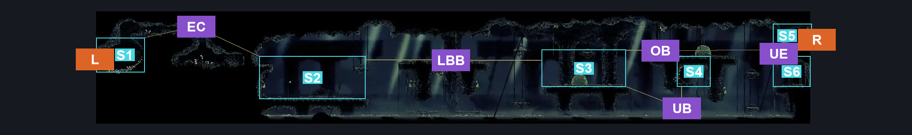
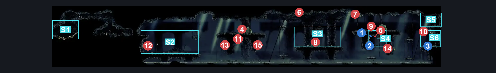
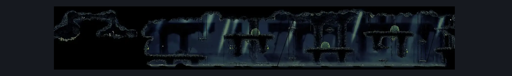

# Putrified Ducts Entrance (Aqueduct_01)

**Game ID:** Aqueduct_01

**Contributors:** Pyxl

## Subrooms

| No. | Subroom | Annotated |
| --- | --- | --- |
| S1 | Entrance | ✓ |
| S2 | Left Platform | ✓ |
| S3 | Centre Platform | ✓ |
| S4 | Shell Shards bridge | ✓ |
| S5 | Exit | ✓ |
| S6 | Rosary String Ledge | ✓ |

## Room Transitions

| Alias | Name | From subroom | Destination | Destination alias | Requirements | TODO | Verification | Annotated | Notes |
| --- | --- | --- | --- | --- | --- | --- | --- | --- | --- |
| R | right1 | Exit | [Putrified Ducts Tall Room (Aqueduct_02)](putrified-ducts-tall-room.md) | UL | None |  | Verified | ✓ |  |
| L | left1 | Entrance | [Shopkeeper Hides (Arborium_11)](../memorium/shopkeeper-hides.md) | R | None |  | Verified | ✓ |  |

## Subroom Connections

| Alias | Name | Source | Destination | Requirements | TODO | Verification | Annotated | Notes |
| --- | --- | --- | --- | --- | --- | --- | --- | --- |
| EC | Entrance Cave | Entrance | Left Platform | Faydown Cloak AND ( CLing Grip Left OR ( Cling Grip Right AND ( Proficient movement OR Easy Flea Brew Stall OR Easy Heal Stall OR Easy Thread Storm Stall OR Medium Rune Rage Stall ) ) OR Scuttlebrace ) |  | Verified | ✓ |  |
| EC | Entrance Cave | Left Platform | Entrance | ( ( Faydown Cloak OR easy Heal Stall OR Easy Shaman Pogo OR Easy Rune rage stall OR Silk Soar ) AND ( Cling Grip Left OR Cling Grip Right ) AND ( Sharpdart OR Faydown Cloak OR Drifters Cloak OR Dash Left OR Clawline Left OR Easy Plasmium Stall OR Easy Voltvessels stall OR Easy Flintslate stall OR Medium Flea Brew Stall OR Easy Beast pogo OR Easy Architect pogo OR ( Dash right AND Scuttlebrace ) OR ( Ledge Grab Left AND ( easy Hunter Pogo OR easy Cross stitch Stall ) ) ) ) |  | Verified | ✓ |  |
| LBB | Left Broken Bridge | Left Platform | Centre Platform | Faydown Cloak OR ( ( Ledge Grab Right OR Cling grip Right OR Easy Beast Charge ) AND ( Easy Flea Brew Stall OR Easy Voltvessels stall OR Sprint Right OR Dash Right OR Easy Beast pogo OR Swim OR Sharpdart OR Clawline Right ) ) OR ( Easy Flea brew stall AND ( Easy Plasmium Stall OR Easy Voltvessels Stall ) ) OR ( Silk Soar AND ( Easy Flea Brew Stall OR Easy Plasmium Stall OR Medium Voltvessels stall OR Easy Flintslate stall OR Easy thread storm stall OR Easy Cross stitch stall OR Easy Rune Rage Stall OR Easy Pale Nails Stall OR Medium Heal Stall OR Sharpdart OR Dash Right OR Drifters Cloak OR Clawline Right OR Sprint Right OR Easy Hunter Pogo OR ( Ledge Grab Right AND Easy Reaper Pogo ) OR Hard Reaper Pogo OR Easy Beast Pogo OR Easy Architect Pogo OR ( Easy shaman pogo AND easy Scuttlebrace ) ) ) OR ( Hard Shaman pogo AND Medium Scuttlebrace ) |  | Verified | ✓ |  |
| LBB | Left Broken Bridge | Centre Platform | Left Platform | Faydown Cloak OR Clawline left OR Sprint Left OR ( Intended pogo off barnak AND Drifters Cloak ) OR Silk Soar OR ( Cling Grip Right AND ( Dash Left OR Drifters Cloak OR Easy Plasmium Stall OR Easy Voltvessels Stall OR Easy Flea Brew Stall ) ) |  | Verified | ✓ |  |
| UB | Under The Bridge | Centre Platform | Shell Shards bridge | Faydown Cloak OR ( ( Swim OR Easy Voltvessels stall OR Medium Flea Brew Stall OR ( Ledge Grab Right AND ( easy Flintslate Stall OR Medium Cross stitch stall OR Hard Pale Nails Stall ) ) OR Easy Plasmium Stall OR Easy beast pogo OR ( Easy Reaper pogo AND Easy Flintslate stall ) OR ( Easy Architect pogo AND Architect attack Right ) OR Dash Right OR Drifters cloak OR Clawline Right OR Sharpdart ) AND ( cling grip right OR Medium Scuttlebrace OR ( Intended pogo off barnak AND ( Ledge grab left OR Dash Left OR Clawline Left OR Drifters Cloak OR Sharpdart OR Hard hunter pogo OR Medium Flintslate stall OR Easy voltvessels stall OR Easy Beast Pogo OR Easy Plasmium stall OR Easy flea brew stall OR architect attack left OR Easy Architect pogo OR Easy shaman pogo ) ) ) ) |  | Verified | ✓ |  |
| UB | Under The Bridge | Shell Shards bridge | Centre Platform | ( Faydown Cloak AND ( Cling grip right OR Clawline Left OR Sharpdart OR Drifters Cloak OR Medium Beast pogo OR Easy Flea Brew stall OR ( ( Ledge grab left OR Cling grip left ) AND Easy Plasmium Stall ) OR ( Cling grip Left AND ( Dash left OR Swim OR Hard flintslate stall OR Hard Cross stitch stall OR Easy Voltvessels stall ) ) ) ) OR ( Swim AND Cling Grip right AND ( Ledge grab Left OR Cling Grip left ) ) |  | Verified | ✓ |  |
| OB | Over The Bridge | Centre Platform | Exit | Silk Soar OR ( intended pogo off barnak AND ( Clawline Right OR Sharpdart OR Drifters Cloak ) ) OR ( Faydown Cloak AND ( Cling grip right OR Ledge Grab Right ) ) |  | Verified | ✓ |  |
| OB | Over The Bridge | Exit | Centre Platform | Dash Left OR Faydown Cloak OR Sprint Left OR Drifters Cloak OR Cling Grip left OR Silk Soar OR Clawline Left OR Sharpdart OR Ledge grab Left OR Easy Flea brew stall OR Easy Voltvessels stall OR Hard thread storm stall OR hard Cross stitch stall OR Medium Flintslate stall OR Easy Rune Rage stall OR Easy plasmium stall OR hard Pale nails stall OR Easy Beast Pogo OR Easy Shaman Pogo OR Easy architect pogo |  | Verified | ✓ |  |
| UE | Under The Exit | Exit | Rosary String Ledge | None |  | Verified | ✓ |  |
| UE | Under The Exit | Rosary String Ledge | Exit | Faydown Cloak OR Silk Soar OR ( ( Ledge grab Left OR Cling grip Left OR Easy Plasmium stall OR Hard thread storm stall OR Easy rune rage stall OR Easy heal stall ) AND ( Clawline Right OR Drifters cloak OR Sharpdart OR Sprint Right OR Hard beast charge ) ) |  | Verified | ✓ |  |

## Check Locations

| No. | Check | Subroom | Requirements | TODO | Verification | Location Type | Annotated | Notes |
| --- | --- | --- | --- | --- | --- | --- | --- | --- |
| 1 | Putrified Ducts - Shell Shard Cache #1 | Shell Shards bridge | None |  | Verified | resource | ✓ | Merge Map icons on map |
| 2 | Putrified Ducts - Shell Shard Cache #2 | Shell Shards bridge | None |  | Verified | resource | ✓ | Merge Map icons on map |
| 3 | Putrified Ducts - Frayed Rosary String | Rosary String Ledge | None |  | Verified | collectible | ✓ |  |
| 4 | Breakable Wall Ducts entrance Start | Entrance | Needle Left OR Needle Up OR Needle Down |  | Verified | blockade | ✓ |  |
| 5 | Ductsucker 1 | Centre Platform | Faydown Cloak OR Clawline left OR Sprint Left OR ( intended pogo off barnak AND Drifters Cloak ) OR Silk Soar OR ( Cling Grip Right AND ( Dash Left OR Drifters Cloak OR Easy Plasmium Stall OR Easy Voltvessels Stall OR Easy Flea Brew Stall ) ) |  | Verified | enemy | ✓ |  |
| 6 | Barnak 1 | Shell Shards bridge | None |  | Verified | enemy | ✓ |  |
| 7 | Barnak 2 | Centre Platform | None |  | Verified | enemy | ✓ |  |
| 8 | Barnak 3 | Centre Platform | None |  | Verified | enemy | ✓ |  |
| 9 | Ductsucker 2 | Centre Platform | None |  | Verified | enemy | ✓ |  |
| 10 | Ductsucker 3 | Exit | None |  | Verified | enemy | ✓ |  |
| 11 | Barnak 4 | Rosary String Ledge | None |  | Verified | enemy | ✓ |  |
| 12 | Barnak 5 | Centre Platform | None |  | Verified | enemy | ✓ |  |
| 13 | Spit Squit 1 | Left Platform | None |  | Verified | enemy | ✓ |  |
| 14 | Spit Squit 2 | Left Platform | None |  | Verified | enemy | ✓ |  |
| 15 | Spit Squit 3 | Rosary String Ledge | None |  | Verified | enemy | ✓ |  |
| 16 | Spit Squit 4 | Centre Platform | None |  | Verified | enemy | ✓ |  |

## Room Images

### Connections

### Checks

### Scene

