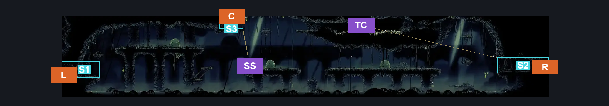
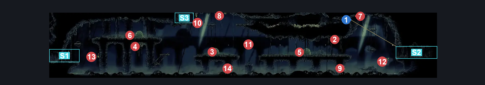
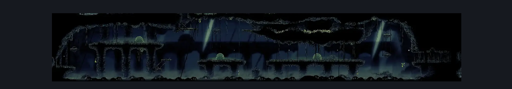

# Putrified Ducts Lower Bridge Room (Aqueduct_03)

**Game ID:** Aqueduct_03

**Contributors:** Pyxl

## Subrooms

| No. | Subroom | Annotated |
| --- | --- | --- |
| S1 | Left Entrance | ✓ |
| S2 | Left Bridge | ✓ |
| S3 | Centre Bridge | ✓ |
| S4 | Right Bridge | ✓ |
| S5 | Exit Platform | ✓ |
| S6 | Ceiling Tunnel | ✓ |
| S7 | Ceiling Exit | ✓ |

## Room Transitions

| Alias | Name | From subroom | Destination | Destination alias | Requirements | TODO | Verification | Annotated | Notes |
| --- | --- | --- | --- | --- | --- | --- | --- | --- | --- |
| R | right1 | Exit Platform | [Fleatopia (Aqueduct_05)](fleatopia.md) | L | None |  | Verified | ✓ |  |
| L | left1 | Left Entrance | [Putrified Ducts Tall Room (Aqueduct_02)](putrified-ducts-tall-room.md) | LR | None |  | Verified | ✓ |  |
| C | top1 | Ceiling Exit | [Putrified Ducts Path To Vog (Aqueduct_06)](putrified-ducts-path-to-vog.md) | F | Faydown Cloak OR Cling Grip Left OR Silk Soar OR Medium pogo off spit squit OR ( ( Cling grip Right OR hard delvers drill stall ) AND ( easy shaman pogo OR Easy rune rage stall OR easy Thread storm stall OR Easy cross stitch stall OR easy Heal stall OR easy voltvessels stall OR easy flea brew stall ) ) |  | Verified | ✓ |  |

## Subroom Connections

| Alias | Name | Source | Destination | Requirements | TODO | Verification | Annotated | Notes |
| --- | --- | --- | --- | --- | --- | --- | --- | --- |
| LB | Left Bridge | Left Bridge | Left Entrance | None |  | Verified | ✓ |  |
| LB | Left Bridge | Left Entrance | Left Bridge | Hard pogo off spit squit OR  ( Silk Soar AND ( Cling Grip either OR Sprint Right OR Dash Right OR Drifters Cloak OR Faydown Cloak OR Clawline RIght OR Sharpdart OR Scuttlebrace OR Ledge grab Right OR Easy Hunter Pogo OR Easy Reaper Pogo OR Easy Beast Pogo OR Easy Architect pogo OR Easy Shaman Pogo OR Architect Attack Right OR medium witch charge OR Easy Wanderer Charge OR Easy plasmium stall OR Easy Delvers drill stall OR Easy Flintslate stall OR Easy Voltvessels stall OR Easy flea brew stall OR Flea brew jump OR Easy Heal Stall OR Easy rune rage stall OR easy Cross stitch stall OR easy Thread storm stall OR Easy Pale nails stall ) ) OR ( Faydown Cloak AND ( Ledge grab either OR Cling grip either ) ) OR ( Cling grip Right AND ( Swim OR Dash Right OR Sprint Right OR Drifters Cloak OR Clawline Right OR Sharpdart OR Easy hunter pogo OR ( ( easy reaper charge OR Easy Wanderer charge OR Easy Witch charge ) AND Easy Heal stall ) OR Easy Beast pogo OR Hard shaman pogo OR easy thread storm stall OR Easy cross stitch stall OR Easy Pale nails stall OR Easy Flintslate stall OR Easy voltvessels stall OR easy Plasmium stall OR Flea brew jump OR Easy Flea brew stall ) AND ( Clawline left AND ( Ledge grab Left OR Cling grip left ) ) ) |  | Verified | ✓ |  |
| CBT | Centre bridge traversal | Left Bridge | Centre Bridge | Drifters Cloak OR Clawline Right OR ( medium drill crystal pogo ( needs soul of spit squit ) ) OR Medium pogo off spit squit OR Sprint Right OR Sharpdart OR ( Dash Right AND ( Easy voltvessels stall OR easy plasmium stall OR easy flea brew stall OR Faydown Cloak ) ) OR ( Swim AND Cling grip Right AND Medium Heal Stall ) OR ( Faydown Cloak AND ( Easy Hunter Pogo OR ( Easy reaper charge AND Easy Reaper Pogo ) OR Easy wanderer charge OR Easy beast pogo OR Easy witch charge OR Easy Architect charge OR Medium shaman pogo OR Easy thread storm stall OR Easy Rune rage stall OR Easy Cross stitch stall OR Easy pale nails stall OR flea brew jump OR easy Plasmium stall OR easy flintslate stall OR easy voltvessels stall ) ) |  | Verified | ✓ |  |
| CBT | Centre bridge traversal | Centre Bridge | Left Bridge | ( Silk Soar AND ( Clawline Left OR Sharp dart OR Drifters Cloak OR Medium Enemy pogo OR Hard Voltvessels stall OR Easy Flea brew stall OR ( Swim AND Faydown Cloak ) ) ) OR ( Faydown Cloak AND (  Easy Hunter Pogo OR ( Easy reaper charge AND Easy Reaper Pogo ) OR Easy wanderer charge OR Easy beast pogo OR Easy witch charge OR Easy Architect charge OR Medium shaman pogo OR Easy thread storm stall OR Easy Rune rage stall OR Easy Cross stitch stall OR Easy pale nails stall OR flea brew jump OR easy Plasmium stall OR easy flintslate stall OR easy voltvessels stall ) AND ( Silk Soar OR Cling Grip Left OR Ledge grab left ) ) |  | Verified | ✓ |  |
| CBR | Centre bridge Right | Centre Bridge | Right Bridge | Dash Right OR Sprint Right OR Ledge grab Right OR Drifters Cloak OR Faydown Cloak OR Cling grip right OR Silk Soar OR Clawline RIght OR Sharpdart OR Scuttlebrace OR Easy heal Stall OR Easy Beast pogo OR Easy shaman pogo OR Easy Delvers drill stall OR Easy Voltvessels stall OR Easy Flea brew stall OR Easy Plasmium stall OR Easy Rune rage stall OR Easy Cross stitch stall OR Easy Thread storm stall |  | Verified | ✓ |  |
| CBR | Centre bridge Right | Right Bridge | Centre Bridge | Dash Left OR Sprint Left OR Ledge grab Left OR Drifters Cloak OR Faydown Cloak OR Cling grip Left OR Silk Soar OR Clawline Left OR Sharpdart OR Scuttlebrace OR Easy heal Stall OR Easy Beast pogo OR Easy shaman pogo OR Easy Delvers drill stall OR Easy Voltvessels stall OR Easy Flea brew stall OR Easy Plasmium stall OR Easy Rune rage stall OR Easy Cross stitch stall OR Easy Thread storm stall |  | Verified | ✓ |  |
| LEX | Lower Exit | Right Bridge | Exit Platform | Hard pogo off spit squit OR Clawline Right OR Faydown Cloak OR Sharpdart OR Silk Soar OR Easy Beast Charge OR Sprint RIght OR Drifters Cloak OR ( Dash Right AND ( medium delvers drill stall OR Easy flea brew stall OR Easy plasmium stall OR Easy Heal Stall OR Ledge grab Right ) ) OR Hard flea brew stall OR hard shaman scuttle slide |  | Verified | ✓ |  |
| LEX | Lower Exit | Exit Platform | Right Bridge | Clawline Left OR Sharpdart OR Faydown Cloak OR ( ( Dash Left OR Easy Plasmium stall OR Easy flea brew stall OR easy Flintslate stall OR Easy Voltvessels stall OR Easy Thread storm stall OR easy cross stitch stall OR Easy Rune rage stall OR Easy Pale nails stall OR ( Swim AND ( Ledge grab left OR Cling grip Left ) ) OR Easy heal stall OR Drifters cloak OR Easy hunter pogo OR Easy Reaper charge OR Easy Wanderer charge OR Easy beast pogo OR Easy Witch charge OR Easy architect pogo ) AND ( Silk Soar OR ( Ledge grab left AND Easy flea brew stall ) OR ( Cling grip left AND ( Proficient Movement OR Easy Heal Stall OR easy Flea brew stall OR Medium Thread storm stall OR Easy Rune rage stall ) ) ) ) |  | Verified | ✓ |  |
| SE | Secret Exit | Right Bridge | Ceiling Tunnel | prereq breakable wall AND ( Silk Soar OR ( Faydown Cloak AND intended pogo off barnak ) OR ( Cling grip Right AND ( Faydown Cloak OR Hard pogo off spit squit OR Clawline Right OR Sharpdart OR Easy Beast Charge OR Sprint RIght OR Drifters Cloak OR ( Dash Right AND ( medium delvers drill stall OR Easy flea brew stall OR Easy plasmium stall OR Easy Heal Stall OR Ledge grab Right ) ) OR Hard flea brew stall OR hard shaman scuttle slide ) AND ( Dash Right OR Sprint Right OR Drifters Cloak OR Clawline Right OR Sharpdart OR Easy shaman scuttle slide OR Easy Flea brew stall ) AND ( Clawline Left OR Drifters Cloak OR Faydown Cloak OR Sharpdart OR ( Ledge Grab Left AND ( Dash Left OR Easy plasmium stall OR Easy Flea brew stall ) ) ) ) ) |  | Verified | ✓ |  |
| SE | Secret Exit | Ceiling Tunnel | Right Bridge | prereq breakable wall |  | Verified | ✓ |  |
| TUP | Tunnel & Platforms | Ceiling Tunnel | Ceiling Exit | Clawline Left OR ( Drifters Cloak AND ( easy heal stall OR easy Pale nails stall OR easy Cross stitch stall OR Easy Rune Rage Stall OR Easy Thread storm Stall OR Easy flea brew stall OR easy Flintslate stall OR easy Plasmium stall OR ( ( easy voltvessels stall OR Cling grip Right ) AND ( Hard Hazard respawn OR Cling grip Left ) ) OR Dash left OR Faydown Cloak OR Sharpdart OR Easy Reaper Charge OR Easy Beast pogo OR easy shaman Pogo ) ) |  | Verified | ✓ |  |
| TUP | Tunnel & Platforms | Ceiling Exit | Ceiling Tunnel | Clawline Right OR ( Drifters Cloak AND ( easy heal stall OR easy Pale nails stall OR easy Cross stitch stall OR Easy Rune Rage Stall OR Easy Thread storm Stall OR Easy flea brew stall OR easy Flintslate stall OR easy Plasmium stall OR ( ( easy voltvessels stall OR Cling grip Right ) AND ( Hard Hazard respawn OR Cling grip Left ) ) OR Dash right OR Faydown Cloak OR Sharpdart OR Easy Reaper Charge OR Easy Beast pogo OR easy shaman Pogo ) ) |  | Verified | ✓ | Rushed this one, any errors in room will probs be this transition |
| SS | Silk Soar | Centre Bridge | Ceiling Exit | Silk Soar OR CBT pogo off spit squit |  | Verified | ✓ |  |
| SS | Silk Soar | Ceiling Exit | Centre Bridge | None |  | Verified | ✓ |  |

## Check Locations

| No. | Check | Subroom | Requirements | TODO | Verification | Location Type | Annotated | Notes |
| --- | --- | --- | --- | --- | --- | --- | --- | --- |
| 1 | Breakable Wall | Right Bridge | Silk Soar OR ( Faydown Cloak AND intended pogo off barnak ) OR ( Cling grip Right AND ( Faydown Cloak OR Hard pogo off spit squit OR Clawline Right OR Sharpdart OR Easy Beast Charge OR Sprint RIght OR Drifters Cloak OR ( Dash Right AND ( medium delvers drill stall OR Easy flea brew stall OR Easy plasmium stall OR Easy Heal Stall OR Ledge grab Right ) ) OR Hard flea brew stall OR hard shaman scuttle slide ) AND ( Dash Right OR Sprint Right OR Drifters Cloak OR Clawline Right OR Sharpdart OR Easy shaman scuttle slide OR Easy Flea brew stall ) AND ( Clawline Left OR Drifters Cloak OR Faydown Cloak OR Sharpdart OR ( Ledge Grab Left AND ( Dash Left OR Easy plasmium stall OR Easy Flea brew stall ) ) ) ) |  | Verified | blockade | ✓ |  |
| 2 | Barnak 1 | Right Bridge | None |  | Verified | enemy | ✓ |  |
| 3 | Ductsucker 1 | Centre Bridge | None |  | Verified | enemy | ✓ |  |
| 4 | Barnak 2 | Left Bridge | None |  | Verified | enemy | ✓ |  |
| 5 | Ductsucker 2 | Right Bridge | None |  | Verified | enemy | ✓ |  |
| 6 | Ductsucker 3 | Left Bridge | None |  | Verified | enemy | ✓ |  |
| 7 | Barnak 3 | Right Bridge | None |  | Verified | enemy | ✓ |  |
| 8 | Barnak 4 | Ceiling Exit | None |  | Verified | enemy | ✓ |  |
| 9 | Spit Squit 1 | Right Bridge | None |  | Verified | enemy | ✓ |  |
| 10 | Spit Squit 2 | Ceiling Exit | None |  | Verified | enemy | ✓ |  |
| 11 | Spit Squit 3 | Centre Bridge | None |  | Verified | enemy | ✓ |  |
| 12 | Spit Squit 4 | Exit Platform | None |  | Verified | enemy | ✓ |  |
| 13 | Spit Squit 5 | Left Entrance | None |  | Verified | enemy | ✓ |  |
| 14 | Spit Squit 6 | Centre Bridge | None |  | Verified | enemy | ✓ |  |

## Room Images

### Connections

### Checks

### Scene

