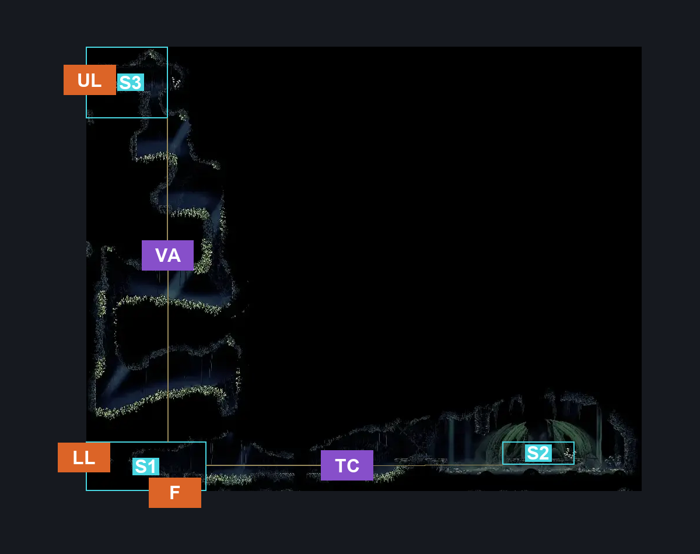
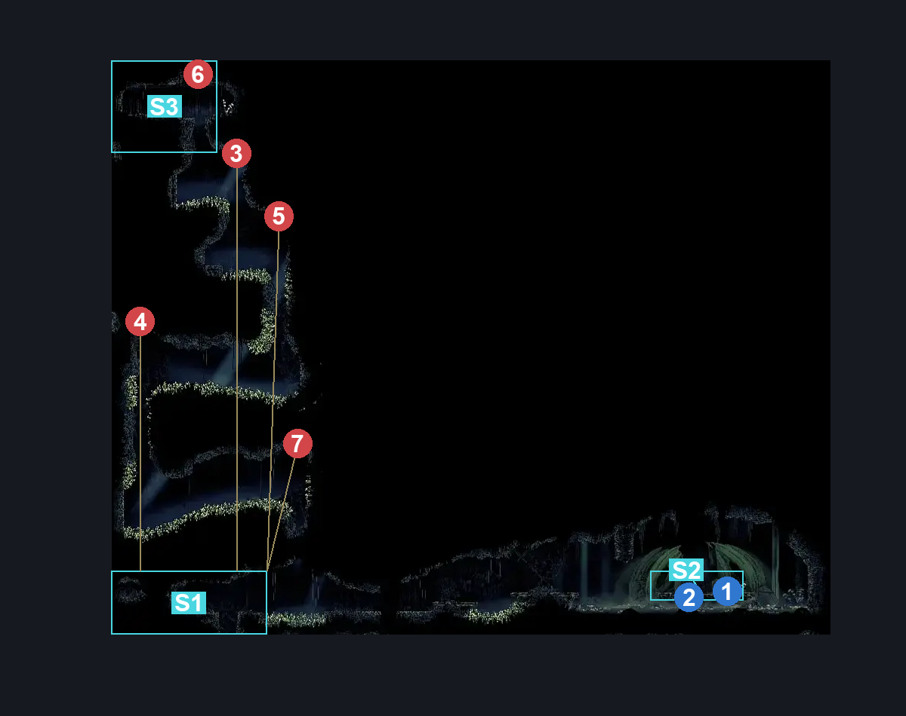
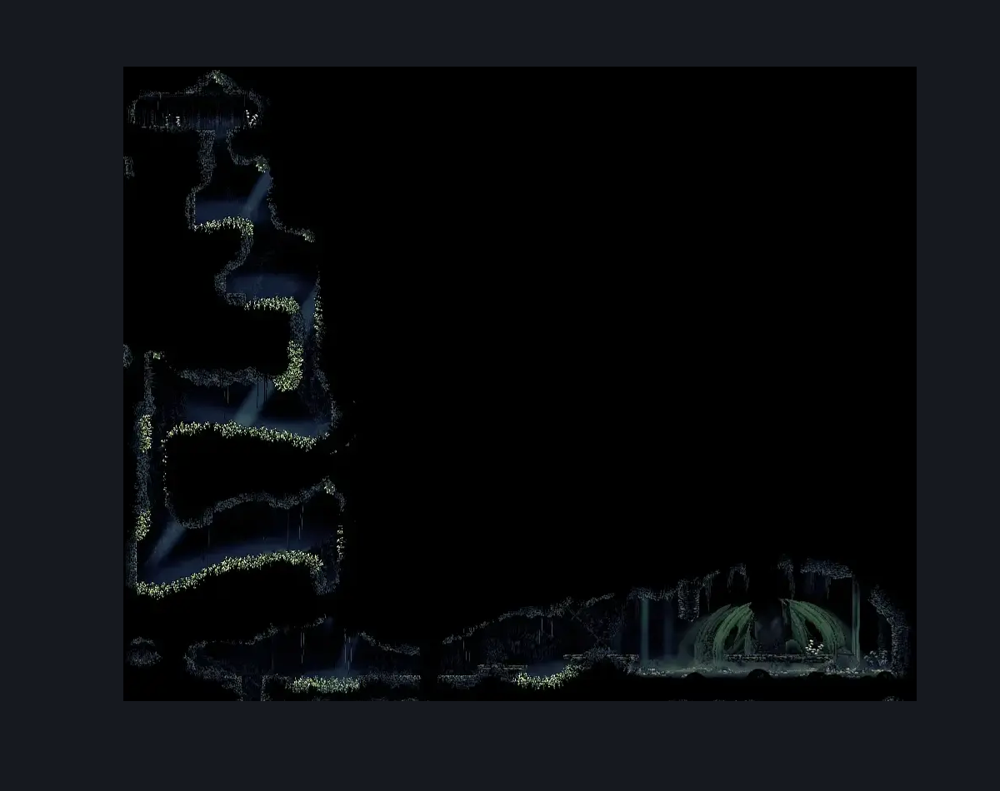

# Putrified Ducts Path To Vog (Aqueduct_06)

**Game ID:** Aqueduct_06

**Contributors:** Pyxl

## Subrooms

| No. | Subroom | Annotated |
| --- | --- | --- |
| S1 | Main | ✓ |
| S2 | Camp | ✓ |
| S3 | Top | ✓ |

## Room Transitions

| Alias | Name | From subroom | Destination | Destination alias | Requirements | TODO | Verification | Annotated | Notes |
| --- | --- | --- | --- | --- | --- | --- | --- | --- | --- |
| F | bot1 | Main | [Putrified Ducts Lower Bridge Room (Aqueduct_03)](putrified-ducts-lower-bridge-room.md) | C | None |  | Verified | ✓ |  |
| UL | left1 | Top | [Putrified Ducts Bellway (Bellway_Aqueduct)](putrified-ducts-bellway.md) | R | None |  | Verified | ✓ |  |
| LL | left2 | Main | [Putrified Ducts Rosary Room (Aqueduct_08)](putrified-ducts-rosary-room.md) | R | None |  | Verified | ✓ |  |

## Subroom Connections

| Alias | Name | Source | Destination | Requirements | TODO | Verification | Annotated | Notes |
| --- | --- | --- | --- | --- | --- | --- | --- | --- |
| VA | Vine Acsent | Main | Top | Intended pogo off barnak AND ( ( Clawline both AND ( Cling grip Both  OR Drifters Cloak ) ) OR ( drifters cloak AND ( Easy shaman pogo OR Easy flea brew stall OR easy Voltvessels stall OR easy flintslate stall OR easy plasmium stall ) ) ) |  | Verified | ✓ |  |
| VA | Vine Acsent | Top | Main | Clawline both AND Faydown Cloak |  | Verified | ✓ |  |
| TC | Thorn Crossing | Main | Camp | Clawline Right OR Sharpdart OR ( Swim AND ( Dash Right OR Sprint Right OR Drifters Cloak OR Faydown Cloak OR ( intended pogo off barnak AND ( Easy hunter pogo OR Hard reaper pogo OR ( ledge grab right AND Easy reaper pogo ) OR easy beast pogo OR easy architect pogo OR Easy shaman pogo OR Easy plasmium stall OR easy Flintslate stall OR easy voltvessels stall OR flea brew jump OR easy thread storm stall OR easy cross stitch stall OR easy rune rage stall OR easy pale nails stall ) ) ) ) |  | Verified | ✓ |  |
| TC | Thorn Crossing | Camp | Main | ( Faydown Cloak AND ( easy Hunter Crest pogo OR Swim OR easy Reaper Crest pogo OR easy Beast Crest pogo OR easy Architect Crest pogo OR Sprint left OR Dash left OR ( Ledge Grab left AND Hard heal stall ) ) ) OR Sharpdart OR Clawline left OR Drifters Cloak OR ( Sprint left AND Dash left ) |  | Verified | ✓ |  |

## Check Locations

| No. | Check | Subroom | Requirements | TODO | Verification | Location Type | Annotated | Notes |
| --- | --- | --- | --- | --- | --- | --- | --- | --- |
| 1 | thread_memory | Camp | Needolin |  | Verified | lore | ✓ | dont think we doing these |
| 2 | Wreath OF Purity | Camp | None |  | Verified | collectible | ✓ |  |
| 3 | Barnak 1 | Main | Intended pogo off barnak AND ( ( Clawline both AND ( Cling grip Both  OR Drifters Cloak ) ) OR ( drifters cloak AND ( Easy shaman pogo OR Easy flea brew stall OR easy Voltvessels stall OR easy flintslate stall OR easy plasmium stall ) ) ) |  | Verified | enemy | ✓ |  |
| 4 | Barnak 2 | Main | Intended pogo off barnak AND ( ( Clawline both AND ( Cling grip Both  OR Drifters Cloak ) ) OR ( drifters cloak AND ( Easy shaman pogo OR Easy flea brew stall OR easy Voltvessels stall OR easy flintslate stall OR easy plasmium stall ) ) ) |  | Verified | enemy | ✓ |  |
| 5 | Barnak 3 | Main | Intended pogo off barnak AND ( ( Clawline both AND ( Cling grip Both  OR Drifters Cloak ) ) OR ( drifters cloak AND ( Easy shaman pogo OR Easy flea brew stall OR easy Voltvessels stall OR easy flintslate stall OR easy plasmium stall ) ) ) |  | Verified | enemy | ✓ |  |
| 6 | Barnak 4 | Top | None |  | Verified | enemy | ✓ |  |
| 7 | Barnak 5 | Main | Intended pogo off barnak AND ( ( Clawline both AND ( Cling grip Both  OR Drifters Cloak ) ) OR ( drifters cloak AND ( Easy shaman pogo OR Easy flea brew stall OR easy Voltvessels stall OR easy flintslate stall OR easy plasmium stall ) ) ) |  | Verified | enemy | ✓ |  |

## Room Images

### Connections

### Checks

### Scene

