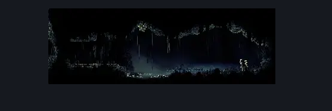

# Putrified Ducts Rosary Room (Aqueduct_08)

**Game ID:** Aqueduct_08

**Contributors:** Pyxl

## Subrooms

| No. | Subroom | Annotated |
| --- | --- | --- |
| S1 | Left | ✓ |
| S2 | Right | ✓ |

## Room Transitions

| Alias | Name | From subroom | Destination | Destination alias | Requirements | TODO | Verification | Annotated | Notes |
| --- | --- | --- | --- | --- | --- | --- | --- | --- | --- |
| L | left1 | Left | [Putrified Ducts Tall Room (Aqueduct_02)](putrified-ducts-tall-room.md) | MR | prereq Breakable Sewer Grate 2 |  | Verified | ✓ |  |
| R | right1 | Right | [Putrified Ducts Path To Vog (Aqueduct_06)](putrified-ducts-path-to-vog.md) | LL | None |  | Verified | ✓ |  |

## Subroom Connections

| Alias | Name | Source | Destination | Requirements | TODO | Verification | Annotated | Notes |
| --- | --- | --- | --- | --- | --- | --- | --- | --- |
| MP | Maggot Puddle | Left | Right | Swim OR Sprint right OR Dash right OR Faydown Cloak OR Drifters Cloak OR Clawline right OR Sharpdart OR easy Beast Crest pogo OR Easy voltvessels stall OR Easy flintslate stall OR Flea brew jump OR Easy plasmium stall OR easy pale nails stall OR easy thread storm stall OR easy cross stitch stall OR easy hunter pogo OR easy wanderer charge OR easy witch charge OR ( ledge grab right AND ( Easy reaper charge OR Easy flintslate stall ) ) |  | Verified | ✓ |  |
| MP | Maggot Puddle | Right | Left | Swim OR Sprint left OR Dash left OR Faydown Cloak OR Drifters Cloak OR Clawline left OR Sharpdart OR easy Beast Crest pogo OR flea brew jump OR easy voltvessels stall OR easy plasmium stall OR ( Intended pogo off barnak AND ( Easy thread storm stall OR easy rune rage stall OR easy cross stitch stall OR easy pale nails stall OR easy flintslate stall OR Easy hunter pogo OR easy reaper pogo OR easy architect pogo OR easy shaman pogo OR easy witch pogo ) ) |  | Verified | ✓ |  |

## Check Locations

| No. | Check | Subroom | Requirements | TODO | Verification | Location Type | Annotated | Notes |
| --- | --- | --- | --- | --- | --- | --- | --- | --- |
| 1 | Putrified Ducts - Rosary Cache #1 | Right | None |  | Verified | resource | ✓ |  |
| 2 | Putrified Ducts - Rosary Cache #2 | Right | None |  | Verified | resource | ✓ |  |
| 3 | Putrified Ducts - Rosary Cache #3 | Right | None |  | Verified | resource | ✓ |  |
| 4 | Breakable Sewer Grate 2 | Left | None |  | Verified | blockade | ✓ |  |
| 5 | Barnak 1 | Right | None |  | Verified | enemy | ✓ | technically in both subrooms |

## Room Images

### Connections

### Checks

### Scene

