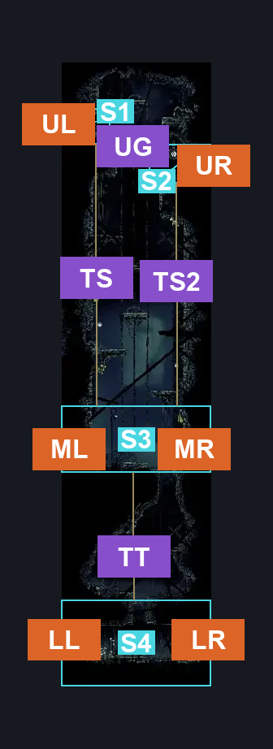
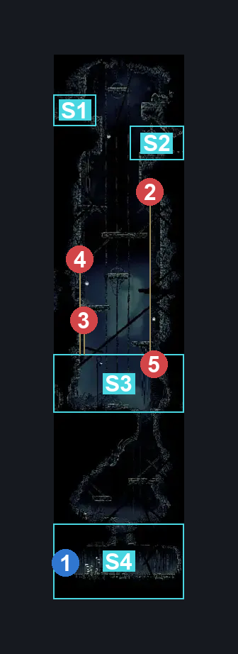
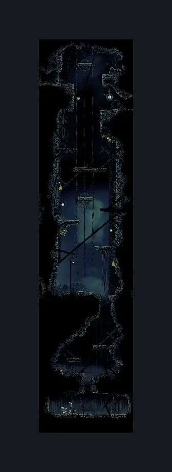

# Putrified Ducts Tall Room (Aqueduct_02)

**Game ID:** Aqueduct_02

**Contributors:** Pyxl

## Subrooms

| No. | Subroom | Annotated |
| --- | --- | --- |
| S1 | Top Left | ✓ |
| S2 | Bellway Door | ✓ |
| S3 | Middle Platform | ✓ |
| S4 | Lower Sewage Tunnel | ✓ |

## Room Transitions

| Alias | Name | From subroom | Destination | Destination alias | Requirements | TODO | Verification | Annotated | Notes |
| --- | --- | --- | --- | --- | --- | --- | --- | --- | --- |
| UL | left1 | Top Left | [Putrified Ducts Entrance (Aqueduct_01)](putrified-ducts-entrance.md) | R | None |  | Verified | ✓ |  |
| UR | right2 | Bellway Door | [Putrified Ducts Bellway (Bellway_Aqueduct)](putrified-ducts-bellway.md) | L | None |  | Verified | ✓ |  |
| ML | left3 | Middle Platform | [Putrified Ducts Map Room (Aqueduct_07)](putrified-ducts-map-room.md) | R | None |  | Verified | ✓ |  |
| MR | right3 | Middle Platform | [Putrified Ducts Rosary Room (Aqueduct_08)](putrified-ducts-rosary-room.md) | L | Prereq Breakable Sewer Grate 2 IN Putrified Ducts Rosary Room |  | Verified | ✓ |  |
| LL | left2 | Lower Sewage Tunnel | [Putrified Ducts Connection To Bilewater (Aqueduct_04)](putrified-ducts-connection-to-bilewater.md) | R | Prereq Breakable Sewer Grate |  | Verified | ✓ |  |
| LR | right1 | Lower Sewage Tunnel | [Putrified Ducts Lower Bridge Room (Aqueduct_03)](putrified-ducts-lower-bridge-room.md) | L | None |  | Verified | ✓ |  |

## Subroom Connections

| Alias | Name | Source | Destination | Requirements | TODO | Verification | Annotated | Notes |
| --- | --- | --- | --- | --- | --- | --- | --- | --- |
| UG | Upper Gap | Top Left | Bellway Door | Ledge grab Right OR Dash Right OR Sprint Right OR Drifters Cloak OR Faydown Cloak OR Cling Grip Right OR Cling Grip Left OR Silk Soar OR Clawline Right OR Sharpdart OR Scuttlebrace OR Easy Hunter Pogo OR Easy Reaper Pogo OR Easy Wanderer charge OR Easy Beast pogo OR Easy Witch Pogo OR Easy Architect pogo OR Architect attack right OR Easy Shaman Pogo OR Medium enemy pogo OR Easy thread storm stall OR Easy cross stitch stall OR Easy Rune Rage STall OR Easy Pale Nails stall OR flea brew jump OR Easy Flea Brew Stall OR Easy Flintslate stall OR Easy VoltVessels Stall OR Easy Plasmium stall OR Easy Heal Stall OR Easy Naked pogo |  | Verified | ✓ |  |
| UG | Upper Gap | Bellway Door | Top Left | Faydown Cloak OR Cling Grip left OR Silk Soar OR Scuttlebrace OR Medium Pogo off Spit Squit |  | Verified | ✓ |  |
| TS | The Shaft | Top Left | Middle Platform | None |  | Verified | ✓ |  |
| TS | The Shaft | Middle Platform | Top Left | Hard Pogo off Spit Squit OR Silk Soar OR Faydown Cloak OR ( Cling grip left AND ( Cling grip right OR ( Ledge Grab Left AND Easy Flea Brew stall ) ) ) |  | Verified | ✓ |  |
| TS2 | The Shaft 2 | Bellway Door | Middle Platform | None |  | Verified | ✓ |  |
| TS2 | The Shaft 2 | Middle Platform | Bellway Door | Hard Pogo off Spit Squit OR Silk Soar OR Faydown Cloak OR ( Cling Grip Right AND ( Ledge Grab Left OR Easy Beast Charge OR ( Easy Heal Stall AND Easy Beast Pogo ) OR Easy Shaman Pogo OR Cling Grip Left OR Easy Plasmium Stall OR Hard Voltvessels stall OR Medium Delvers Drill Stall ) ) |  | Verified | ✓ |  |
| TT | The Tunnel | Middle Platform | Lower Sewage Tunnel | None |  | Verified | ✓ |  |
| TT | The Tunnel | Lower Sewage Tunnel | Middle Platform | Silk Soar OR ( ( Faydown Cloak OR Medium Heal Stall OR Easy Flea Brew Stall OR Medium Plasmium stall OR Easy Thread storm Stall OR Easy Rune Rage Stall OR medium Cross stitch stall OR easy Shaman Pogo ) AND Cling Grip either ) OR ( Faydown Cloak AND Scuttlebrace ) |  | Verified | ✓ |  |

## Check Locations

| No. | Check | Subroom | Requirements | TODO | Verification | Location Type | Annotated | Notes |
| --- | --- | --- | --- | --- | --- | --- | --- | --- |
| 1 | Breakable Sewer Grate | Lower Sewage Tunnel | None |  | Verified | blockade | ✓ |  |
| 2 | Barnak 1 | Middle Platform | Hard Pogo off Spit Squit OR Silk Soar OR Faydown Cloak OR ( Cling Grip Right AND ( Ledge Grab Left OR Easy Beast Charge OR ( Easy Heal Stall AND Easy Beast Pogo ) OR Easy Shaman Pogo OR Cling Grip Left OR Easy Plasmium Stall OR Hard Voltvessels stall OR Medium Delvers Drill Stall ) ) |  | Verified | enemy | ✓ |  |
| 3 | Barnak 2 | Middle Platform | None |  | Verified | enemy | ✓ |  |
| 4 | Spit Squit 1 | Middle Platform | Hard Pogo off Spit Squit OR Silk Soar OR Faydown Cloak OR ( Cling Grip Right AND ( Ledge Grab Left OR Easy Beast Charge OR ( Easy Heal Stall AND Easy Beast Pogo ) OR Easy Shaman Pogo OR Cling Grip Left OR Easy Plasmium Stall OR Hard Voltvessels stall OR Medium Delvers Drill Stall ) ) |  | Verified | enemy | ✓ |  |
| 5 | Spit Squit 2 | Middle Platform | None |  | Verified | enemy | ✓ |  |

## Room Images

### Connections

### Checks

### Scene

