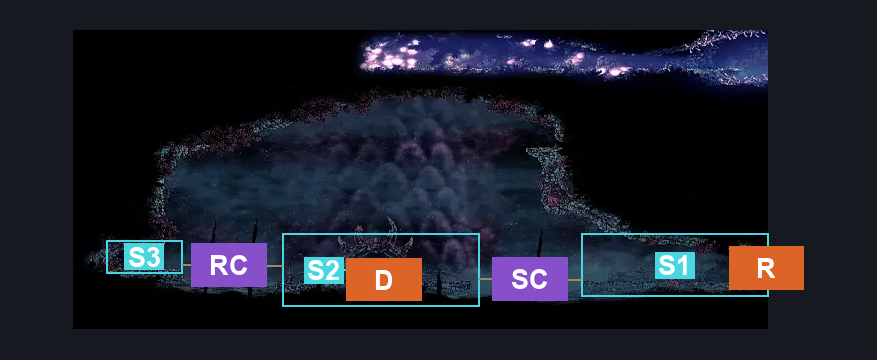
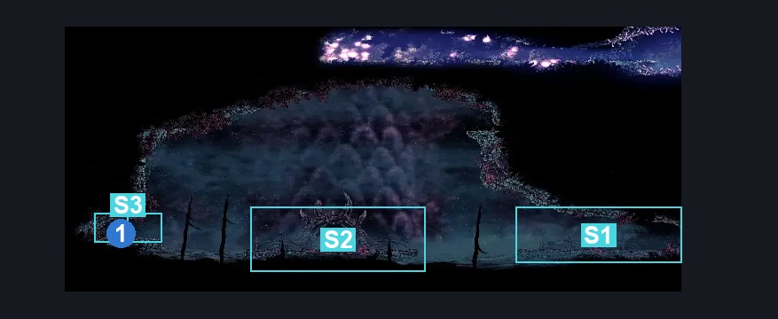
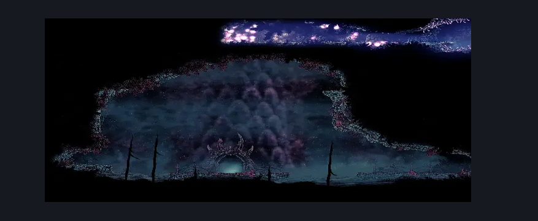

# Coral Tower Entrance (Coral_28)

**Game ID:** Coral_28

**Contributors:** Pxyl

## Subrooms

| No. | Subroom | Annotated |
| --- | --- | --- |
| S1 | Exit | ✓ |
| S2 | Door | ✓ |
| S3 | Resting Site Ledge | ✓ |

## Room Transitions

| Alias | Name | From subroom | Destination | Destination alias | Requirements | TODO | Verification | Annotated | Notes |
| --- | --- | --- | --- | --- | --- | --- | --- | --- | --- |
| R | right1 | Exit | [Sands of Karak Upper Left Long Room (Coral_27)](sands-of-karak-upper-left-long-room.md) | L | None |  | Verified | ✓ |  |
| D | door1 | Door | [Coral Tower (Coral_Tower_01)](coral-tower.md) | L | None |  | Verified | ✓ |  |

## Subroom Connections

| Alias | Name | Source | Destination | Requirements | TODO | Verification | Annotated | Notes |
| --- | --- | --- | --- | --- | --- | --- | --- | --- |
| SC | Sandcarver Pit | Door | Exit | Clawline Right OR Sharpdart OR Drifters Cloak OR ( Sprint Right AND ( Dash Right OR Faydown Cloak OR easy Beast Crest pogo OR Easy Flea brew stall OR Easy Plasmium stall OR Medium cross stitch stall ) ) OR  ( Faydown Cloak AND ( easy Beast Crest pogo OR easy Hunter Crest pogo OR easy Architect Crest pogo OR easy Shaman Crest pogo ( Wanderer Crest AND Needle strike ) ) ) |  | Verified | ✓ |  |
| SC | Sandcarver Pit | Exit | Door | Clawline left OR Sharpdart OR ( Sprint left AND ( Medium flea brew stall OR Easy Plasmium Stall OR medium Cross stitch stall OR Medium flintslate stall OR Dash left OR Faydown Cloak OR Drifters Cloak OR easy Beast Crest pogo OR easy Architect Crest pogo ) )  OR ( Sprint left AND ( easy Shaman Crest pogo OR easy Hunter crest pogo OR medium Heal stall OR (Ledge grab left AND ( easy Cross stitch stall OR Medium Rune rage stall OR Medium thread storm stall OR Medium Pale nails stall OR Easy Voltvessels stall ) ) OR ( easy Wanderer Crest pogo AND easy Needle Strike stall AND Ledge Grab left ) ) ) OR ( Dash left AND ( easy Reaper Crest pogo OR easy Beast Crest pogo OR Faydown Cloak OR Drifters Cloak OR ( easy Architect Crest pogo AND ( Ledge Grab left OR easy Needle Strike stall ) ) ) ) OR ( Faydown Cloak AND ( easy Beast Crest pogo OR easy Architect Crest pogo OR medium Shaman Crest pogo OR easy Hunter Crest pogo OR Drifters Cloak OR ( easy Reaper Crest pogo AND Ledge Grab left ) OR ( easy Wanderer Crest pogo AND easy Needle strike stall ) ) ) OR ( Drifters Cloak AND ( easy Beast Crest pogo OR easy Architect Crest pogo OR easy Shaman Crest pogo OR easy Wanderer Crest pogo OR medium Heal Stall OR Ledge Grab left OR Silk Soar OR Easy voltvessels stall OR easy flintslate stall OR Easy flea brew stall OR Easy Plasmium stall OR Easy rune rage stall OR easy Thread storm Stall OR Easy Cross stitch stall OR Easy pale nails stall OR ( easy Reaper Crest pogo AND easy Needle Strike stall ) ) ) OR ( Silk Soar AND ( easy Beast Crest pogo OR easy Architect Crest pogo ) ) OR ( medium Shaman pogo AND Medium Scuttlebrace ) |  | Verified | ✓ |  |
| RC | Resting Site Crossing | Door | Resting Site Ledge | Sprint Left AND ( ( Dash left OR Drifters Cloak OR Faydown Cloak OR easy Beast Crest pogo ) OR Clawline left OR ( Silk soar AND Ledge Grab left ) ) |  | Verified | ✓ |  |
| RC | Resting Site Crossing | Resting Site Ledge | Door | Sprint right AND ( ( Dash right OR Drifters Cloak OR Faydown Cloak OR easy Beast Crest pogo ) OR Clawline right OR ( Silk soar AND Ledge Grab right ) ) |  | Verified | ✓ |  |

## Check Locations

| No. | Check | Subroom | Requirements | TODO | Verification | Location Type | Annotated | Notes |
| --- | --- | --- | --- | --- | --- | --- | --- | --- |
| 1 | Resting Site: Sands of Karak | Resting Site Ledge | prereq THE A Vassal Lost Wish Promised |  | Verified | event | ✓ | Not Included for the better |

## Room Images

### Connections

### Checks

### Scene

