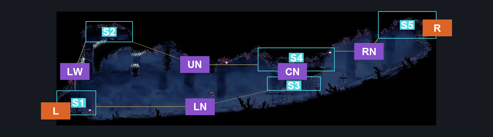
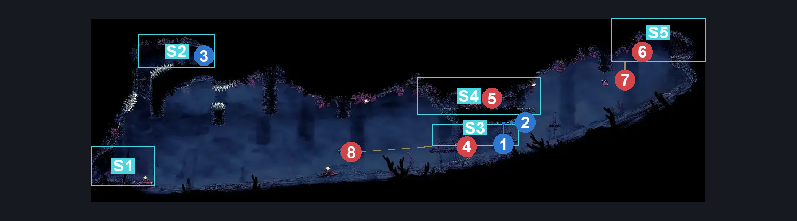
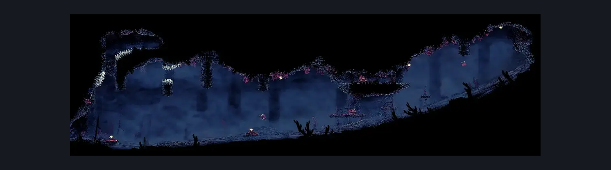

# Sands of Karak Lower Right Long Room (Coral_24)

**Game ID:** Coral_24

**Contributors:** Pyxl

## Subrooms

| No. | Subroom | Annotated |
| --- | --- | --- |
| S1 | Left Exit | ✓ |
| S2 | Flea Ledge | ✓ |
| S3 | Lower Centre Platform | ✓ |
| S4 | Upper Centre Platform | ✓ |
| S5 | Right Exit | ✓ |

## Room Transitions

| Alias | Name | From subroom | Destination | Destination alias | Requirements | TODO | Verification | Annotated | Notes |
| --- | --- | --- | --- | --- | --- | --- | --- | --- | --- |
| L | left1 | Left Exit | [Sands of Karak Tall Centre Room (Coral_35b)](sands-of-karak-tall-centre-room.md) | LR | None |  | Verified | ✓ |  |
| R | right1 | Right Exit | [Sands of Karak Right Side Tall room (Coral_26)](sands-of-karak-right-side-tall-room.md) | LL | None |  | Verified | ✓ |  |

## Subroom Connections

| Alias | Name | Source | Destination | Requirements | TODO | Verification | Annotated | Notes |
| --- | --- | --- | --- | --- | --- | --- | --- | --- |
| LW | Left Wall | Left Exit | Flea Ledge | Silk Soar |  | Verified | ✓ |  |
| LW | Left Wall | Flea Ledge | Left Exit | None |  | Verified | ✓ |  |
| LN | Lower Left Nut Platforms | Left Exit | Lower Centre Platform | easy Beast Crest pogo OR Dash Right OR Clawline Right OR Faydown Cloak OR Drifters Cloak OR Sharpdart OR ( Ledge grab Right AND ( easy Reaper crest pogo OR easy Shaman Crest pogo OR easy Hunter Crest pogo OR easy Wanderer Crest pogo ) ) |  | Verified | ✓ |  |
| LN | Lower Left Nut Platforms | Lower Centre Platform | Left Exit | ( Drifters Cloak AND ( Clawline Left OR easy Beast crest pogo OR Dash Left OR Faydown Cloak ) ) OR ( Clawline Left AND ( easy Shaman crest pogo OR Faydown Cloak OR Silk Soar OR easy Beast Crest pogo ) ) OR ( Faydown Cloak AND ( easy Beast Crest pogo OR Sharpdart ) ) |  | Verified | ✓ |  |
| UN | Upper Left Nut Platforms | Upper Centre Platform | Flea Ledge | ( Cling grip Both AND Clawline Left ) OR ( Clawline Left AND ( ( Drifters Cloak AND ( hard hunter Crest pogo OR hard Reaper Crest pogo OR hard Wanderer Crest pogo OR hard Shaman Crest pogo ) ) OR Faydown Cloak ) ) |  | Verified | ✓ | While technically not one way its just cancer to get back and had 0 practical use to dropping down and redoing the lower route |
| RN | Right Nut Platforms | Upper Centre Platform | Right Exit | ( Cling grip Right AND  ( ( Clawline Right OR Drifters Cloak ) OR easy Beast Crest pogo ) ) |  | Verified | ✓ |  |
| RN | Right Nut Platforms | Right Exit | Upper Centre Platform | None |  | Verified | ✓ |  |
| CN | Centre Platforms | Lower Centre Platform | Upper Centre Platform | Faydown Cloak OR Sprint Right OR ( Dash Right AND ( Ledge grab Right OR Cling grip Right ) ) OR Drifters Cloak OR Sharpdart OR Silk soar OR easy Beast Crest pogo OR ( easy Architect Crest pogo AND easy Needle Strike stall ) |  | Verified | ✓ |  |
| CN | Centre Platforms | Upper Centre Platform | Lower Centre Platform | None |  | Verified | ✓ |  |

## Check Locations

| No. | Check | Subroom | Requirements | TODO | Verification | Location Type | Annotated | Notes |
| --- | --- | --- | --- | --- | --- | --- | --- | --- |
| 1 | Shell Shard Cache: Sands of Karak #1 | Lower Centre Platform | None |  | Verified | resource | ✓ |  |
| 2 | Shell Shard Cache: Sands of Karak #2 | Lower Centre Platform | None |  | Verified | resource | ✓ |  |
| 3 | Flea: Sands of Karak | Flea Ledge | None |  | Verified | collectible | ✓ |  |
| 4 | Coral Furm 1 | Lower Centre Platform | None |  | Verified | enemy | ✓ |  |
| 5 | Coral Furm 2 | Upper Centre Platform | None |  | Verified | enemy | ✓ |  |
| 6 | Pokenabbin 1 | Right Exit | None |  | Verified | enemy | ✓ |  |
| 7 | Pokenabbin 2 | Right Exit | None |  | Verified | enemy | ✓ |  |
| 8 | Driznarga 1 | Lower Centre Platform | none |  | Verified | enemy | ✓ |  |

## Room Images

### Connections

### Checks

### Scene

