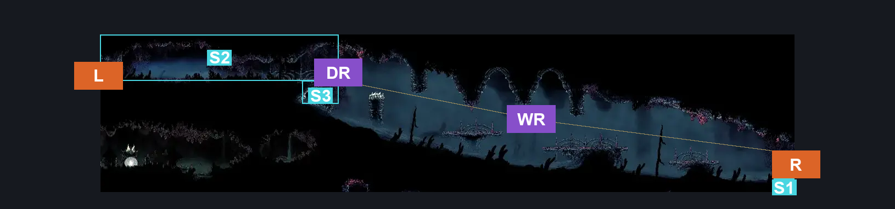
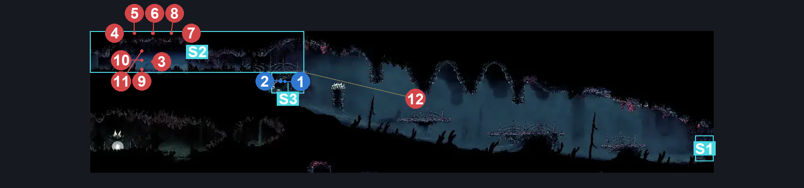
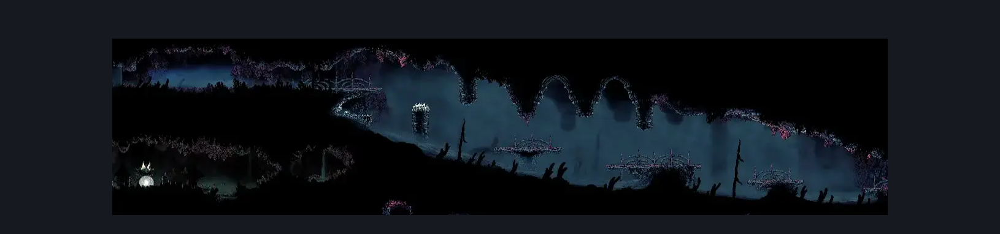

# Sands of Karak Upper Left Long Room (Coral_27)

**Game ID:** Coral_27

**Contributors:** Pyxl

## Subrooms

| No. | Subroom | Annotated |
| --- | --- | --- |
| S1 | Right Ledge | ✓ |
| S2 | Left Ledge | ✓ |
| S3 | Shell Ledge | ✓ |

## Room Transitions

| Alias | Name | From subroom | Destination | Destination alias | Requirements | TODO | Verification | Annotated | Notes |
| --- | --- | --- | --- | --- | --- | --- | --- | --- | --- |
| L | left1 | Left Ledge | [Coral Tower Entrance (Coral_28)](coral-tower-entrance.md) | R | None |  | Verified | ✓ |  |
| R | right1 | Right Ledge | [Sands of Karak Tall Centre Room (Coral_35b)](sands-of-karak-tall-centre-room.md) | UL | None |  | Verified | ✓ |  |

## Subroom Connections

| Alias | Name | Source | Destination | Requirements | TODO | Verification | Annotated | Notes |
| --- | --- | --- | --- | --- | --- | --- | --- | --- |
| WR | Whole Room | Left Ledge | Right Ledge | easy Beast Crest pogo OR Clawline right OR Faydown Cloak OR Drifters Cloak OR Sharpdart OR Dash right |  | Verified | ✓ |  |
| WR | Whole Room | Right Ledge | Left Ledge | ( Cling Grip left AND ( ( ( Dash left OR Drifters Cloak OR Faydown Cloak ) AND Sprint left ) OR Clawline left OR Sharpdart ) ) OR ( Faydown Cloak AND Clawline left AND ( Proficient Movement AND Spike Pogo ) ) |  | Verified | ✓ |  |
| DR | Drop | Left Ledge | Shell Ledge | easy Hunter Crest pogo OR easy Beast Crest pogo OR easy Architect Crest pogo OR easy Shaman Crest pogo OR ( Ledge grab left AND ( easy Reaper crest pogo OR easy Witch Crest pogo ) ) OR Dash left OR Clawline left OR Sharpdart OR Drifters Cloak OR Faydown Cloak OR ( easy Wanderer crest pogo AND easy Needle Strike stall ) |  | Verified | ✓ |  |
| DR | Drop | Shell Ledge | Left Ledge | Ledge Grab left OR Clawline both OR Faydown Cloak OR ( medium Beast Crest pogo AND Spike pogo ) |  | Verified | ✓ |  |

## Check Locations

| No. | Check | Subroom | Requirements | TODO | Verification | Location Type | Annotated | Notes |
| --- | --- | --- | --- | --- | --- | --- | --- | --- |
| 1 | Shell shard cache: Sands of Karak #3 | Shell Ledge | None |  | Verified | resource | ✓ |  |
| 2 | Shell Shard cache: Sands of Karak #4 | Shell Ledge | None |  | Verified | resource | ✓ |  |
| 3 | Boss: Raging Conchfly | Left Ledge | Combat Requirements |  | Verified | boss | ✓ |  |
| 4 | Conchfly 1 | Left Ledge | None |  | Verified | enemy | ✓ | Boss summon |
| 5 | Conchfly 2 | Left Ledge | None |  | Verified | enemy | ✓ | Boss summon |
| 6 | Conchfly 3 | Left Ledge | None |  | Verified | enemy | ✓ | Boss summon |
| 7 | Conchfly 4 | Left Ledge | None |  | Verified | enemy | ✓ | Boss summon |
| 8 | Conchfly 5 | Left Ledge | None |  | Verified | enemy | ✓ | Boss summon |
| 9 | Conchfly 6 | Left Ledge | None |  | Verified | enemy | ✓ | Boss summon |
| 10 | Conchfly 7 | Left Ledge | None |  | Verified | enemy | ✓ | Boss summon |
| 11 | Conchfly 8 | Left Ledge | None |  | Verified | enemy | ✓ | Boss summon |
| 12 | Driznarga 1 | Left Ledge | None |  | Verified | enemy | ✓ |  |

## Room Images

### Connections

### Checks

### Scene

