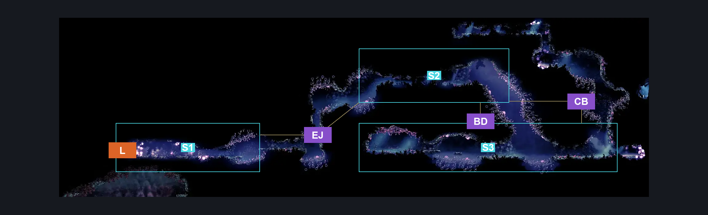
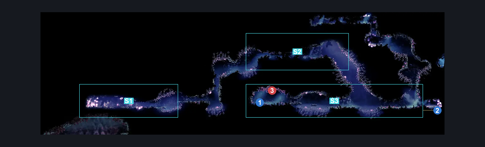
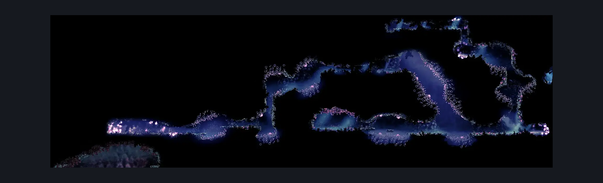

# Voltnest (Coral_29)

**Game ID:** Coral_29

**Contributors:** Pyxl

## Subrooms

| No. | Subroom | Annotated |
| --- | --- | --- |
| S1 | Start | ✓ |
| S2 | Centre | ✓ |
| S3 | Bottom | ✓ |

## Room Transitions

| Alias | Name | From subroom | Destination | Destination alias | Requirements | TODO | Verification | Annotated | Notes |
| --- | --- | --- | --- | --- | --- | --- | --- | --- | --- |
| L | left1 | Start | [Sands of Karak Tall Centre Room (Coral_35b)](sands-of-karak-tall-centre-room.md) | D | None |  | Verified | ✓ |  |

## Subroom Connections

| Alias | Name | Source | Destination | Requirements | TODO | Verification | Annotated | Notes |
| --- | --- | --- | --- | --- | --- | --- | --- | --- |
| EJ | Electric Jumps | Start | Centre | ( Cling grip Right OR ( Scuttlebrace AND ( Dash right OR Clawline right OR Drifters Cloak OR Faydown Cloak OR Sharpdart ) ) ) |  | Verified | ✓ |  |
| EJ | Electric Jumps | Centre | Start | ( Cling grip either OR ( Scuttlebrace AND ( Dash left OR Clawline left OR Drifters Cloak OR Faydown Cloak OR Sharpdart ) ) ) |  | Verified | ✓ |  |
| BD | Big Drop | Centre | Bottom | None |  | Verified | ✓ |  |
| CB | Climb back | Bottom | Centre | Cling Grip both AND ( Faydown Cloak OR ( Silk Soar AND ( ( Dash both AND Ledge grab left ) OR easy Beast Crest pogo OR Sharpdart OR Drifters Cloak ) ) ) |  | Verified | ✓ |  |

## Check Locations

| No. | Check | Subroom | Requirements | TODO | Verification | Location Type | Annotated | Notes |
| --- | --- | --- | --- | --- | --- | --- | --- | --- |
| 1 | Volt Filament | Bottom | None |  | Verified | collectible | ✓ |  |
| 2 | Voltstone | Bottom | None |  | Verified | lore | ✓ |  |
| 3 | Boss: Voltwyrm | Bottom | Combat Requirements |  | Verified | enemy | ✓ |  |

## Room Images

### Connections

### Checks

### Scene

