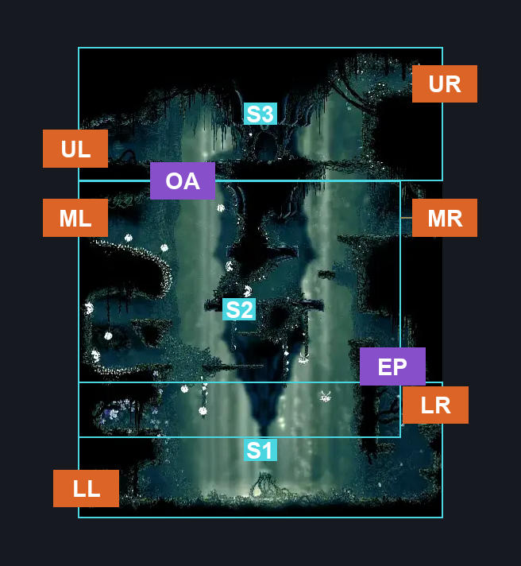
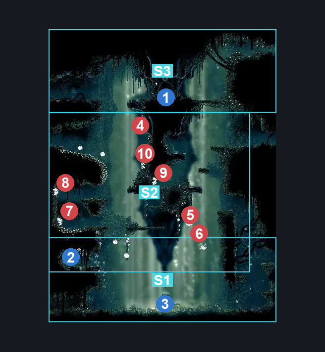
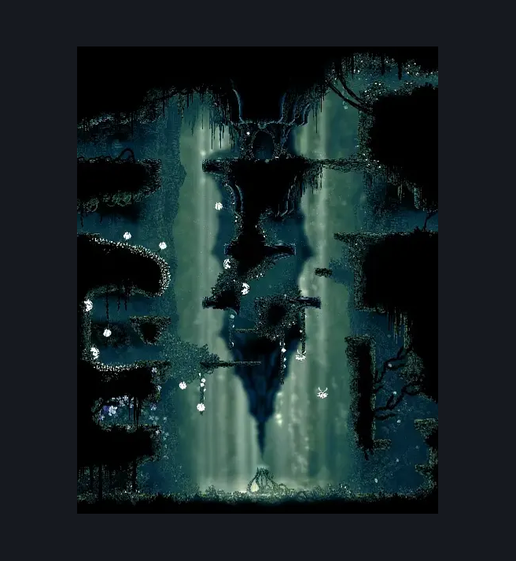

# Cling Grip Room (Shellwood_10)

**Game ID:** Shellwood_10

**Contributors:** Pyxl

## Subrooms

| No. | Subroom | Annotated |
| --- | --- | --- |
| S1 | Ground Level | ✓ |
| S2 | Central Level | ✓ |
| S3 | Upper Level | ✓ |

## Room Transitions

| Alias | Name | From subroom | Destination | Destination alias | Requirements | TODO | Verification | Annotated | Notes |
| --- | --- | --- | --- | --- | --- | --- | --- | --- | --- |
| UR | right1 | Upper Level | [Shellwood Top Room (Shellwood_26)](shellwood-top-room.md) | L | Cling Grip Right OR Silk Soar OR Scuttlebrace |  | Verified | ✓ |  |
| LR | right2 | Ground Level | [Shellwood Flower Pogo Upper Hall (Shellwood_20)](shellwood-flower-pogo-upper-hall.md) | L | Scuttlebrace OR Cling Grip Right OR Faydown Cloak OR Ledge Grab Right |  | Verified | ✓ |  |
| ML | left2 | Central Level | [Cling Grip Side Room (Shellwood_11)](cling-grip-side-room.md) | LR | Dash Left OR Sprint Left OR Clawline Left OR SharpDart OR easy Beast Crest pogo OR Faydown Cloak OR Drifters Cloak |  | Verified | ✓ |  |
| UL | left1 | Upper Level | [Cling Grip Side Room (Shellwood_11)](cling-grip-side-room.md) | UR | None |  | Verified | ✓ |  |
| MR | right3 | Central Level | [Sister Splinter (Shellwood_18)](sister-splinter.md) | L | Dash RIght OR Cling Grip Right OR Faydown Cloak OR Ledge Grab Right |  | Verified | ✓ |  |
| LL | left3 | Ground Level | [Shellwood Lower Left Tall Room (Shellwood_03)](shellwood-lower-left-tall-room.md) | UR | None |  | Verified | ✓ |  |

## Subroom Connections

| Alias | Name | Source | Destination | Requirements | TODO | Verification | Annotated | Notes |
| --- | --- | --- | --- | --- | --- | --- | --- | --- |
| EP | taunt pogo | Ground Level | Central Level | Scuttlebrace OR Cling Grip Left OR ( ( Faydown Cloak OR ( Easy enemy pogo AND Advanced Knowledge AND taunt ))  AND ( Clawline OR  Sharpdart OR  Faydown Cloak ) ) OR Silk Soar |  | Verified | ✓ | dunno what the knowledge predicate will be please fix |
| EP | taunt pogo | Central Level | Ground Level | None |  | Verified | ✓ |  |
| OA | Open Area | Central Level | Upper Level | Silk Soar OR ( Easy enemy pogo AND ( Cling Grip Right OR Cling Grip LEft ) AND Faydown Cloak ) |  | Verified | ✓ |  |
| OA | Open Area | Upper Level | Central Level | None |  | Verified | ✓ |  |

## Check Locations

| No. | Check | Subroom | Requirements | TODO | Verification | Location Type | Annotated | Notes |
| --- | --- | --- | --- | --- | --- | --- | --- | --- |
| 1 | Cling Grip | Upper Level | None |  | Verified | collectible | ✓ |  |
| 2 | Pollip Heart Cling Grip Room | Central Level | None |  | Verified | collectible | ✓ |  |
| 3 | Shellwood - Weaver Harp Inscryption | Ground Level | Needolin |  | Verified | lore | ✓ |  |
| 4 | Phacia 1 | Central Level | None |  | Verified | enemy | ✓ |  |
| 5 | Phacia 2 | Central Level | None |  | Verified | enemy | ✓ |  |
| 6 | Phacia 3 | Central Level | None |  | Verified | enemy | ✓ |  |
| 7 | Gahlia 1 | Central Level | None |  | Verified | enemy | ✓ |  |
| 8 | Gahlia 2 | Central Level | None |  | Verified | enemy | ✓ |  |
| 9 | Gahlia 3 | Central Level | None |  | Verified | enemy | ✓ |  |
| 10 | Gahlia 4 | Central Level | None |  | Verified | enemy | ✓ |  |

## Room Images

### Connections

### Checks

### Scene

