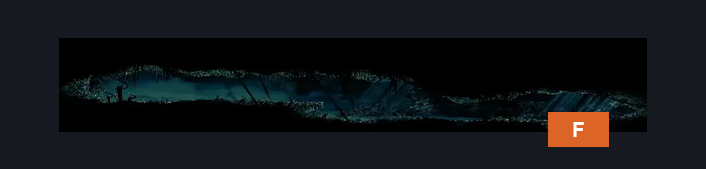
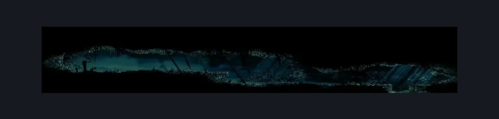

# Shellgrave (Shellgrave)

**Game ID:** Shellgrave

**Contributors:** Pyxl

## Subrooms

No subrooms defined.

## Room Transitions

| Alias | Name | From subroom | Destination | Destination alias | Requirements | TODO | Verification | Annotated | Notes |
| --- | --- | --- | --- | --- | --- | --- | --- | --- | --- |
| F | bot1 |  | [Shellwood Left Side Long Pond Room (Shellwood_04b)](shellwood-left-side-long-pond-room.md) | RC | None |  | Verified | ✓ |  |

## Subroom Connections

No subroom connections defined.

## Check Locations

| No. | Check | Subroom | Requirements | TODO | Verification | Location Type | Annotated | Notes |
| --- | --- | --- | --- | --- | --- | --- | --- | --- |
| 1 | Rosary Cache |  | None |  | Verified | resource | ✓ | Not included no id |
| 2 | Save Plinney |  | ACT 3 |  | Verified | event | ✓ | Plinney comes here upon starting act and starts an encounter |
| 3 | Pilgrim Bellbearer 1 |  | Prereq save plinney |  | Verified | enemy | ✓ |  |
| 4 | Pilgrim Guide 1 |  | Prereq save plinney |  | Verified | enemy | ✓ |  |
| 5 | Covetous Pilgrim 1 |  | Prereq save plinney |  | Verified | enemy | ✓ |  |
| 6 | Pilgrim Groveller 1 |  | Prereq save plinney |  | Verified | enemy | ✓ |  |
| 7 | Pilgrim Pouncer 1 |  | Prereq save plinney |  | Verified | enemy | ✓ |  |
| 8 | Pilgrim Pouncer 2 |  | Prereq save plinney |  | Verified | enemy | ✓ |  |
| 9 | Pilgrim Bellbearer 2 |  | Prereq save plinney |  | Verified | enemy | ✓ |  |
| 10 | Pilgrim Hulk 1 |  | Prereq save plinney |  | Verified | enemy | ✓ |  |
| 11 | Pilgrim Groveller 2 |  | Prereq save plinney |  | Verified | enemy | ✓ |  |
| 12 | Pilgrim Hulk 2 |  | Prereq save plinney |  | Verified | enemy | ✓ |  |
| 13 | Pilgrim Guide 2 |  | Prereq save plinney |  | Verified | enemy | ✓ |  |
| 14 | Pilgrim Hulk 3 |  | Prereq save plinney |  | Verified | enemy | ✓ |  |
| 15 | Rosary Pilgrim 1 |  | None |  | Verified | enemy | ✓ |  |

## Room Images

### Connections

### Checks

### Scene

