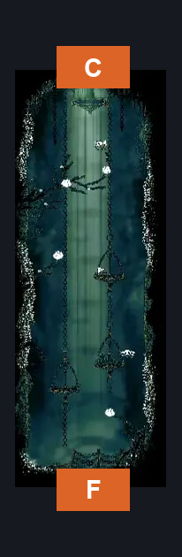
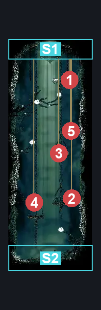
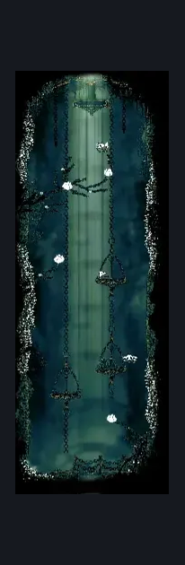

# shellwood Far Left Tall Room (Shellwood_04c)

**Game ID:** Shellwood_04c

**Contributors:** Pyxl

## Subrooms

| No. | Subroom | Annotated |
| --- | --- | --- |
| S1 | Top | ✓ |
| S2 | Bottom | ✓ |

## Room Transitions

| Alias | Name | From subroom | Destination | Destination alias | Requirements | TODO | Verification | Annotated | Notes |
| --- | --- | --- | --- | --- | --- | --- | --- | --- | --- |
| C | top1 | Top | [Shellwood Connection To Blasted steps (Shellwood_08)](shellwood-connection-to-blasted-steps.md) | F | None |  | Verified | ✓ |  |
| F | bot1 | Bottom | [Shellwood Left Side Long Pond Room (Shellwood_04b)](shellwood-left-side-long-pond-room.md) | LC | None |  | Verified | ✓ |  |

## Subroom Connections

| Alias | Name | Source | Destination | Requirements | TODO | Verification | Annotated | Notes |
| --- | --- | --- | --- | --- | --- | --- | --- | --- |
| A | 04c | Bottom | Top | ( Faydown Cloak AND Hard enemy pogo ) OR cling grip OR silk soar OR ( Dash AND Medium Scuttlebrace AND Faydown Cloak ) |  | Verified | ✓ |  |
| A | 04c | Top | Bottom | None |  | Verified | ✓ |  |

## Check Locations

| No. | Check | Subroom | Requirements | TODO | Verification | Location Type | Annotated | Notes |
| --- | --- | --- | --- | --- | --- | --- | --- | --- |
| 1 | Winged Pilgrim Bellbearer 1 | Top | None |  | Verified | enemy | ✓ |  |
| 2 | Winged Pilgrim Bellbearer 2 | Top | Normal World Spawn |  | Verified | enemy | ✓ |  |
| 3 | Winged Pilgrim 1 | Top | Normal World Spawn |  | Verified | enemy | ✓ |  |
| 4 | Winged Pilgrim Bellbearer 3 | Top | Black Thread World Spawn |  | Verified | enemy | ✓ |  |
| 5 | Winged Pilgrim 2 | Top | Black Thread World Spawn |  | Verified | enemy | ✓ |  |

## Room Images

### Connections

### Checks

### Scene

