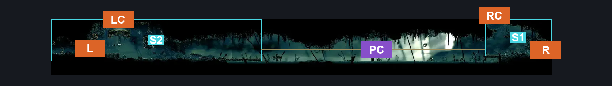
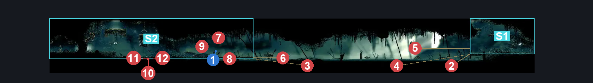
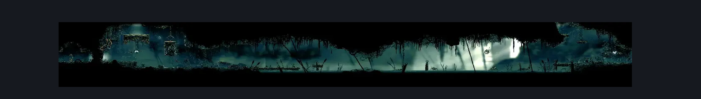

# Shellwood Left Side Long Pond Room (Shellwood_04b)

**Game ID:** Shellwood_04b

**Contributors:** Pyxl

## Subrooms

| No. | Subroom | Annotated |
| --- | --- | --- |
| S1 | Right Lake | ✓ |
| S2 | Left Lake | ✓ |

## Room Transitions

| Alias | Name | From subroom | Destination | Destination alias | Requirements | TODO | Verification | Annotated | Notes |
| --- | --- | --- | --- | --- | --- | --- | --- | --- | --- |
| R | right1 | Right Lake | [Shellwood Lower Left Tall Room (Shellwood_03)](shellwood-lower-left-tall-room.md) | LL | None |  | Verified | ✓ |  |
| RC | top2 | Right Lake | [Shellgrave (Shellgrave)](shellgrave.md) | F | Ledge grab Left OR Ledge Grab Right OR Faydown Cloak OR Silk Soar OR Easy pogo off pondcatcher OR Cling Grip Right OR Cling Grip Left |  | Verified | ✓ |  |
| L | left1 | Left Lake | [Shellwood Lower Toll bench (Shellwood_08c)](shellwood-lower-toll-bench.md) | R | Break Vines Left |  | Verified | ✓ |  |
| LC | top1 | Left Lake | [shellwood Far Left Tall Room (Shellwood_04c)](shellwood-far-left-tall-room.md) | F | medium pogo off pondcatcher OR Cling grip Right OR Cling Grip Left OR Silk soar OR Faydown Cloak OR Easy Scuttlebrace |  | Verified | ✓ |  |

## Subroom Connections

| Alias | Name | Source | Destination | Requirements | TODO | Verification | Annotated | Notes |
| --- | --- | --- | --- | --- | --- | --- | --- | --- |
| PC | Pond Crossing | Left Lake | Right Lake | Swim OR Clawline Right OR ( Sprint Right AND Drifters Cloak ) OR ( Faydown Cloak AND easy pogo off pond skipper) OR ( Drifters Cloak AND easy Pogo off pond skipper ) |  | Verified | ✓ |  |
| PC | Pond Crossing | Right Lake | Left Lake | Swim OR Clawline left OR ( Sprint left AND Drifters Cloak ) OR ( Faydown Cloak AND easy Pogo off pond skipper ) OR ( Drifters Cloak AND easy Pogo off pond skipper ) |  | Verified | ✓ |  |

## Check Locations

| No. | Check | Subroom | Requirements | TODO | Verification | Location Type | Annotated | Notes |
| --- | --- | --- | --- | --- | --- | --- | --- | --- |
| 1 | Garmond and Zaza Act 3 Meeting Shellwood | Left Lake | Act 3 |  | Verified | event | ✓ |  |
| 2 | Pond Skipper 1 | Right Lake | None |  | Verified | enemy | ✓ |  |
| 3 | Pond Skipper 2 | Left Lake | None |  | Verified | enemy | ✓ |  |
| 4 | Pond Skipper 3 | Right Lake | None |  | Verified | enemy | ✓ |  |
| 5 | Pondcatcher 1 | Right Lake | None |  | Verified | enemy | ✓ |  |
| 6 | Pondcatcher 2 | Left Lake | Normal World Spawn |  | Verified | enemy | ✓ |  |
| 7 | Void Mass 1 | Left Lake | Black Thread World Spawn |  | Verified | enemy | ✓ |  |
| 8 | Pilgrim Hornfly 1 | Left Lake | Black Thread World Spawn |  | Verified | enemy | ✓ |  |
| 9 | Pondcatcher 3 | Left Lake | Black Thread World Spawn |  | Verified | enemy | ✓ |  |
| 10 | Shellwood Gnat 1 | Left Lake | None |  | Verified | enemy | ✓ |  |
| 11 | Shellwood Gnat 2 | Left Lake | None |  | Verified | enemy | ✓ |  |
| 12 | Shellwood Gnat 3 | Left Lake | None |  | Verified | enemy | ✓ |  |

## Room Images

### Connections

### Checks

### Scene

