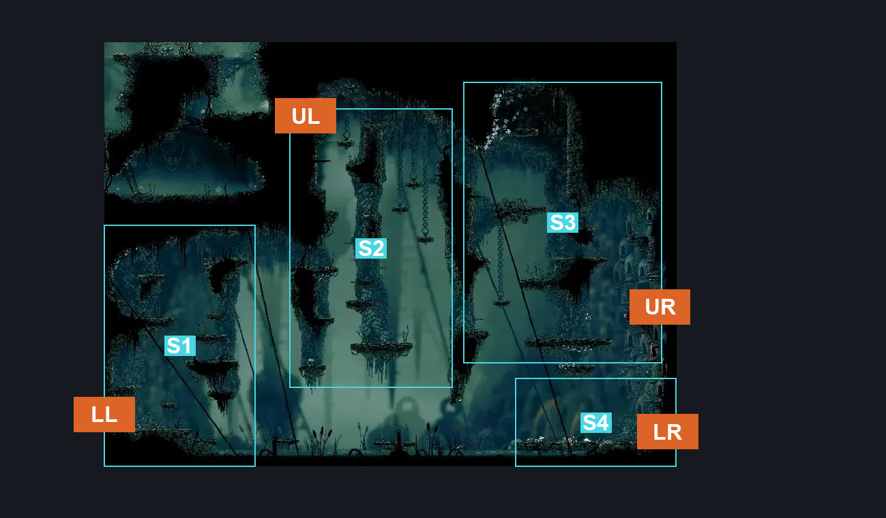
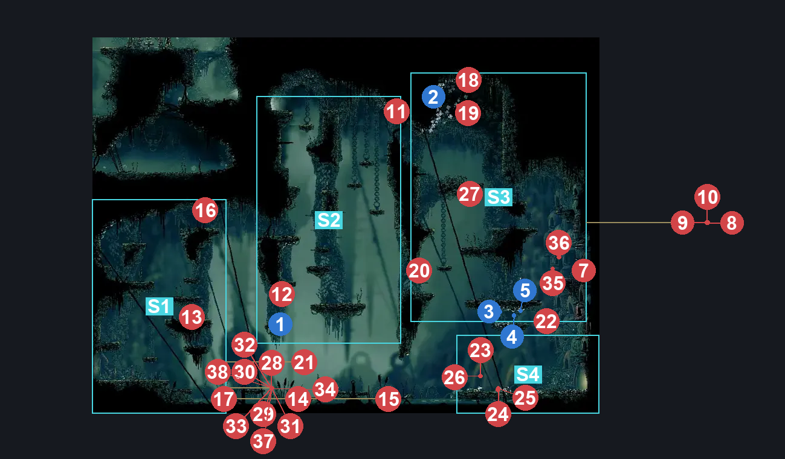
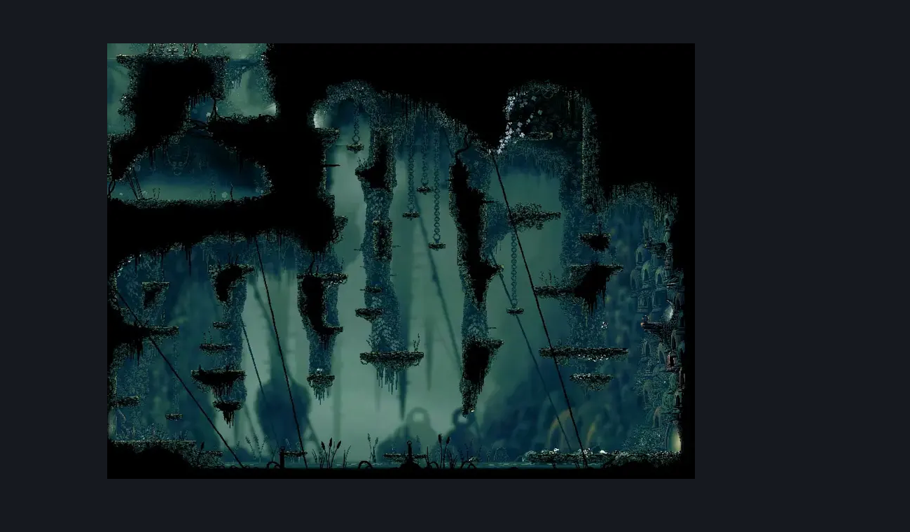

# Shellwood Right Side Big room (Shellwood_01)

**Game ID:** Shellwood_01

**Contributors:** Pyxl

## Subrooms

| No. | Subroom | Annotated |
| --- | --- | --- |
| S1 | Ground Level Left | ✓ |
| S2 | Central Platforms | ✓ |
| S3 | Right Platforms | ✓ |
| S4 | Ground Level Right | ✓ |

## Room Transitions

| Alias | Name | From subroom | Destination | Destination alias | Requirements | TODO | Verification | Annotated | Notes |
| --- | --- | --- | --- | --- | --- | --- | --- | --- | --- |
| UR | right1 | Right Platforms | [Long Pin (Belltown_Room_shellwood)](long-pin.md) | L | Prereq Longpin Nest |  | Verified | ✓ |  |
| UL | left1 | Central Platforms | [Shellwood Sister Splinter Bench (Shellwood_01b)](shellwood-sister-splinter-bench.md) | LR | None |  | Verified | ✓ |  |
| LR | right2 | Ground Level Right | [Bellhart Hallway to Shellwood (Belltown_07)](../bellhart/bellhart-hallway-to-shellwood.md) | L | None |  | Verified | ✓ |  |
| LL | left2 | Ground Level Left | [Shellwood Big Room Left (Shellwood_02)](shellwood-big-room-left.md) | LR | Prereq Big Door Button IN Shellwood Big Room Left |  | Verified | ✓ |  |

## Subroom Connections

| Alias | Name | Source | Destination | Requirements | TODO | Verification | Annotated | Notes |
| --- | --- | --- | --- | --- | --- | --- | --- | --- |
| LA | Lake | Ground Level Left | Ground Level Right | ( Dash Right AND ( Sprint Right AND ( Drifters Cloak OR Easy pogo off pond skipper OR Easy Beast Pogo OR Hard Reaper Pogo OR ( medium hunter pogo AND Cling Grip Right  ) )  ) ) OR Clawline Right OR Sharpdart OR Swim OR ( Faydown Cloak AND Drifters Cloak ) OR ( Medium Shaman Pogo AND Medium Scuttlebrace ) |  | Verified | ✓ |  |
| LA | Lake | Ground Level Right | Ground Level Left | ( Dash Left AND ( Sprint Left AND ( Drifters Cloak OR Easy pogo off pond skipper OR Easy Beast Pogo OR Hard Reaper Pogo )  ) ) OR Clawline Left OR Sharpdart OR Swim OR ( Faydown Cloak AND Drifters Cloak ) OR ( Medium Shaman Pogo AND Medium Scuttlebrace ) |  | Verified | ✓ |  |
| C1 | Chasm 1 | Ground Level Left | Central Platforms | ( Ledge Grab Right AND Ledge Grab left AND ( Dash Right OR Drifters Cloak OR Easy Beast Crest pogo ) ) OR Clawline Right OR ( Cling Grip Right AND Cling Grip Left ) OR Silk Soar OR Sharpdart OR Faydown Cloak |  | Verified | ✓ |  |
| C1 | Chasm 1 | Central Platforms | Ground Level Left | None |  | Verified | ✓ |  |
| C2 | Chasm 2 | Central Platforms | Right Platforms | Ledge Grab OR Faydown Cloak OR Silk Soar OR Cling grip OR Dash OR Scuttlebrace OR Clawline  OR Sprint |  | Verified | ✓ |  |
| C2 | Chasm 2 | Right Platforms | Central Platforms | None |  | Verified | ✓ |  |
| C3 | Chasm 3 | Right Platforms | Ground Level Right | None |  | Verified | ✓ |  |
| C3 | Chasm 3 | Ground Level Right | Right Platforms | Silk Soar OR ( Cling Grip Right AND Faydown Cloak  AND ( Swim OR ( Easy Enemy Pogo AND ( Sprint Left OR Dash Left ) ) OR Drifters Cloak OR Clawline Left OR Sharpdart ) ) |  | Verified | ✓ |  |

## Check Locations

| No. | Check | Subroom | Requirements | TODO | Verification | Location Type | Annotated | Notes |
| --- | --- | --- | --- | --- | --- | --- | --- | --- |
| 1 | Shellwood - Frayed Rosary String | Central Platforms | None |  | Verified | collectible | ✓ |  |
| 2 | Pollip Heart Right Side Big Room | Right Platforms | Cling Grip Right OR Silk Soar OR Scuttlebrace OR ( Medium enemy pogo AND medium pogo off shellwood gnat ) |  | Verified | collectible | ✓ |  |
| 3 | Shell shard Cache: Outside Longpin 1 | Right Platforms | None |  | Verified | resource | ✓ |  |
| 4 | Shell shard Cache: Outside Longpin 2 | Right Platforms | None |  | Verified | resource | ✓ |  |
| 5 | Shell shard Cache: Outside Longpin 3 | Right Platforms | None |  | Verified | resource | ✓ |  |
| 6 | Longpin Nest | Right Platforms | None |  | Verified | blockade |  |  |
| 7 | Control 1 | Right Platforms | Normal World Spawn |  | Verified | enemy | ✓ |  |
| 8 | Wood Wasp 1 | Right Platforms | Normal World Spawn |  | Verified | enemy | ✓ |  |
| 9 | Wood Wasp 2 | Right Platforms | Normal World Spawn |  | Verified | enemy | ✓ |  |
| 10 | Wood Wasp 3 | Right Platforms | Normal World Spawn |  | Verified | enemy | ✓ |  |
| 11 | Shellwood Goomba Flyer (2) 1 | Central Platforms | None |  | Verified | enemy | ✓ |  |
| 12 | Shellwood Goomba Flyer (1) 1 | Central Platforms | None |  | Verified | enemy | ✓ |  |
| 13 | Shellwood Goomba 1 | Ground Level Left | None |  | Verified | enemy | ✓ |  |
| 14 | Pond Skipper 1 | Ground Level Left | None |  | Verified | enemy | ✓ |  |
| 15 | Pond Skipper 2 | Ground Level Left | None |  | Verified | enemy | ✓ |  |
| 16 | Shellwood Goomba (2) 1 | Ground Level Left | None |  | Verified | enemy | ✓ |  |
| 17 | Pond Skipper 3 | Ground Level Left | None |  | Verified | enemy | ✓ |  |
| 18 | Wood Wasp 4 | Right Platforms | None |  | Verified | enemy | ✓ |  |
| 19 | Wood Wasp 5 | Right Platforms | None |  | Verified | enemy | ✓ |  |
| 20 | Shellwood Goomba Flyer 1 | Right Platforms | Normal World Spawn |  | Verified | enemy | ✓ |  |
| 21 | Pondcatcher 1 | Ground Level Left | Normal World Spawn |  | Verified | enemy | ✓ |  |
| 22 | Shellwood Goomba (6) 1 | Right Platforms | Normal World Spawn |  | Verified | enemy | ✓ |  |
| 23 | Pondcatcher 2 | Ground Level Right | Black Thread World Spawn |  | Verified | enemy | ✓ |  |
| 24 | Pilgrim Hornfly 1 | Ground Level Right | Black Thread World Spawn |  | Verified | enemy | ✓ |  |
| 25 | Elder Pilgrim 1 | Ground Level Right | Black Thread World Spawn |  | Verified | enemy | ✓ |  |
| 26 | Pondcatcher 3 | Ground Level Right | Black Thread World Spawn |  | Verified | enemy | ✓ |  |
| 27 | Shellwood Goomba Flyer (4) 1 | Right Platforms | Black Thread World Spawn |  | Verified | enemy | ✓ |  |
| 28 | Shellwood Gnat 1 | Ground Level Left | Prereq shellwood goomba flyer 1 |  | Verified | enemy | ✓ |  |
| 29 | Shellwood Gnat 2 | Ground Level Left | Prereq shellwood goomba flyer 1 |  | Verified | enemy | ✓ |  |
| 30 | Shellwood Gnat 3 | Ground Level Left | Prereq shellwood goomba flyer 1 |  | Verified | enemy | ✓ |  |
| 31 | Shellwood Gnat 4 | Ground Level Left | Prereq shellwood goomba flyer 1 |  | Verified | enemy | ✓ |  |
| 32 | Shellwood Gnat 5 | Ground Level Left | Prereq shellwood goomba flyer 1 |  | Verified | enemy | ✓ |  |
| 33 | Shellwood Gnat 6 | Ground Level Left | Prereq shellwood goomba flyer 1 |  | Verified | enemy | ✓ |  |
| 34 | Shellwood Gnat 7 | Ground Level Left | Prereq shellwood goomba flyer 1 |  | Verified | enemy | ✓ |  |
| 35 | Wood Wasp 6 | Right Platforms | None |  | Verified | enemy | ✓ |  |
| 36 | Wood Wasp 7 | Right Platforms | None |  | Verified | enemy | ✓ |  |
| 37 | Shellwood Gnat 8 | Ground Level Left | Prereq shellwood goomba flyer 1 |  | Verified | enemy | ✓ |  |
| 38 | Shellwood Gnat 9 | Ground Level Left | Prereq shellwood goomba flyer 1 |  | Verified | enemy | ✓ |  |

## Room Images

### Connections

### Checks

### Scene

