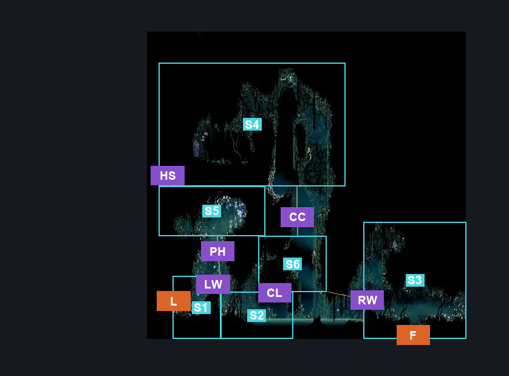
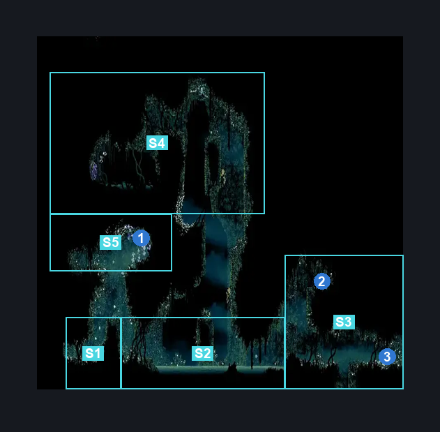
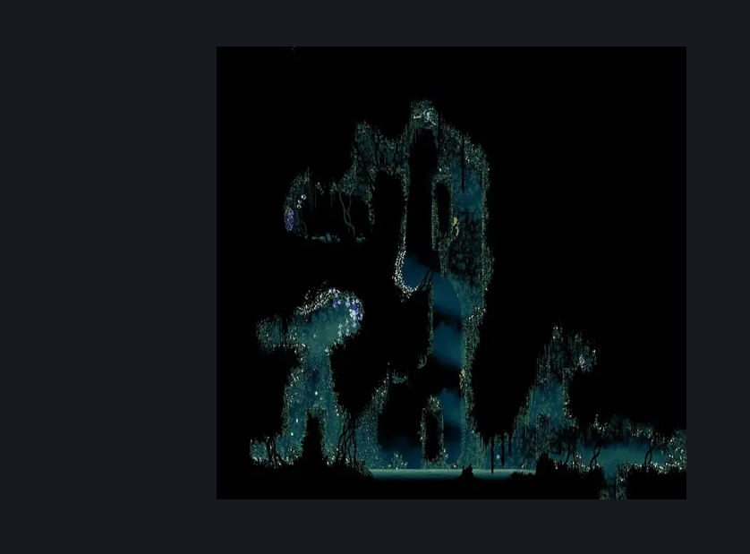

# Shellwood Top Room (Shellwood_26)

**Game ID:** Shellwood_26

**Contributors:** Pyxl

## Subrooms

| No. | Subroom | Annotated |
| --- | --- | --- |
| S1 | Left Side | ✓ |
| S2 | Central Left | ✓ |
| S3 | Right Side | ✓ |
| S4 | Upper Area | ✓ |
| S5 | Pollip Room | ✓ |
| S6 | Central Upper | ✓ |

## Room Transitions

| Alias | Name | From subroom | Destination | Destination alias | Requirements | TODO | Verification | Annotated | Notes |
| --- | --- | --- | --- | --- | --- | --- | --- | --- | --- |
| L | left1 | Left Side | [Cling Grip Room (Shellwood_10)](cling-grip-room.md) | UR | None |  | Verified | ✓ |  |
| F | bot1 | Right Side | [Sister Splinter (Shellwood_18)](sister-splinter.md) | C | None |  | Verified | ✓ |  |

## Subroom Connections

| Alias | Name | Source | Destination | Requirements | TODO | Verification | Annotated | Notes |
| --- | --- | --- | --- | --- | --- | --- | --- | --- |
| LW | Left Wall | Left Side | Central Left | Cling Grip Left OR Cling Grip Right OR Easy Scuttlebrace OR Faydown Cloak OR Silk Soar |  | Verified | ✓ |  |
| LW | Left Wall | Central Left | Left Side | Cling Grip Left OR Easy Scuttlebrace OR Faydown Cloak OR Silk Soar |  | Verified | ✓ |  |
| RW | Right Wall | Central Upper | Right Side | ( Swim AND ( CLing Grip Right OR Easy Scuttlebrace ) ) OR ( ( Clawline RIghT AND ( Cling Grip Right OR Medium Scuttlebrace ) AND ( Medium Pogo off Pond Skipper OR Easy damage boost OR Drifters Cloak OR Faydown Cloak OR Dash Right  ) ) ) OR ( Hard Shaman Pogo AND Hard Scuttlebrace ) |  | Verified | ✓ |  |
| RW | Right Wall | Right Side | Central Upper | ( Cling Grip Left OR Easy Scuttlebrace ) AND ( Swim OR ( Clawline Left AND ( Faydown Cloak OR Drifters Cloak OR Hard Shaman Pogo ) ) ) |  | Verified | ✓ |  |
| HS | Hidden Shaft | Pollip Room | Upper Area | prereq Shellwood 26 Wall AND Silk Soar AND ( Swim AND ( Cling Grip Right OR ( Easy Scuttlebrace AND ( Hard Shaman Pogo OR Faydown Cloak ) ) ) ) |  | Verified | ✓ |  |
| HS | Hidden Shaft | Upper Area | Pollip Room | prereq Shellwood 26 Wall AND ( Swim OR ( Clawline Left OR ( Easy Shaman Pogo AND Hard Scuttlebrace ) ) ) |  | Verified | ✓ |  |
| CC | Central Shaft | Central Upper | Upper Area | Silk Soar OR Cling Grip Right OR Easy Scuttlebrace |  | Verified | ✓ |  |
| CC | Central Shaft | Upper Area | Central Upper | None |  | Verified | ✓ |  |
| PH | Pollip Hole | Central Left | Pollip Room | Silk Soar OR ( Faydown Cloak AND ( Ledge Grab OR Cling Grip OR ( Easy Heal stall AND Easy Beast Pogo ) ) ) |  | Verified | ✓ |  |
| PH | Pollip Hole | Pollip Room | Central Left | None |  | Verified | ✓ |  |
| CL | Central Lake | Central Left | Central Upper | ( Swim AND ( Cling Grip Right OR Cling Grip Left OR Easy Scuttlebrace ) ) OR ( Clawline Right AND ( Faydown Cloak OR Cling Grip Right OR Easy Scuttlebrace ) ) OR ( Sprint Right AND Cling Grip Right AND ( Dash Right OR Faydown Cloak OR Drifters Cloak OR Easy Beast Pogo ) ) |  | Verified | ✓ |  |
| CL | Central Lake | Central Upper | Central Left | Clawline Left OR Drifters Cloak OR Swim OR ( Sprint Left AND ( Easy Hunter pogo OR Easy Beast Pogo OR Dash Left OR Faydown Cloak OR Easy Scuttlebrace ) ) |  | Verified | ✓ |  |

## Check Locations

| No. | Check | Subroom | Requirements | TODO | Verification | Location Type | Annotated | Notes |
| --- | --- | --- | --- | --- | --- | --- | --- | --- |
| 1 | Pollip Heart #4 | Pollip Room | None |  | Verified | collectible | ✓ |  |
| 2 | Rosary cache: Shellwood Top Room | Right Side | Faydown Cloak OR Silk Soar OR Easy Scuttlebrace OR ( Cling Grip Left AND CLing Grip RIght ) |  | Verified | resource | ✓ |  |
| 3 | Resting Site: Shellwood | Right Side | prereq THE A Vassal Lost Wish Promised |  | Verified | event | ✓ |  |
| 4 | Shellwood 26 Wall | Upper Area | ( Swim OR ( Clawline Left OR ( Easy Shaman Pogo AND Hard Scuttlebrace ) ) ) |  | Verified | blockade | ✓ |  |
| 5 | Control 1 | Upper Area | ( Swim OR ( Clawline Left OR ( Easy Shaman Pogo AND Hard Scuttlebrace ) ) ) |  | Verified | enemy | ✓ |  |
| 6 | Wood Wasp 1 | Upper Area | None |  | Verified | enemy | ✓ |  |
| 7 | Wood Wasp 2 | Upper Area | None |  | Verified | enemy | ✓ |  |
| 8 | Wood Wasp 3 | Upper Area | None |  | Verified | enemy | ✓ |  |
| 9 | Pond Skipper 1 | Central Left | None |  | Verified | enemy | ✓ |  |
| 10 | Pond Skipper 2 | Central Left | None |  | Verified | enemy | ✓ |  |
| 11 | Splinterbark 1 | Upper Area | Normal World Spawn |  | Verified | enemy | ✓ |  |
| 12 | Splinterbark 2 | Upper Area | Normal World Spawn |  | Verified | enemy | ✓ |  |
| 13 | Void Mass 1 | Upper Area | Black Thread World Spawn |  | Verified | enemy | ✓ |  |
| 14 | Splinterbark 3 | Upper Area | Black Thread World Spawn |  | Verified | enemy | ✓ |  |
| 15 | Splinterbark 4 | Upper Area | Black Thread World Spawn |  | Verified | enemy | ✓ |  |
| 16 | Shellwood Gnat 1 | Upper Area | None |  | Verified | enemy | ✓ |  |
| 17 | Shellwood Gnat 2 | Upper Area | None |  | Verified | enemy | ✓ |  |
| 18 | Wood Wasp 4 | Upper Area | None |  | Verified | enemy | ✓ |  |
| 19 | Wood Wasp 5 | Upper Area | None |  | Verified | enemy | ✓ |  |

## Room Images

### Connections

### Checks

### Scene

