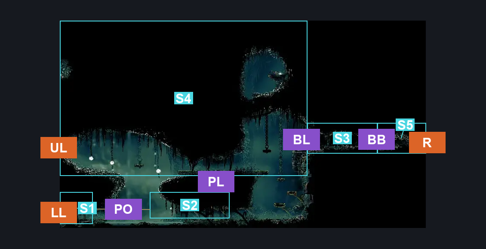
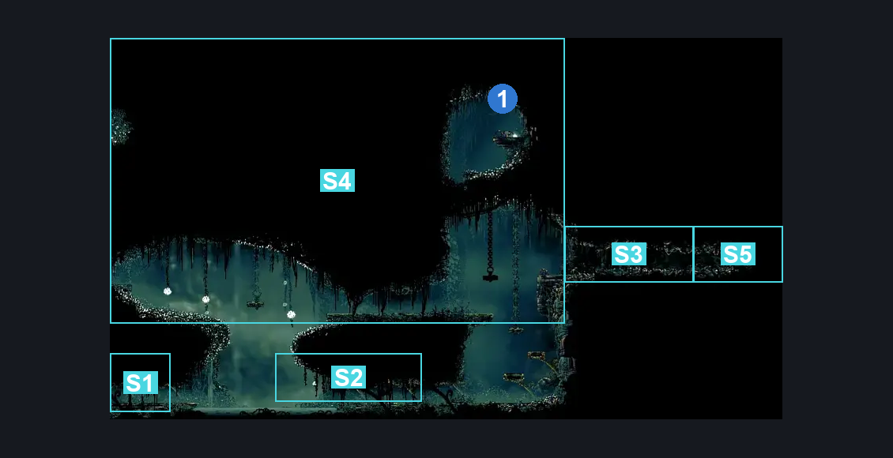
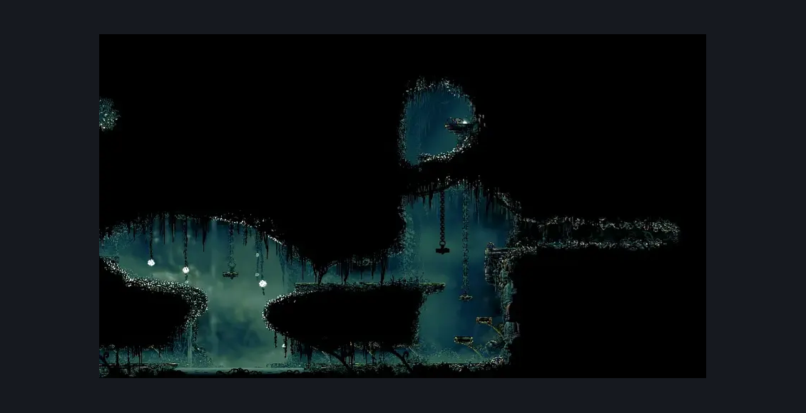

# Shellwood Upper Bellhart Entrance (Shellwood_13)

**Game ID:** Shellwood_13

**Contributors:** Pyxl

## Subrooms

| No. | Subroom | Annotated |
| --- | --- | --- |
| S1 | Left Pond | ✓ |
| S2 | Right Pond | ✓ |
| S3 | Bell Ledge | ✓ |
| S4 | Upper Area | ✓ |
| S5 | Right Exit Area | ✓ |

## Room Transitions

| Alias | Name | From subroom | Destination | Destination alias | Requirements | TODO | Verification | Annotated | Notes |
| --- | --- | --- | --- | --- | --- | --- | --- | --- | --- |
| UL | left1 | Upper Area | [Sister Splinter (Shellwood_18)](sister-splinter.md) | R | ((( Easy Hunter Crest pogo OR Easy Beast Crest pogo OR medium Architect Crest pogo ) AND Ledge Grab left ) OR ( Medium Heal Stall AND ( medium Reaper Crest pogo OR Hard Shaman Crest pogo OR easy Wanderer Crest pogo OR hard Witch Crest pogo ) ) ) OR Clawline left OR Dash left  OR Drifter's Cloak OR Faydown Cloak OR Sharpdart |  | Verified | ✓ |  |
| R | right1 | Right Exit Area | [Upper Bellhart (Belltown_04)](../bellhart/upper-bellhart.md) | UL | None |  | Verified | ✓ |  |
| LL | left2 | Left Pond | [Shellwood Sister Splinter Bench (Shellwood_01b)](shellwood-sister-splinter-bench.md) | UR | None |  | Verified | ✓ |  |

## Subroom Connections

| Alias | Name | Source | Destination | Requirements | TODO | Verification | Annotated | Notes |
| --- | --- | --- | --- | --- | --- | --- | --- | --- |
| BL | Bell Ledge | Bell Ledge | Upper Area | None |  | Verified | ✓ |  |
| BL | Bell Ledge | Upper Area | Bell Ledge | Cling Grip Right OR Faydown Cloak OR Silk soar OR Scuttlebrace |  | Verified | ✓ |  |
| PO | Pond | Left Pond | Right Pond | Swim OR Clawline right OR (Drifter's Cloak AND (Faydown Cloak OR (Sprint right AND Dash right ) OR (Sharpdart AND Ledge Grab right ))) OR (Faydown Cloak AND Sharpdart AND (Dash right OR easy Beast Crest pogo )) |  | Verified | ✓ |  |
| PO | Pond | Right Pond | Left Pond | Swim OR ( Clawline right AND ( Ledge Grab right OR Dash right OR Sharpdart OR easy beast Crest pogo OR Faydown Cloak ) ) OR ( Sprint right AND ( ( Sharpdart AND Dash right ) OR ( Sharpdart AND easy Beast Crest pogo ) OR ( Faydown Cloak AND Drifters Cloak ) OR ( Sharpdart AND Drifters Cloak) OR ( Faydown Cloak AND Sharpdart ) ) ) |  | Verified | ✓ |  |
| PL | Platforms | Upper Area | Right Pond | None |  | Verified | ✓ |  |
| PL | Platforms | Right Pond | Upper Area | Ledge Grab Left OR Ledge Grab Right OR Dash Right OR Dash Left OR Faydown Cloak OR Cling Grip Right OR Cling Grip Left OR Silk soar OR Easy Shaman Pogo |  | Verified | ✓ |  |
| BB | Break Bell Walls | Bell Ledge | Right Exit Area | Break Wall Right |  | Verified | ✓ |  |
| BB | Break Bell Walls | Right Exit Area | Bell Ledge | Break Wall Left |  | Verified | ✓ |  |

## Check Locations

| No. | Check | Subroom | Requirements | TODO | Verification | Location Type | Annotated | Notes |
| --- | --- | --- | --- | --- | --- | --- | --- | --- |
| 1 | Shard Bundle: Shellwood | Upper Area | Silk Soar OR ( ( Cling Grip Left OR Scuttlebrace ) AND ( Faydown Cloak OR ( ( Cling Grip Right OR Faydown Cloak OR Silk soar OR Scuttlebrace ) AND ( Drifters Cloak OR Clawline Left OR ( Dash Left AND Sprint Left ) OR Sharpdart OR (Sprint left AND Easy Beast pogo AND ( medium heal stall OR medium flea brew stall OR medium plasmium phial stall OR Medium flintslate stall) ) ) )  ) ) |  | Verified | collectible | ✓ |  |

## Room Images

### Connections

### Checks

### Scene

