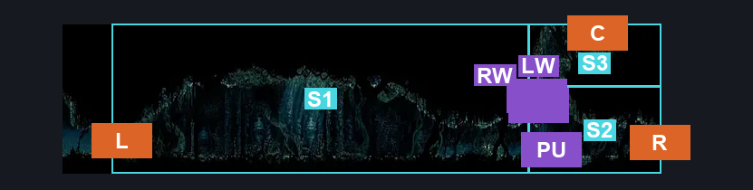
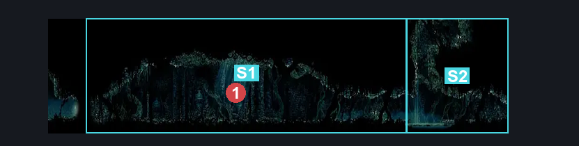
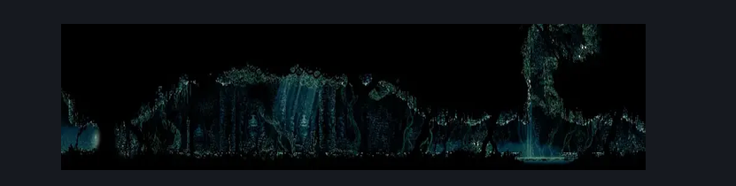

# Sister Splinter (Shellwood_18)

**Game ID:** Shellwood_18

**Contributors:** Pyxl

## Subrooms

| No. | Subroom | Annotated |
| --- | --- | --- |
| S1 | Arena Side | ✓ |
| S2 | Right Side | ✓ |
| S3 | Top SIde | ✓ |

## Room Transitions

| Alias | Name | From subroom | Destination | Destination alias | Requirements | TODO | Verification | Annotated | Notes |
| --- | --- | --- | --- | --- | --- | --- | --- | --- | --- |
| L | left1 | Arena Side | [Cling Grip Room (Shellwood_10)](cling-grip-room.md) | MR | None |  | Verified | ✓ |  |
| R | right1 | Right Side | [Shellwood Upper Bellhart Entrance (Shellwood_13)](shellwood-upper-bellhart-entrance.md) | UL | None |  | Verified | ✓ |  |
| C | top1 | Top SIde | [Shellwood Top Room (Shellwood_26)](shellwood-top-room.md) | F | Cling Grip Left OR Scuttlebrace OR Cling Grip Right OR Silk Soar OR Faydown Cloak |  | Verified | ✓ |  |

## Subroom Connections

| Alias | Name | Source | Destination | Requirements | TODO | Verification | Annotated | Notes |
| --- | --- | --- | --- | --- | --- | --- | --- | --- |
| PU | Puddle | Arena Side | Right Side | Swim OR ( Cling Grip left AND Ledge grab Right ) OR Dash Right OR Clawline Right OR SharpDart OR Drifters Cloak OR Faydown Cloak OR easy Beast Crest pogo OR Easy Scuttlebrace |  | Verified | ✓ |  |
| PU | Puddle | Right Side | Arena Side | Swim OR Dash Left OR Clawline Left OR SharpDart OR Drifters Cloak OR Faydown Cloak OR easy Beast Crest pogo |  | Verified | ✓ |  |
| LW | Left Wall | Arena Side | Top SIde | Cling Grip Left OR Medium Scuttlebrace |  | Verified | ✓ |  |
| LW | Left Wall | Top SIde | Arena Side | Easy Hunter Pogo OR Easy Beast Pogo OR Easy Architect Pogo OR ( Ledge Grab Left AND ( Medium Reaper Pogo OR Medium Shaman Pogo ) ) OR Dash Left OR Drifters Cloak OR Faydown Cloak OR Clawline Left OR Scuttlebrace OR Swim OR Sharpdart |  | Verified | ✓ |  |
| RW | Rightwall but acutally still left | Right Side | Top SIde | ( ( Cling Grip Left OR Medium Scuttlebrace ) AND (  Sprint left OR Faydown Cloak OR Drifters Cloak OR Clawline Left ) ) OR ( Cling Grip Left AND Dash Left ) OR ( Medium Scuttlebrace AND Medium Scuttlebrace AND Medium Shaman Pogo ) |  | Verified | ✓ |  |
| RW | Rightwall but acutally still left | Top SIde | Right Side | Easy Hunter Pogo OR Easy Beast Pogo OR Easy Architect Pogo OR ( Ledge Grab Right AND ( Medium Reaper Pogo OR Medium Shaman Pogo ) ) OR Dash Right OR Drifters Cloak OR Faydown Cloak OR Clawline Right OR Scuttlebrace OR Swim OR Sharpdart |  | Verified | ✓ |  |

## Check Locations

| No. | Check | Subroom | Requirements | TODO | Verification | Location Type | Annotated | Notes |
| --- | --- | --- | --- | --- | --- | --- | --- | --- |
| 1 | Boss: Sister Splinter | Arena Side | None |  | Verified | boss | ✓ |  |
| 2 | Splinterbark 1 | Arena Side | None |  | Verified | enemy | ✓ | Sistersplinter summon |
| 3 | Splinterbark 2 | Arena Side | None |  | Verified | enemy | ✓ | Sistersplinter summon |
| 4 | Splinter Queen Spike 1 | Arena Side | None |  | Verified | enemy | ✓ | Sistersplinter summon |
| 5 | Splinter Queen Spike (1) 1 | Arena Side | None |  | Verified | enemy | ✓ | Sistersplinter summon |
| 6 | Splinter Queen Spike (2) 1 | Arena Side | None |  | Verified | enemy | ✓ | Sistersplinter summon |
| 7 | Splinter Queen Spike (3) 1 | Arena Side | None |  | Verified | enemy | ✓ | Sistersplinter summon |
| 8 | Splinter Queen Spike (4) 1 | Arena Side | None |  | Verified | enemy | ✓ | Sistersplinter summon |
| 9 | Splinter Queen Spike (5) 1 | Arena Side | None |  | Verified | enemy | ✓ | Sistersplinter summon |

## Room Images

### Connections

### Checks

### Scene

