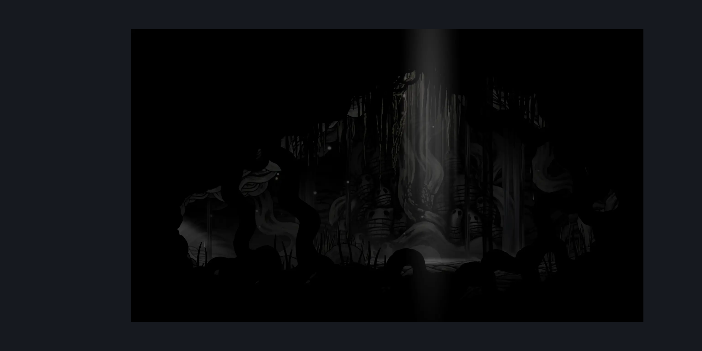

# Witch Chapel (Shellwood_25b)

**Game ID:** Shellwood_25b

**Contributors:** Pyxl

## Subrooms

No subrooms defined.

## Room Transitions

| Alias | Name | From subroom | Destination | Destination alias | Requirements | TODO | Verification | Annotated | Notes |
| --- | --- | --- | --- | --- | --- | --- | --- | --- | --- |
| L | Left1 |  | [Shellwood Diddy Basement Main (Shellwood_25)](shellwood-diddy-basement-main.md) | D | None |  | Verified | ✓ |  |
| QR | Quest Rebirth |  | [Greyroot (Room_Witch)](greyroot.md) | QR | invalid |  | Verified | ✓ | 1 way 1 use teleport from other side this is here just for the link |

## Subroom Connections

No subroom connections defined.

## Check Locations

| No. | Check | Subroom | Requirements | TODO | Verification | Location Type | Annotated | Notes |
| --- | --- | --- | --- | --- | --- | --- | --- | --- |
| 1 | import enemies |  |  | TODO | Needs verification |  |  |  |

## Notes

not sure the image is right based on the

## Room Images

### Connections

### Checks

### Scene

