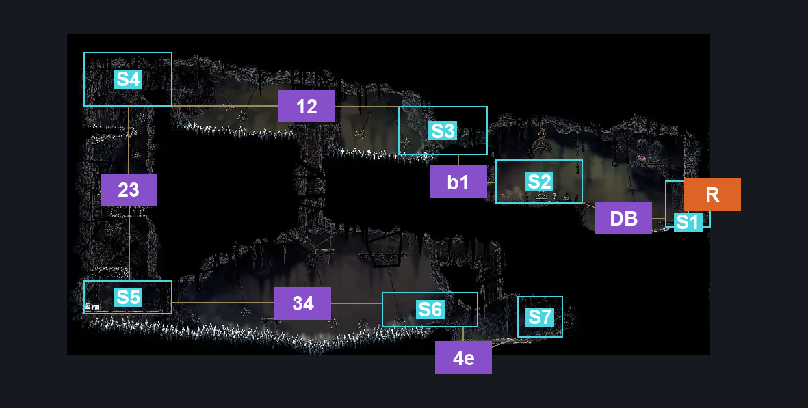
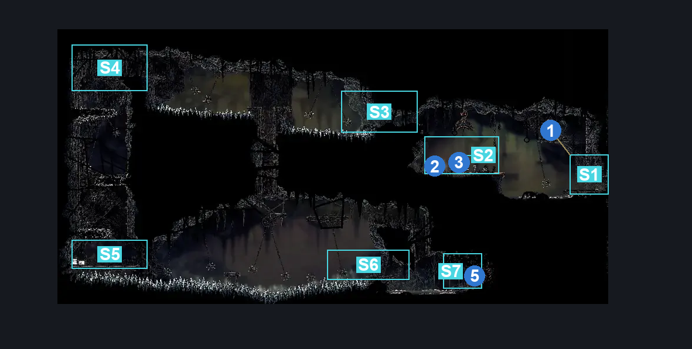
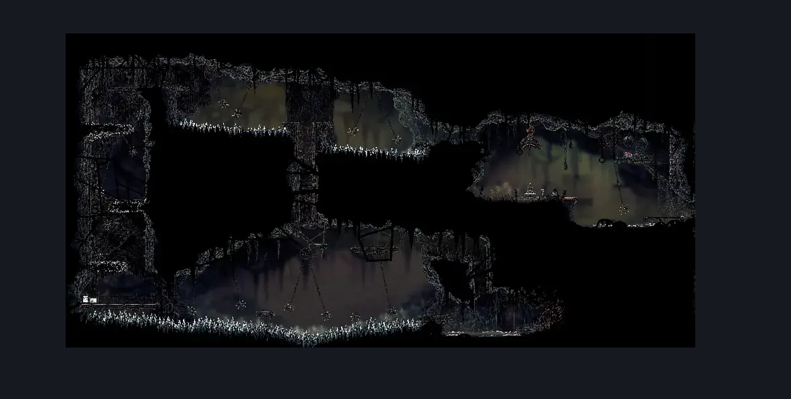

# Sinner's Road Bench (Dust_10)

**Game ID:** Dust_10

**Contributors:** herchey when he was chillin'

## Subrooms

| No. | Subroom | Annotated |
| --- | --- | --- |
| S1 | door | ✓ |
| S2 | bench | ✓ |
| S3 | spike hall 1 | ✓ |
| S4 | spike hall 2 | ✓ |
| S5 | spike hall 3 | ✓ |
| S6 | spike hall 4 | ✓ |
| S7 | end | ✓ |

## Room Transitions

| Alias | Name | From subroom | Destination | Destination alias | Requirements | TODO | Verification | Annotated | Notes |
| --- | --- | --- | --- | --- | --- | --- | --- | --- | --- |
| R | right | door | [Sinner's Road Vertical Hall West (Dust_02)](sinner-s-road-vertical-hall-west.md) | ML | none |  | Verified | ✓ |  |

## Subroom Connections

| Alias | Name | Source | Destination | Requirements | TODO | Verification | Annotated | Notes |
| --- | --- | --- | --- | --- | --- | --- | --- | --- |
| DB | to the bench | door | bench | Silk Soar OR swim OR ledge grab left |  | Verified | ✓ |  |
| b1 | going to fix the bench | bench | spike hall 1 | (cling grip left OR silk soar) AND break wall left |  | Verified | ✓ |  |
| 12 | upper spike hall | spike hall 1 | spike hall 2 | proficient movement OR clawline left OR faydown cloak OR (drifter's cloak AND (ledge grab left OR cling grip left)) |  | Verified | ✓ |  |
| 23 | spike drop | spike hall 2 | spike hall 3 | proficient movement OR cling grip both |  | Verified | ✓ |  |
| 34 | lower spike hall | spike hall 3 | spike hall 4 | proficient movement OR drifter's cloak OR faydown cloak OR spike pogo |  | Verified | ✓ |  |
| 4e | end | spike hall 4 | end | swim OR (drifter's cloak AND (clawline OR sharpdart)) OR (faydown cloak AND (drifter's cloak OR dash OR sharpdart OR clawline)) OR (proficient movement AND (clawline OR sharpdart OR (drifter's cloak AND dash AND (ledge grab right OR cling grip right)))) |  | Verified | ✓ |  |

## Check Locations

| No. | Check | Subroom | Requirements | TODO | Verification | Location Type | Annotated | Notes |
| --- | --- | --- | --- | --- | --- | --- | --- | --- |
| 1 | Rosaries Looking Over The Sinner's Bench | door | Silk soar OR (Faydown AND cling grip right) |  | Verified | collectible | ✓ | Formerly: Rosary Cache: Sinner’s Road #8 |
| 2 | Buy Shakra's Maps! Sinner's Road Edition | bench | none |  | Verified | collectible | ✓ | Formerly: Map Purchase: Sinner's Road |
| 3 | Please Help Me Fix This Bench, Shakra | bench | Spend 40 Rosaries AND complete Unclogging The Overly Complicated Bench |  | Verified | bench | ✓ | Formerly: Sinner's Road Bench |
| 4 | Craw Summons | bench | Craw Summons Ready |  | Verified | collectible |  |  |
| 5 | Unclogging The Overly Complicated Bench | end | break vines right |  | Verified | blockade | ✓ | Formerly: Sinner's Road Bench |

## Room Images

### Connections

### Checks

### Scene

