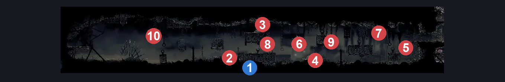
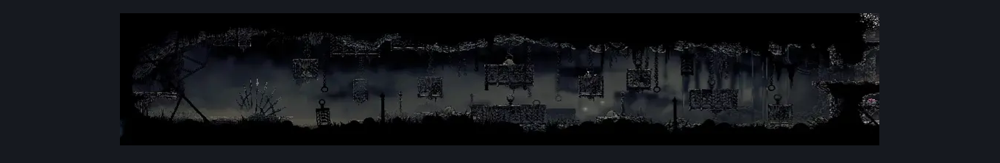

# Sinner's Road Entrance (Dust_01)

**Game ID:** Dust_01

**Contributors:** herchey and Moriko Kyoho's dog

## Subrooms

| No. | Subroom | Annotated |
| --- | --- | --- |
| S1 | center | ✓ |
| S2 | left | ✓ |
| S3 | right | ✓ |

## Room Transitions

| Alias | Name | From subroom | Destination | Destination alias | Requirements | TODO | Verification | Annotated | Notes |
| --- | --- | --- | --- | --- | --- | --- | --- | --- | --- |
| L | left | left | [Greymoor Halfway Home Exterior (Greymoor_03)](../greymoor/greymoor-halfway-home-exterior.md) | UR | none |  | Verified | ✓ |  |
| R | right | right | [Sinner's Road Vertical Hall West (Dust_02)](sinner-s-road-vertical-hall-west.md) | LL | none |  | Verified | ✓ |  |

## Subroom Connections

| Alias | Name | Source | Destination | Requirements | TODO | Verification | Annotated | Notes |
| --- | --- | --- | --- | --- | --- | --- | --- | --- |
| LC | left center | left | center | none |  | Verified | ✓ |  |
| LC | left center | center | left | ledge grab left OR cling grip left OR silk soar OR faydown cloak OR scuttlebrace |  | Verified | ✓ |  |
| RC | right center | right | center | none |  | Verified | ✓ |  |
| RC | right center | center | right | ledge grab right OR cling grip right OR silk soar OR faydown cloak OR scuttlebrace |  | Verified | ✓ |  |

## Check Locations

| No. | Check | Subroom | Requirements | TODO | Verification | Location Type | Annotated | Notes |
| --- | --- | --- | --- | --- | --- | --- | --- | --- |
| 1 | Caged Rosaries In the Sinner's Entryway | center | break wall left |  | Verified | collectible | ✓ | Formerly: Frayed Rosary String: Sinner's Road |
| 2 | Disease, the Muckroach | center | none |  | Verified | enemy | ✓ | Formerly: Muckroach 1 |
| 3 | Gag, the Muckroach | center | attack up OR have Tool: Conchcutter OR faydown cloak OR silk soar OR cling grip either |  | Verified | enemy | ✓ | Formerly: Muckroach 2 |
| 4 | Toilet, the Muckroach | center | none |  | Verified | enemy | ✓ | Formerly: Muckroach 3 |
| 5 | Roachfeeder 1 | center | invalid |  | Verified | enemy | ✓ | Disabled; no activation found. |
| 6 | Muckroach 4 | center | invalid |  | Verified | enemy | ✓ | caged and invincible (to non-cheating means)  Disabled; no activation found. |
| 7 | Muckroach 5 | center | invalid |  | Verified | enemy | ✓ | Disabled; no activation found. |
| 8 | Muckroach 6 | center | invalid |  | Verified | enemy | ✓ | Disabled; no activation found. |
| 9 | Muckroach 7 | center | invalid |  | Verified | enemy | ✓ | Invincible |
| 10 | Muckroach 8 | center | invalid |  | Verified | enemy | ✓ | caged and invincible (to non-cheating means) |

## Room Images

### Connections

### Checks

### Scene

