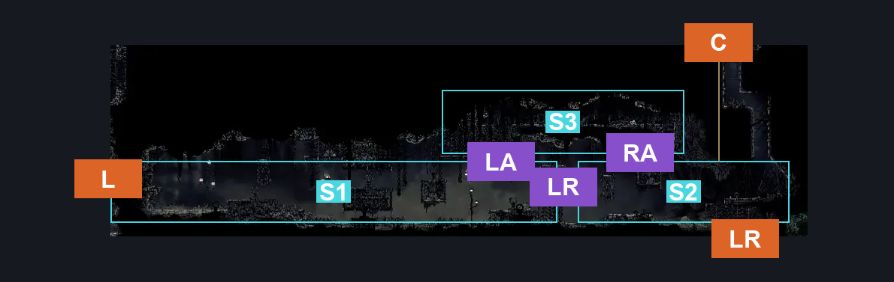
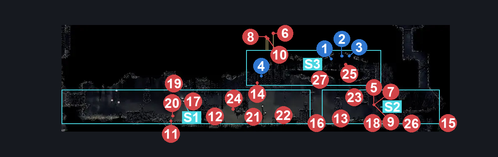
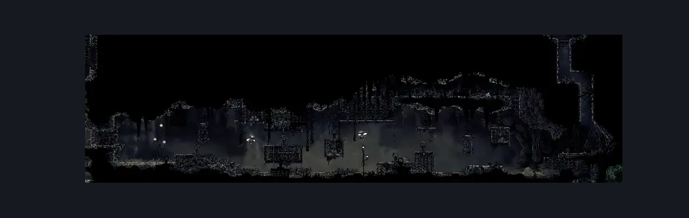

# Sinner's Road Muckroach Cages (Dust_03)

**Game ID:** Dust_03

**Contributors:** herchey and NOT these shitty muckroaches

## Subrooms

| No. | Subroom | Annotated |
| --- | --- | --- |
| S1 | left half | ✓ |
| S2 | right half | ✓ |
| S3 | attic | ✓ |

## Room Transitions

| Alias | Name | From subroom | Destination | Destination alias | Requirements | TODO | Verification | Annotated | Notes |
| --- | --- | --- | --- | --- | --- | --- | --- | --- | --- |
| C | ceiling | right half | [Sinner's Road Chef's Kitchen (Dust_Chef)](sinner-s-road-chef-s-kitchen.md) | H | (faydown cloak AND cling grip) OR silk soar |  | Verified | ✓ |  |
| LR | lower right | right half | [Sinner's Road Spike Basement (Dust_Barb)](sinner-s-road-spike-basement.md) | C | none |  | Verified | ✓ |  |
| L | left | left half | [Sinner's Road Vertical Hall West (Dust_02)](sinner-s-road-vertical-hall-west.md) | LR | none |  | Verified | ✓ |  |

## Subroom Connections

| Alias | Name | Source | Destination | Requirements | TODO | Verification | Annotated | Notes |
| --- | --- | --- | --- | --- | --- | --- | --- | --- |
| LR | left to right | left half | right half | none |  | Verified | ✓ |  |
| LR | left to right | right half | left half | Cling grip either OR ledge grab left OR silk soar OR dash OR easy pogo off muckroach OR faydown cloak |  | Verified | ✓ |  |
| LA | left to attic | left half | attic | Silk soar OR ledge grab both OR cling grip either OR faydown cloak |  | Verified | ✓ |  |
| LA | left to attic | attic | left half | none |  | Verified | ✓ |  |
| RA | right to attic | right half | attic | silk soar OR cling grip either OR faydown cloak |  | Verified | ✓ |  |
| RA | right to attic | attic | right half | none |  | Verified | ✓ |  |

## Check Locations

| No. | Check | Subroom | Requirements | TODO | Verification | Location Type | Annotated | Notes |
| --- | --- | --- | --- | --- | --- | --- | --- | --- |
| 1 | Shell Shard Cache: Sinner’s Road #1 | attic | none |  | Verified | collectible | ✓ | Check subroom |
| 2 | Shell Shard Cache: Sinner’s Road #2 | attic | none |  | Verified | collectible | ✓ |  |
| 3 | Shell Shard Cache: Sinner’s Road #3 | attic | none |  | Verified | collectible | ✓ |  |
| 4 | Rosary Cache: Sinner’s Road #4 | attic | none |  | Verified | collectible | ✓ |  |
| 5 | Roachcatcher 1 | right half | invalid |  | Verified | enemy | ✓ | disabled - hero, 10/29 |
| 6 | Muckroach 1 | attic | invalid |  | Verified | enemy | ✓ | disabled - hero, 10/29 |
| 7 | Roachcatcher 2 | right half | invalid |  | Verified | enemy | ✓ | disabled - hero, 10/29 |
| 8 | Muckroach 2 | attic | invalid |  | Verified | enemy | ✓ | disabled - hero, 10/29 |
| 9 | Roachcatcher 3 | right half | invalid |  | Verified | enemy | ✓ | disabled - hero, 10/29 |
| 10 | Muckroach 3 | attic | invalid |  | Verified | enemy | ✓ | disabled - hero, 10/29 |
| 11 | Muckroach 4 | left half | invalid |  | Verified | enemy | ✓ | disabled - hero, 10/29 |
| 12 | Roachfeeder 1 | left half | invalid |  | Verified | enemy | ✓ | disabled - hero, 10/29 |
| 13 | Roachfeeder 2 | right half | invalid |  | Verified | enemy | ✓ | disabled - hero, 10/29 |
| 14 | Muckroach 5 | attic | invalid |  | Verified | enemy | ✓ | disabled - hero, 10/29 |
| 15 | Muckroach 6 | right half | invalid |  | Verified | enemy | ✓ | disabled - hero, 10/29 |
| 16 | Muckroach 7 | right half | invalid |  | Verified | enemy | ✓ | disabled - hero, 10/29 |
| 17 | Muckroach 8 | left half | invalid |  | Verified | enemy | ✓ | disabled - hero, 10/29 |
| 18 | Stupid, the Muckroach | right half | invalid |  | Verified | enemy | ✓ | Formerly: Muckroach 9 |
| 19 | Useless, the Muckroach | left half | invalid |  | Verified | enemy | ✓ | disabled - hero, 10/29 |
| 20 | Roachfeeder 3 | left half | invalid |  | Verified | enemy | ✓ | disabled - hero, 10/29 |
| 21 | Roachfeeder 4 | left half | invalid |  | Verified | enemy | ✓ | disabled - hero, 10/29 |
| 22 | Spider, the Muckroach | left half | invalid |  | Verified | enemy | ✓ | disabled - hero, 10/29 |
| 23 | Muckroach 12 | right half | invalid |  | Verified | enemy | ✓ | caged and invincible |
| 24 | Muckroach 13 | left half | invalid |  | Verified | enemy | ✓ | caged and invincible |
| 25 | Mite 1 | attic | none |  | Verified | enemy | ✓ |  |
| 26 | Mite 2 | right half | Invalid |  | Verified | enemy | ✓ | Disabled; no activation found. |
| 27 | Void Mass 1 | attic | Black Thread World Spawn |  | Verified | enemy | ✓ |  |

## Notes

this room has a few disabled battle scenes which is why there are so many disabled and invalid enemies - hero, 10/29

## Room Images

### Connections

### Checks

### Scene

