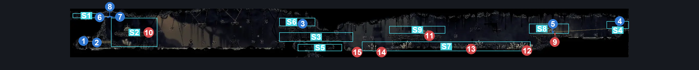
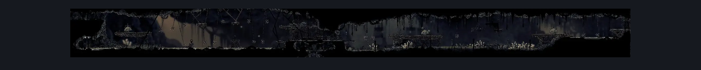

# Sinner's Road North Hall (Dust_05)

**Game ID:** Dust_05

**Contributors:** herchey boi

## Subrooms

| No. | Subroom | Annotated |
| --- | --- | --- |
| S1 | behind left wall | ✓ |
| S2 | left area | ✓ |
| S3 | middle area | ✓ |
| S4 | right door | ✓ |
| S5 | hatch | ✓ |
| S6 | chest plat | ✓ |
| S7 | low right | ✓ |
| S8 | right plat | ✓ |
| S9 | right keeper plat | ✓ |

## Room Transitions

| Alias | Name | From subroom | Destination | Destination alias | Requirements | TODO | Verification | Annotated | Notes |
| --- | --- | --- | --- | --- | --- | --- | --- | --- | --- |
| L | left | behind left wall | [Sinner's Road Mist Maze Completed (Dust_Maze_08_completed)](sinner-s-road-mist-maze-completed.md) | LR | none |  | Verified | ✓ |  |
| C | center | hatch | [Sinner's Road Vertical Hall West (Dust_02)](sinner-s-road-vertical-hall-west.md) | C | none |  | Verified | ✓ |  |
| R | right | right door | [Sinner's Road Vertical Hall East (Dust_06)](sinner-s-road-vertical-hall-east.md) | L | complete The Lever Gettin' You Outta The North Hall |  | Verified | ✓ |  |

## Subroom Connections

| Alias | Name | Source | Destination | Requirements | TODO | Verification | Annotated | Notes |
| --- | --- | --- | --- | --- | --- | --- | --- | --- |
| LWL | Behind left wall to left area | behind left wall | left area | complete Secret Wall Logic |  | Verified | ✓ |  |
| LWL | Behind left wall to left area | left area | behind left wall | complete Secret Wall Logic AND (Silk soar OR faydown cloak OR cling grip left OR scuttlebrace) |  | Verified | ✓ |  |
| LAM | Left area to middle area | left area | middle area | clawline right OR (sharpdart x 3 AND (drifter’s cloak OR faydown cloak)) OR (drifter’s cloak AND ((cling grip right AND ledge grab right) OR faydown cloak)) OR (swim AND ledge grab right) |  | Verified | ✓ |  |
| LAM | Left area to middle area | middle area | left area | clawline left OR (sharpdart AND (drifter’s cloak OR faydown cloak)) OR (drifter’s cloak AND faydown cloak) OR (swim AND (ledge grab left OR cling grip left)) |  | Verified | ✓ |  |
| MAH | Middle area to hatch | middle area | hatch | none |  | Verified | ✓ | Technically "any attack" is the requirement |
| MAH | Middle area to hatch | hatch | middle area | Ledge grab either OR cling grip either OR faydown cloak OR silk soar |  | Verified | ✓ |  |
| MAC | mid to chest | middle area | chest plat | faydown cloak OR silk soar |  | Verified | ✓ |  |
| MAC | mid to chest | chest plat | middle area | none |  | Verified | ✓ |  |
| LC | left to chest | left area | chest plat | (dash right AND faydown cloak AND drifter's cloak) OR enemy pogo OR (clawline right x 5) |  | Verified | ✓ |  |
| LC | left to chest | chest plat | left area | (dash left AND faydown cloak AND drifter's cloak) OR enemy pogo OR (clawline left x 5) |  | Verified | ✓ |  |
| MLR | mid to low right | middle area | low right | none |  | Verified | ✓ | falling |
| MLR | mid to low right | low right | middle area | faydown cloak OR ledge grab left OR silk soar OR cling grip left |  | Verified | ✓ |  |
| LRR | low right to right | low right | right plat | faydown cloak OR silk soar |  | Verified | ✓ |  |
| LRR | low right to right | right plat | low right | none |  | Verified | ✓ | falling |
| LRK | low right to keeper | low right | right keeper plat | faydown cloak OR ledge grab either OR silk soar OR cling grip either OR easy damage boost OR proficient movement |  | Verified | ✓ | Proficient movement can get a pogo from the swinging spikes. |
| LRK | low right to keeper | right keeper plat | low right | none |  | Verified | ✓ | falling |
| MRK | mid to right keep | middle area | right keeper plat | none |  | Verified | ✓ | spike balls |
| MRK | mid to right keep | right keeper plat | middle area | none |  | Verified | ✓ | Just pogoing them spikey ball pendulums thingermajingers |
| MKR | mid keeper to right | right keeper plat | right plat | (easy beast pogo OR ledge grab right) AND (drifter's cloak OR clawline right OR sharpdart OR dash right) |  | Verified | ✓ |  |
| MKR | mid keeper to right | right plat | right keeper plat | (proficient movement AND clawline left) OR ((ledge grab left OR clawline left OR dash left) AND ledge grab) OR (faydown cloak AND drifter's cloak) |  | Verified | ✓ |  |

## Check Locations

| No. | Check | Subroom | Requirements | TODO | Verification | Location Type | Annotated | Notes |
| --- | --- | --- | --- | --- | --- | --- | --- | --- |
| 1 | Left Shards In the Hall of the Spike Swingers | left area | swim AND attack up |  | Verified | collectible | ✓ | Formerly: Shell Shard Cache: Sinner’s Road #6 |
| 2 | Right Shards In the Hall of the Spike Swingers | left area | attack up AND (swim OR clawline left OR sharpdart (run AND drifter's cloak)) |  | Verified | collectible | ✓ | Formerly: Shell Shard Cache: Sinner’s Road #7 |
| 3 | That Chest In the Halls of the Spike Swingers That's RIGHT THERE | chest plat | none |  | Verified | collectible | ✓ | Formerly: Sinner's Road - Rosary Chest |
| 4 | The Lever Gettin' You Outta The North Hall | right door | hit switch up OR hit switch right OR hit switch left |  | Verified | switch | ✓ | Formerly: North Hall Door Switch |
| 5 | Garmond and Zaza Act 3 Meeting Sinner's Road | right door | Act 3 |  | Verified | event | ✓ |  |
| 6 | Secret Wall To The Mists Left | behind left wall | break wall right |  | Verified | blockade | ✓ |  |
| 7 | Secret Wall To The Mists Right | behind left wall | break wall left |  | Verified | blockade | ✓ |  |
| 8 | Secret Wall Logic | behind left wall | complete Secret Wall to The Mists Left OR complete Secret Wall to The Mists Right |  | Verified | logic-point | ✓ |  |
| 9 | Steven, the Roachkeeper | right plat | none |  | Verified | enemy | ✓ | Formerly: Roachkeeper 1 |
| 10 | Sturgis, the Roachkeeper | left area | none |  | Verified | enemy | ✓ | Formerly: Roachkeeper 2 |
| 11 | Phillip, the Roachkeeper | right keeper plat | none |  | Verified | enemy | ✓ | Formerly: Roachkeeper 3 |
| 12 | Trash, the Muckroach | low right | none |  | Verified | enemy | ✓ | Formerly: Muckroach 1 |
| 13 | Aneurysm, the Muckroach | low right | none |  | Verified | enemy | ✓ | Formerly: Muckroach 2 |
| 14 | Tumor, the Muckroach | low right | none |  | Verified | enemy | ✓ | Formerly: Muckroach 3 |
| 15 | Leech, the Muckroach | low right | Normal World Spawn |  | Verified | enemy | ✓ | Formerly: Muckroach 4 |

## Room Images

### Connections

### Checks

### Scene

