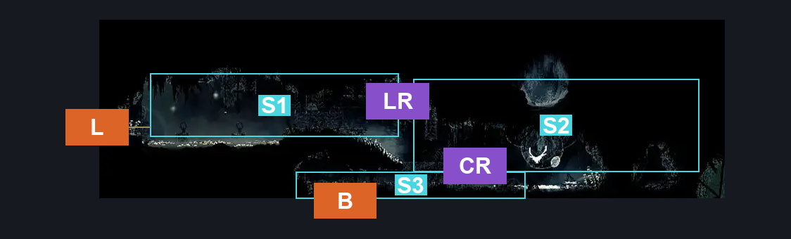
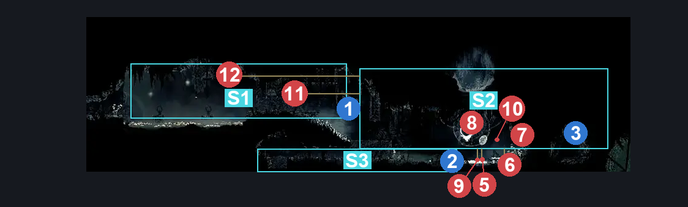
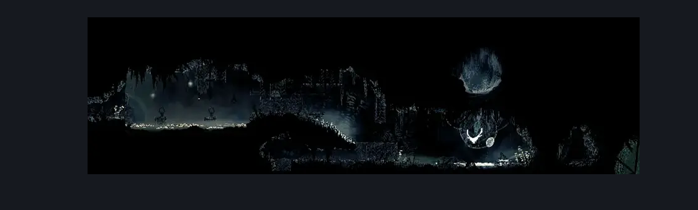

# Sinner's Road Styx Room (Dust_11)

**Game ID:** Dust_11

**Contributors:** herchey and Styx

## Subrooms

| No. | Subroom | Annotated |
| --- | --- | --- |
| S1 | left | ✓ |
| S2 | right | ✓ |
| S3 | cage | ✓ |

## Room Transitions

| Alias | Name | From subroom | Destination | Destination alias | Requirements | TODO | Verification | Annotated | Notes |
| --- | --- | --- | --- | --- | --- | --- | --- | --- | --- |
| L | left | left | [Sinner's Road Vertical Hall East (Dust_06)](sinner-s-road-vertical-hall-east.md) | LR | none |  | Verified | ✓ |  |
| B | basement | cage | [Greymoor Silver Shells Room (Greymoor_17)](../greymoor/greymoor-silver-shells-room.md) | U | none |  | Verified | ✓ |  |

## Subroom Connections

| Alias | Name | Source | Destination | Requirements | TODO | Verification | Annotated | Notes |
| --- | --- | --- | --- | --- | --- | --- | --- | --- |
| LR | left to right | left | right | (Swim OR drifter's cloak OR faydown cloak OR clawline right OR sharpdart OR dash right) AND complete Styx Room Upper Breakable Wall |  | Verified | ✓ |  |
| LR | left to right | right | left | (Spike pogo OR Faydown cloak OR (silk soar AND drifter’s cloak) OR (cling grip right AND (sharpdart OR clawline left OR dash left))) AND complete Styx Room Upper Breakable Wall |  | Verified | ✓ |  |
| CR | cage to right | cage | right | complete Styx Room Lower Breakable Wall |  | Verified | ✓ |  |
| CR | cage to right | right | cage | complete Styx Room Lower Breakable Wall |  | Verified | ✓ |  |

## Check Locations

| No. | Check | Subroom | Requirements | TODO | Verification | Location Type | Annotated | Notes |
| --- | --- | --- | --- | --- | --- | --- | --- | --- |
| 1 | Styx Room Upper Breakable Wall | left | break wall right |  | Verified | blockade | ✓ |  |
| 2 | Styx Room Lower Breakable Wall | cage | break wall right |  | Verified | blockade | ✓ |  |
| 3 | Styx Grew First Grub | right | steel soul off |  | Verified | logic-point | ✓ |  |
| 4 | Craw Summons | left | Craw Summons Ready |  | Verified | collectible |  |  |
| 5 | Tuna Lord, the Muckroach | right | Normal World Spawn |  | Verified | enemy | ✓ | Formerly: Muckroach 1  Spawn conditions: silkFarmBattle1_complete=false |
| 6 | Millipeter, the Muckroach | right | Normal World Spawn |  | Verified | enemy | ✓ | Formerly: Muckroach 2  Spawn conditions: silkFarmBattle1_complete=false |
| 7 | Void Mass 1 | right | Black Thread World Spawn AND Steel Soul Off |  | Verified | enemy | ✓ | these are dead in steel soul mode - hero, 10/29 |
| 8 | Void Mass 2 | right | Black Thread World Spawn AND Steel Soul Off |  | Verified | enemy | ✓ | these are dead in steel soul mode - hero, 10/29 |
| 9 | Muckroach 3 | right | invalid |  | Verified | enemy | ✓ | I think this just spawns dead?  part of the "WAVE UNUSED" scene hierarchy LOL - hero, 10/29 |
| 10 | Roachfeeder 1 | right | invalid |  | Verified | enemy | ✓ | WHO IS THIS LOST CHILD?  part of the "WAVE UNUSED" scene hierarchy LOL - hero, 10/29 |
| 11 | Muckroach 4 | right | invalid |  | Verified | enemy | ✓ | Caged and invincible. |
| 12 | Muckroach 5 | right | invalid |  | Verified | enemy | ✓ | Caged and invincible. |

## Room Images

### Connections

### Checks

### Scene

