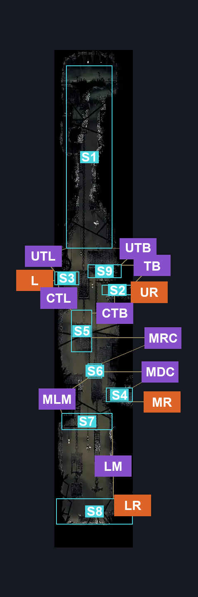
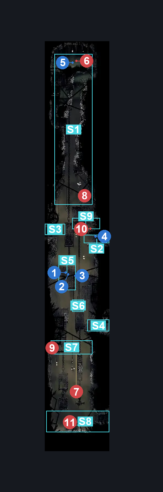
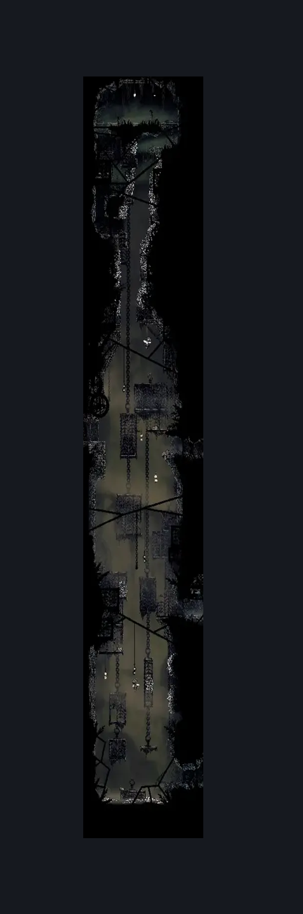

# Sinner's Road Vertical Hall East (Dust_06)

**Game ID:** Dust_06

**Contributors:** herchey, Sponsor of BatAtMakingDumbFunShit

## Subrooms

| No. | Subroom | Annotated |
| --- | --- | --- |
| S1 | upper | ✓ |
| S2 | bilewater door | ✓ |
| S3 | left door | ✓ |
| S4 | mid right door | ✓ |
| S5 | upper mid cage | ✓ |
| S6 | mid cage | ✓ |
| S7 | low mid cage | ✓ |
| S8 | low door | ✓ |
| S9 | above bw door | ✓ |

## Room Transitions

| Alias | Name | From subroom | Destination | Destination alias | Requirements | TODO | Verification | Annotated | Notes |
| --- | --- | --- | --- | --- | --- | --- | --- | --- | --- |
| L | left | left door | [Sinner's Road North Hall (Dust_05)](sinner-s-road-north-hall.md) | R | complete The Lever Gettin' You Outta The North Hall IN Sinner's Road North Hall |  | Verified | ✓ |  |
| LR | lower right | low door | [Sinner's Road Styx Room (Dust_11)](sinner-s-road-styx-room.md) | L | none |  | Verified | ✓ |  |
| MR | middle right | mid right door | [Sinner's Road Flea Rescue (Dust_12)](sinner-s-road-flea-rescue.md) | L | none |  | Verified | ✓ |  |
| UR | upper right | bilewater door | [Bilewater Sinner's Entrance (Shadow_05)](../bilewater/bilewater-sinner-s-entrance.md) | L | none |  | Verified | ✓ |  |

## Subroom Connections

| Alias | Name | Source | Destination | Requirements | TODO | Verification | Annotated | Notes |
| --- | --- | --- | --- | --- | --- | --- | --- | --- |
| UTB | upper to above bilewater | upper | above bw door | none |  | Verified | ✓ |  |
| UTB | upper to above bilewater | above bw door | upper | silk soar OR cling grip either OR faydown cloak OR scuttlebrace |  | Verified | ✓ |  |
| UTL | upper to left | upper | left door | NONE |  | Verified | ✓ | IT'S BECAUSE YOU FUCKING FALL TO IT AND THAT'S IT |
| UTL | upper to left | left door | upper | ledge grab right OR cling grip right OR faydown cloak OR scuttlebrace OR (silk soar AND proficient movement) |  | Verified | ✓ |  |
| CTL | cage to left | upper mid cage | left door | scuttlebrace OR cling grip LEFT OR silk soar |  | Verified | ✓ |  |
| CTL | cage to left | left door | upper mid cage | none |  | Verified | ✓ | It's like "Only Up" but if it was the other direction |
| CTB | cage to bile | upper mid cage | bilewater door | (faydown cloak AND (ledge grab right OR cling grip right)) OR (silk soar AND (clawline right OR sharpdart OR drifter's cloak OR faydown cloak OR easy beast pogo)) |  | Verified | ✓ |  |
| CTB | cage to bile | bilewater door | upper mid cage | none |  | Verified | ✓ | you go down |
| MRC | cage traversal | mid cage | upper mid cage | (faydown cloak AND ledge grab) OR silk soar OR cling grip |  | Verified | ✓ |  |
| MRC | cage traversal | upper mid cage | mid cage | none |  | Verified | ✓ | alling |
| MDC | mid door to cage | mid cage | mid right door | none |  | Verified | ✓ | gravitytty5fdsf |
| MDC | mid door to cage | mid right door | mid cage | ledge grab left OR cling grip left OR faydown cloak OR scuttlebrace OR silk soar |  | Verified | ✓ |  |
| TB | to bilewater | above bw door | bilewater door | (proficient movement AND dash) OR (dash AND (ledge grab right OR cling grip right)) OR clawline right OR sharpdart OR faydown cloak OR easy beast pogo OR (drifters cloak AND (ledge grab right OR cling grip right)) |  | Verified | ✓ |  |
| TB | to bilewater | bilewater door | above bw door | (proficient movement AND faydown cloak) OR (cling grip left AND (clawline left OR sharpdart OR faydown cloak OR drifter's cloak OR run OR dash OR easy beast pogo)) |  | Verified | ✓ |  |
| MLM | mid to low mid cage | low mid cage | mid cage | (proficient movement AND (cling grip left OR (faydown cloak AND cling grip right))) OR faydown cloak OR silk soar |  | Verified | ✓ |  |
| MLM | mid to low mid cage | mid cage | low mid cage | none |  | Verified | ✓ | go down forcefully |
| LM | low to low mid | low door | low mid cage | silk soar OR cling grip both OR (faydown cloak AND cling grip left) |  | Verified | ✓ |  |
| LM | low to low mid | low mid cage | low door | none |  | Verified | ✓ | fALLING |

## Check Locations

| No. | Check | Subroom | Requirements | TODO | Verification | Location Type | Annotated | Notes |
| --- | --- | --- | --- | --- | --- | --- | --- | --- |
| 1 | Eastern Sinner's Cage Rosary Primus | upper mid cage | none |  | Verified | collectible | ✓ | Formerly: Rosary Cache: Sinner’s Road #5 |
| 2 | Eastern Sinner's Cage Rosary Secundus | upper mid cage | none |  | Verified | collectible | ✓ | Formerly: Rosary Cache: Sinner’s Road #6 |
| 3 | Eastern Sinner's Cage Rosary Tertius | upper mid cage | none |  | Verified | collectible | ✓ | Formerly: Rosary Cache: Sinner’s Road #7 |
| 4 | Shards on Bilewater's Doorstep | bilewater door | none |  | Verified | collectible | ✓ | Formerly: Shard Bundle: Sinner’s Road |
| 5 | Key Hoarding Roachkeeper In the Attic | upper | Cling grip AND (dash OR drifter’s cloak OR clawline OR sharpdart) |  | Verified | collectible | ✓ | Formerly: Simple Key: Roachkeeper |
| 6 | Ahmed, the Roachkeeper | upper | ((cling grip either AND faydown cloak) OR (Cling grip both AND (dash OR drifter’s cloak OR clawline left OR sharpdart OR silk soar))) AND hit lever up |  | Verified | enemy | ✓ | Formerly: Roachkeeper 1 |
| 7 | Hyakinthos, the Roachfeeder | low mid cage | none |  | Verified | enemy | ✓ | Formerly: Roachfeeder 1 |
| 8 | Dominic, the Roachfeeder | upper | none |  | Verified | enemy | ✓ | Formerly: Roachfeeder 2 |
| 9 | Skree, the Mite | low mid cage | none |  | Verified | enemy | ✓ | Formerly: Mite 1 |
| 10 | Pretzel, the Mite | above bw door | none |  | Verified | enemy | ✓ | Formerly: Mite 2 |
| 11 | Pockets, the Mite | low door | none |  | Verified | enemy | ✓ | Formerly: Mite 3 |

## Room Images

### Connections

### Checks

### Scene

