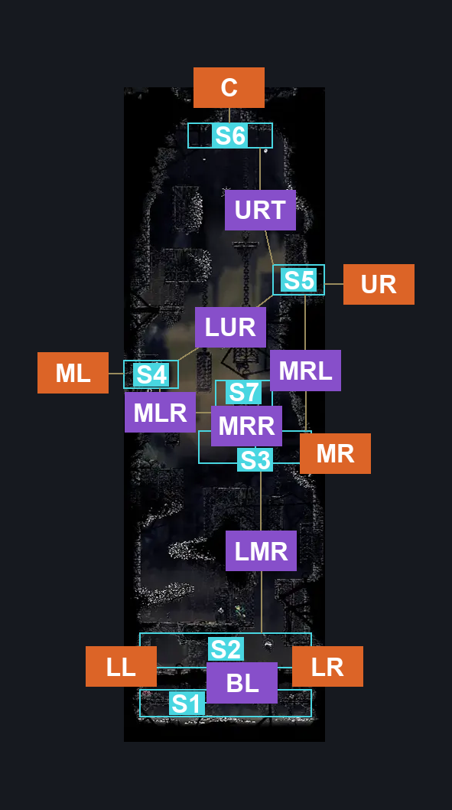
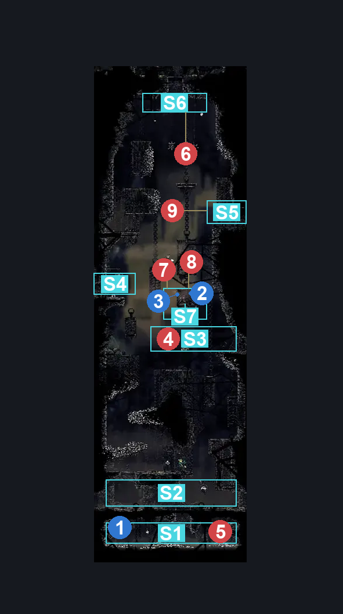
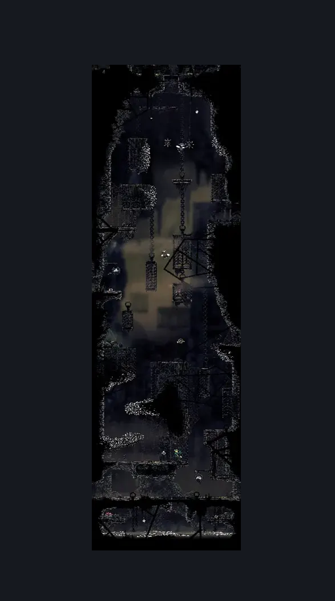

# Sinner's Road Vertical Hall West (Dust_02)

**Game ID:** Dust_02

**Contributors:** herchey's going to bed

## Subrooms

| No. | Subroom | Annotated |
| --- | --- | --- |
| S1 | basement | ✓ |
| S2 | lower | ✓ |
| S3 | middle right | ✓ |
| S4 | middle left | ✓ |
| S5 | upper right | ✓ |
| S6 | top | ✓ |
| S7 | rosary cage | ✓ |

## Room Transitions

| Alias | Name | From subroom | Destination | Destination alias | Requirements | TODO | Verification | Annotated | Notes |
| --- | --- | --- | --- | --- | --- | --- | --- | --- | --- |
| LL | lower left | lower | [Sinner's Road Entrance (Dust_01)](sinner-s-road-entrance.md) | R | none |  | Verified | ✓ |  |
| ML | middle left | middle left | [Sinner's Road Bench (Dust_10)](sinner-s-road-bench.md) | R | none |  | Verified | ✓ |  |
| C | ceiling | top | [Sinner's Road North Hall (Dust_05)](sinner-s-road-north-hall.md) | C | none |  | Verified | ✓ |  |
| LR | lower right | lower | [Sinner's Road Muckroach Cages (Dust_03)](sinner-s-road-muckroach-cages.md) | L | none |  | Verified | ✓ |  |
| MR | middle right | middle right | [Sinner's Road Hanging Cages (Dust_04)](sinner-s-road-hanging-cages.md) | LL | none |  | Verified | ✓ |  |
| UR | upper right | upper right | [Sinner's Road Hanging Cages (Dust_04)](sinner-s-road-hanging-cages.md) | UL | prereq Upper Entry Switch IN Sinner's Road Hanging Cages |  | Verified | ✓ |  |

## Subroom Connections

| Alias | Name | Source | Destination | Requirements | TODO | Verification | Annotated | Notes |
| --- | --- | --- | --- | --- | --- | --- | --- | --- |
| BL | basement to lower | lower | basement | none |  | Verified | ✓ | Technically "any attack" is a requirement |
| BL | basement to lower | basement | lower | cling grip |  | Verified | ✓ |  |
| LMR | low to mid right | lower | middle right | Cling grip OR silk soar OR (scuttlebrace AND faydown cloak) |  | Verified | ✓ |  |
| LMR | low to mid right | middle right | lower | none |  | Verified | ✓ |  |
| MRL | mid right to upper right | middle right | upper right | silk soar |  | Verified | ✓ |  |
| MRL | mid right to upper right | upper right | middle right | none |  | Verified | ✓ |  |
| LUR | mid left to upper right | middle left | upper right | Cling grip OR faydown cloak |  | Verified | ✓ |  |
| LUR | mid left to upper right | upper right | middle left | none |  | Verified | ✓ |  |
| URT | upper right to top | upper right | top | Silk soar OR (cling grip AND (enemy pogo OR faydown cloak OR (proficient movement AND drifter's cloak) OR clawline OR sharpdart OR dash)) OR (faydown cloak AND ledge grab AND enemy pogo) |  | Verified | ✓ |  |
| URT | upper right to top | top | upper right | none |  | Verified | ✓ |  |
| MRR | mid right to rosaries | middle right | rosary cage | silk soar |  | Verified | ✓ |  |
| MRR | mid right to rosaries | rosary cage | middle right | none |  | Verified | ✓ |  |
| MLR | mid left to rosaries | middle left | rosary cage | faydown cloak OR cling grip OR scuttlebrace |  | Verified | ✓ |  |
| MLR | mid left to rosaries | rosary cage | middle left | faydown cloak OR cling grip |  | Verified | ✓ |  |

## Check Locations

| No. | Check | Subroom | Requirements | TODO | Verification | Location Type | Annotated | Notes |
| --- | --- | --- | --- | --- | --- | --- | --- | --- |
| 1 | Gross Rosaries In the Sinner's Basement | basement | (swim AND (Ledge grab left OR cling grip left))  OR  (faydown cloak AND ((drifter's cloak AND ledge grab left) OR clawline left OR sharpdart OR swim)) OR (clawline left AND (drifter's cloak AND ledge grab left)) |  | Verified | collectible | ✓ | Formerly: Rosary Cache: Sinner’s Road #1 |
| 2 | First Half of the Rosaries They Took From the Gay Frog When They Put Him In Prison | rosary cage | none |  | Verified | collectible | ✓ | Formerly: Rosary Cache: Sinner’s Road #2 |
| 3 | Second Half of the Rosaries They Took From the Gay Frog When They Put Him In Prison | rosary cage | none |  | Verified | collectible | ✓ | Formerly: Rosary Cache: Sinner’s Road #3 |
| 4 | Amy, the Roachcatcher | middle right | none |  | Verified | enemy | ✓ | Formerly: Roachcatcher 1 |
| 5 | Puddles, the Mite | basement | none |  | Verified | enemy | ✓ | Formerly: Mite 1 |
| 6 | Dickson, the Roachfeeder | top | Normal World Spawn |  | Verified | enemy | ✓ | Formerly: Roachfeeder 1 |
| 7 | Liam, the Roachfeeder | rosary cage | Normal World Spawn |  | Verified | enemy | ✓ | Formerly: Roachfeeder 2 |
| 8 | Aiden, the Roachfeeder | rosary cage | Black Thread World Spawn |  | Verified | enemy | ✓ | Formerly: Roachfeeder 3 |
| 9 | Creed, the Roachfeeder | upper right | Black Thread World Spawn |  | Verified | enemy | ✓ | Formerly: Roachfeeder 4 |

## Room Images

### Connections

### Checks

### Scene

